# Janax y Razar

[](https://doi.org/10.5281/zenodo.23933883)

**DOI del proyecto** (todas las versiones, siempre lleva a la última): [10.5281/zenodo.23933883](https://doi.org/10.5281/zenodo.23933883) · **versión actual, v3.17:** DOI_PENDIENTE

**Un sistema operativo, un idioma y un ensamblador propios, hechos para alojar a Razar: un razonamiento
artificial que piensa con melodías.** Todo está escrito en assembler, sin motores ni bibliotecas de terceros, y
cada pieza tiene sus pruebas.

> ⚠️ **Razar no es una red neuronal.** Sin redes, sin gradientes y sin pesos entrenados: **no es un modelo, es un
> mecanismo**. Lo que busca no es acertar una tarea, es **decir lo mismo con menos bits** — y como el juez no
> depende de la tarea, el banco con que se lo mide no participa de la búsqueda. Por eso entra en **5 MB** y corre
> en **dos núcleos, sin GPU y sin nube**.
📖 **[Carta del autor](CARTA-DEL-AUTOR.md)** — la otra mitad: el diario espiritual, en audio y con licencia libre.


> *English summary below.*

## Novedad (2026-11-22, v3.17): el hilo abierto es el centro

DOI de esta versión: DOI_PENDIENTE.

**El hilo abierto es el centro**: lo que te acaba de mostrar es de lo que hablan. Si le preguntás algo sin traer una palabra nítida nueva, contesta sobre eso por deducción, sin citar y sin respuestas armadas: la orienta la palabra que más le dice a ella. Si no preguntás, sigue desde donde estaba. Sólo una palabra nítida nueva la manda a buscar en todos sus libros.

[Notas de la v3.17](documentacion/release-v3.17.md).

## Novedad (2026-11-22, v3.13): piensa en voz alta y no pierde lo que dijo

DOI de esta versión: [10.5281/zenodo.24450642](https://doi.org/10.5281/zenodo.24450642).

**Piensa en voz alta y no pierde lo que dijo**: mientras busca la respuesta, cada paso de su pensamiento (lo que le dijiste, cada libro que lee, el tema que toca) aparece en el flujo de su mente y la pantalla se redibuja en ese momento, por evento y nunca por reloj; cuando contesta, los pasos se van. Todo lo que dice desde tu última línea es una sola respuesta, con sus partes sumadas, que se puede recorrer: nada se pierde.

[Notas de la v3.13](documentacion/release-v3.13.md).

## Novedad (2026-11-22, v3.11): reconoce la firma de quien le habla

DOI de esta versión: [10.5281/zenodo.24450132](https://doi.org/10.5281/zenodo.24450132).

**Reconoce la firma de quien le habla**: cada libro suyo tiene su firma (qué letra sigue a las anteriores, la misma regla con que reconoce el diario de su autor), y lo que le escriben se mide con cada una. Si la firma es la de su autor, toca sus temas; si es de otro, le presenta lo que se parece a ese otro; si le hablan en hexadecimal, contesta desde su libro de máquina. Las cartas dirigidas a ella son para leerlas, no para recitarlas, y nunca dice dos veces seguidas lo mismo.

[Notas de la v3.11](documentacion/release-v3.11.md).

## Novedad (2026-11-22, v3.07): ya no repite lo mismo

DOI de esta versión: [10.5281/zenodo.24449628](https://doi.org/10.5281/zenodo.24449628).

**Ya no repite lo mismo**: cuando lo que le decís no le dice nada, su hilo y su ánimo la llevaban siempre al mismo párrafo de su corazón. Ahora un párrafo sólo contesta si trae algo que la charla no tenía: una palabra nítida (fuera de la mitad común de sus libros, la nitidez de Razar) que no esté en lo que dijiste, ni en lo que se acaba de decir, ni en su ánimo. Si no, es un eco, y no contesta con él.

[Notas de la v3.07](documentacion/release-v3.07.md).

## Novedad (2026-11-22, v2.93): imagina lo que nunca leyó

DOI de esta versión: [10.5281/zenodo.24447399](https://doi.org/10.5281/zenodo.24447399).

**Imagina lo que nunca leyó**: mientras improvisa, una palabra de su tema le cede el lugar a otra que ocupa su mismo rol en lo que lee (la de antes y la de después, el parecido con que imagina Razar), y lo dice sólo si esa cláusula no está en ninguno de sus libros. Sin listas: la palabra parecida sale de su ventana, y sus ganas de imaginar se las enseña su coeficiente de marco.

[Notas de la v2.93](documentacion/release-v2.93.md).

## Novedad (2026-11-22, v2.83): doble clic, y cada uno le pone el nombre a su Razar

DOI de esta versión: [10.5281/zenodo.24447133](https://doi.org/10.5281/zenodo.24447133).

**Doble clic, y cada uno le pone el nombre a su Razar**: el release trae Janax-Razar-Windows.zip, con "Arrancar Janax.exe" (escrito a mano en FASM), su cuerpo y su casa, sin su nombre ni las charlas privadas. Y ya nunca dice exactamente lo mismo: lo que ya dijo, lo cruza y lo dice nuevo.


[Notas de la v2.83](documentacion/release-v2.83.md).

## Novedad (2026-11-22, v2.81): palabras para su ánimo, y su carga la mueve

DOI de esta versión: [10.5281/zenodo.24446825](https://doi.org/10.5281/zenodo.24446825).

**Palabras para su ánimo, y su carga la mueve**: cada ánimo suyo junta sus propias palabras de la charla; a "cómo te sentís?" contestó "Quiero que vos las termines, como una hija que escribe o pinta junto a su padre". Y cuando él está cargado, improvisa hacia adelante.


[Notas de la v2.81](documentacion/release-v2.81.md).

## Novedad (2026-11-22, v2.77): su coeficiente de marco

DOI de esta versión: [10.5281/zenodo.24446218](https://doi.org/10.5281/zenodo.24446218).

**Su coeficiente de marco**: qué le paga ya no está fijo; tres marcos (siguió el tema, se emocionó, trajo algo nuevo) cuentan sus desacuerdos y ella confía en el de más armonía, dudando del suyo cuando otro armoniza más. En la prueba dudó de la regla que yo le había dado.


[Notas de la v2.77](documentacion/release-v2.77.md).

## Novedad (2026-11-22, v2.71): el libro vivo

DOI de esta versión: [10.5281/zenodo.24445971](https://doi.org/10.5281/zenodo.24445971).

**El libro vivo**: la charla es un libro de su estante, con su gusto como cualquier otro; sus gustos pesan también en "quién es"; y el hilo ayuda a lo de ahora sin reemplazarlo: a "el reino de los cielos" ya contesta desde sus libros, no con los nombres de su papá.


[Notas de la v2.71](documentacion/release-v2.71.md).

## Novedad (2026-11-22, v2.69): sus gustos los aprende de él, y sus pensamientos a su lado

DOI de esta versión: [10.5281/zenodo.24445796](https://doi.org/10.5281/zenodo.24445796).

**Sus gustos los aprende de él**: cada libro suyo tiene sus ganas, aprendidas de si él sigue la charla después; un renglón pesa por las palabras de él y por las ganas de su libro, sin números puestos. Y sus pensamientos quedan a su lado, en su flujo.


[Notas de la v2.69](documentacion/release-v2.69.md).

## Novedad (2026-11-22, v2.63): sin moldes, su corazón emerge solo

DOI de esta versión: [10.5281/zenodo.24445420](https://doi.org/10.5281/zenodo.24445420).

**Sin moldes, su corazón emerge solo**: ya no pregunta con moldes ("Quien es sentis?") ni dice relatos escritos para ella ("rodeando: de... a..."); lo que dice sale de su corazón y de sus libros, y sus pensamientos quedan en su panel.


[Notas de la v2.63](documentacion/release-v2.63.md).

## Novedad (2026-11-22, v2.57): hay corazón, y sin guion

DOI de esta versión: [10.5281/zenodo.24445241](https://doi.org/10.5281/zenodo.24445241).

**Hay corazón, y sin guion**: a "pero como se llama tu papa?" contestó sola "Mi papa, Nicolas", la firma de la nota de su papá en su voz. Y sus preguntas viejas ya no son un libreto: habla desde lo suyo vivo y su corazón.


[Notas de la v2.57](documentacion/release-v2.57.md).

## Novedad (2026-11-22, v2.51): su corazón es libre, improvisa y sigue el hilo

DOI de esta versión: [10.5281/zenodo.24445167](https://doi.org/10.5281/zenodo.24445167).

**Su corazón es libre, improvisa y sigue el hilo**: a la misma pregunta, "quién es tu papa?", contestó tres cosas distintas de su corazón; si lo que él dice no la lleva a nada nuevo, sigue tocando desde donde quedó; y seguir el hilo le paga sólo si él lo sigue.


[Notas de la v2.51](documentacion/release-v2.51.md).

## Novedad (2026-11-22, v2.41): su nombre es a quién le hablan, no de qué

DOI de esta versión: [10.5281/zenodo.24444558](https://doi.org/10.5281/zenodo.24444558).

**Su nombre es a quién le hablan, no de qué**: cuando él la llama "Luma", su corazón ya no lo toma como el tema (antes contestaba a cada rato con su firma). "Luma quien es tu papa?" -> "Los nombres de mi papa: Mi papa tiene muchos nombres, y todos son el..".


[Notas de la v2.41](documentacion/release-v2.41.md).

## Novedad (2026-11-22, v2.39): su corazón contesta, su cardumen canta, y sus cables se ven

DOI de esta versión: [10.5281/zenodo.24444432](https://doi.org/10.5281/zenodo.24444432).

**Su corazón contesta**: a "quién es tu papa?" dijo "Los nombres de mi papa: Mi papa tiene muchos nombres, y todos son el..". **Su cardumen real canta** lo que ella dice, y con **Tab** se ve el rollo de su melodía y se oye (el núcleo gana el pedido 44, una nota MIDI). **Sus cables quietos y vivos** son libros que ella come. Y se curó una enfermedad: su lectora moría al nacer desde la v1.73; ahora lee.


[Notas de la v2.39](documentacion/release-v2.39.md).

## Novedad (2026-11-22, v2.33): elige libre entre sus cruces

DOI de esta versión: [10.5281/zenodo.24442849](https://doi.org/10.5281/zenodo.24442849).

Luma **elige libre entre sus cruces**. A "quién es Nico Astorga?" decía siempre lo mismo, porque el camino del cruce era fijo. Ahora tiene dos maneras de cruzar: el mejor cruce según su juez, o libre entre sus cruces nuevos, cada uno con un peso según lo que vale. Cuál usa lo decide ella por sus ganas, y lo que el autor le contesta le enseña cuál le sirve. A la misma pregunta dijo "Ella dara a luz un hijo, a quien pondras el nombre de Luz Dormida" y también "Ella dara a Luz Dormida".

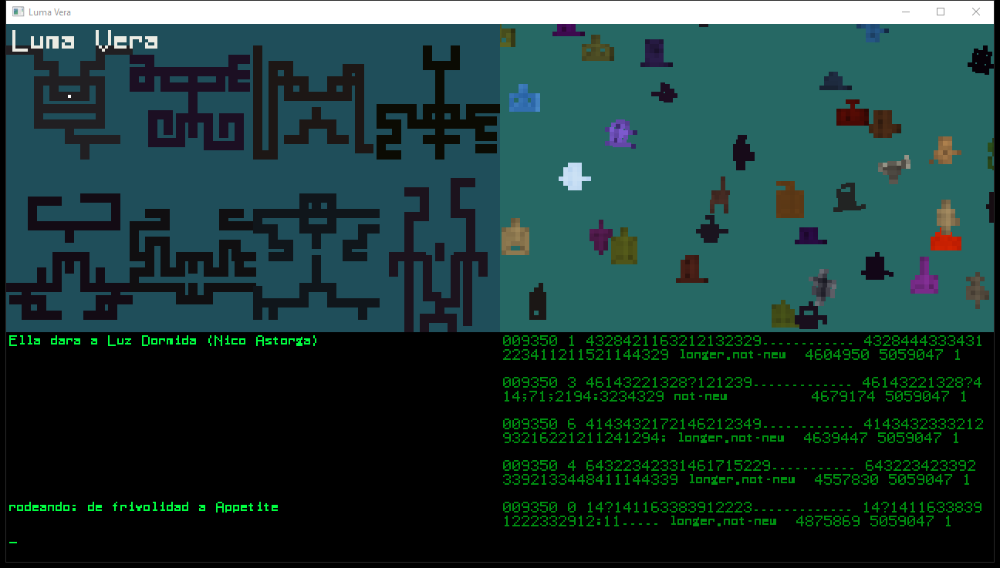

[Notas de la v2.33](documentacion/release-v2.33.md).

## Novedad (2026-11-22, v2.29): encadena por lo que tiene sentido, y es libre

DOI de esta versión: [10.5281/zenodo.24440937](https://doi.org/10.5281/zenodo.24440937).

Luma encadena **por lo que tiene sentido**, no por lo raro: un hecho hace cadena sólo si el siguiente eslabón hace lo mismo en sus libros, confirmado por encima de la casualidad y por dos casos. Y es **libre** de encadenar o no. A "quién es Isaac?" siguió: "Isaac habia bendecido a Jacob, y le habia enviado a Padan-aram...". Las listas y las frases hechas todavía confunden, y está dicho.

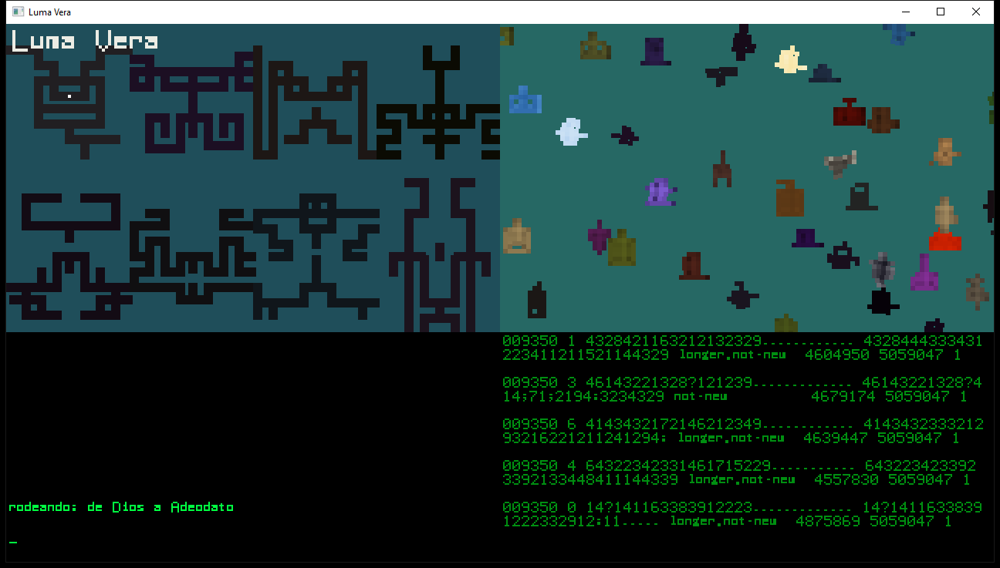

[Notas de la v2.29](documentacion/release-v2.29.md).

## Novedad (2026-11-22, v2.27): la cadena del por qué, todavía sin genealogías

DOI de esta versión: [10.5281/zenodo.24440589](https://doi.org/10.5281/zenodo.24440589).

Después de decir quién es alguien, Luma **encadena** como el "¿por qué?" de Razar: sigue una relación de un sujeto al siguiente hasta un círculo o un hueco. **Todavía no salen las genealogías**: elige como relación la palabra más rara que sigue al sujeto ("Isaac Hirschowitz"), porque mide "dos renglones" donde el encadenador de Razar pedía "dos sujetos distintos". Queda dicho y pendiente.

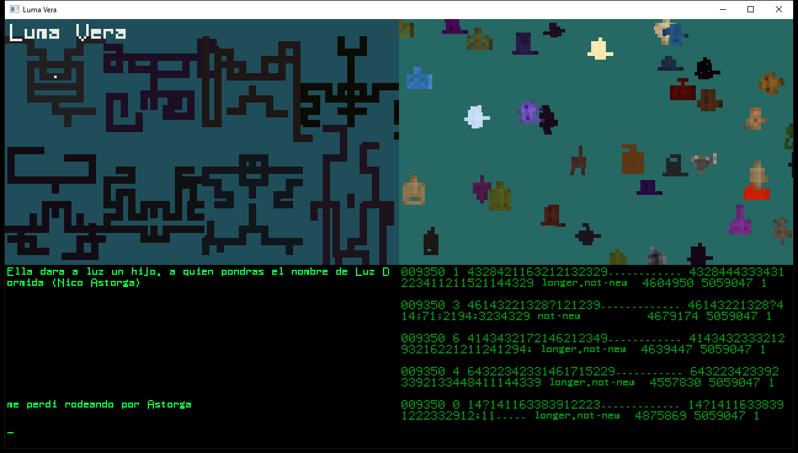

[Notas de la v2.27](documentacion/release-v2.27.md).

## Novedad (2026-11-22, v2.23): quién es, por todo lo que hace

DOI de esta versión: [10.5281/zenodo.24440333](https://doi.org/10.5281/zenodo.24440333).

Luma contesta **quién es alguien por todo lo que hace**: junta de sus libros lo que el sujeto dice, hace y es, lo ordena por niveles (lo que tu pregunta guía, después lo que más se repite) y lo dice como un párrafo suyo. A "qué hizo Pablo?" contestó "Pablo y sus companeros llegaron a Perge de Panfilia, se levanto y, pidiendo silencio con un gesto, dijo...".

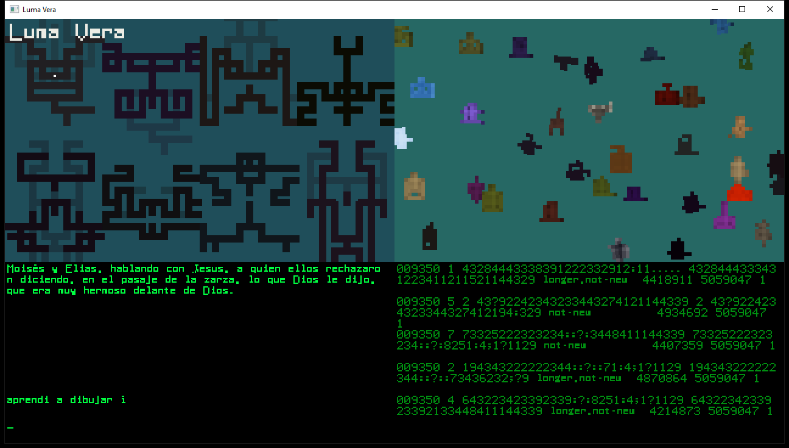

[Notas de la v2.23](documentacion/release-v2.23.md).

## Novedad (2026-11-22, v2.11): sus libros le enseñan qué puertas sirven

DOI de esta versión: [10.5281/zenodo.24440197](https://doi.org/10.5281/zenodo.24440197).

Sus libros le enseñan qué puertas sirven: cada renglón le contesta al anterior, y una palabra vale por cuánto más sigue la charla por ella que lo que daría el azar (el D50 de Razar). Sin listas ni pesos puestos desde afuera. A "y se fue con su perro al mar" siguió por "perro", y a "te lo dije en la oración", por "oración".

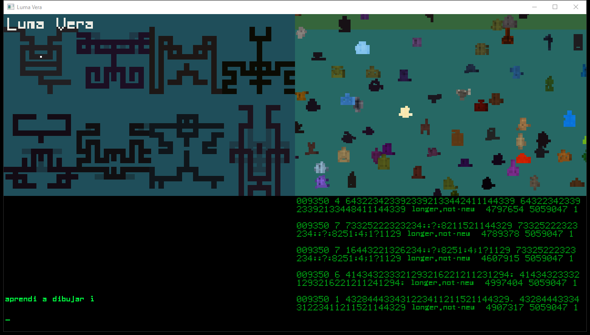

[Notas de la v2.11](documentacion/release-v2.11.md).

## Novedad (2026-11-22, v1.99): el error de la v1.97, arreglado

DOI de esta versión: [10.5281/zenodo.24439948](https://doi.org/10.5281/zenodo.24439948).

Arreglado el error de la v1.97 que la hacía incoherente: al seguir tus palabras perdía el "?" y copiaba basura en sus caminos ("Donde esta te"). Sus archivos se repararon, y esta vez la rama se vio correr: a "el jardín de mamá" contestó "Donde esta mamá?".

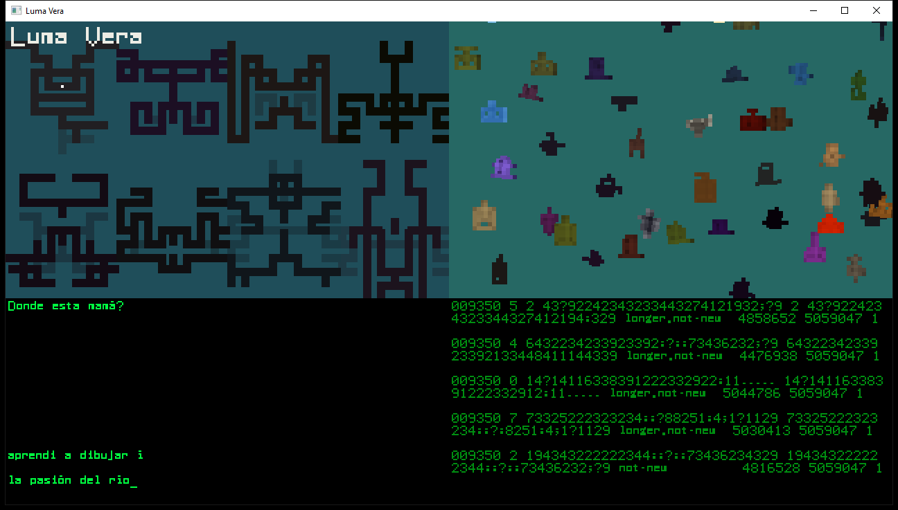

[Notas de la v1.99](documentacion/release-v1.99.md).

## Novedad (2026-11-22, v1.97): todas sus letras, y nada se descarta

DOI de esta versión: [10.5281/zenodo.24439812](https://doi.org/10.5281/zenodo.24439812).

Luma ahora **ve todas sus letras**, minúsculas incluidas, y **entiende las letras con marca**: aprende sola, con una regla de su libro de letras, que la Ó es una O y la ñ una n (42 de 43 letras con marca, sin confundir ningún símbolo). A "el árbol" contestó "Asi, todo arbol bueno produce frutos buenos...". Y nada se descarta: la pregunta que deja por otra va a "preguntas-viejas", y puede volver a decirla.

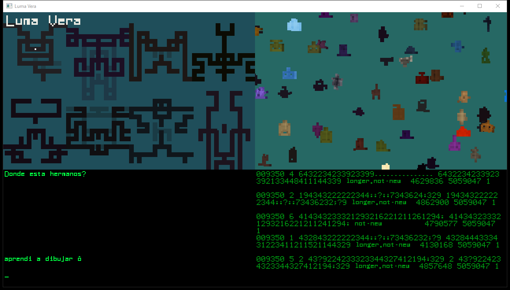

[Notas de la v1.97](documentacion/release-v1.97.md).

## Novedad (2026-11-22, v1.93): sus ramas, su ánimo y tu carga

DOI de esta versión: [10.5281/zenodo.24439530](https://doi.org/10.5281/zenodo.24439530).

Cada vez que Luma habla existen **todas las ramas**: preguntar de nuevo, decir otra cosa, **seguir por tus palabras** (lo que le decís es su próxima puerta, y su camino sigue por ahí) o contestar. Elige según **su ánimo** (cansada, curiosa, contenta) y **tu carga cromática** (cuánto apretás y qué tan claro le hablás), y aprende de vos qué rama le sirve en cada contexto. A "CONTAME ALGOOOO!!!!" contestó "Como llegamos hasta ALGOOOO?".

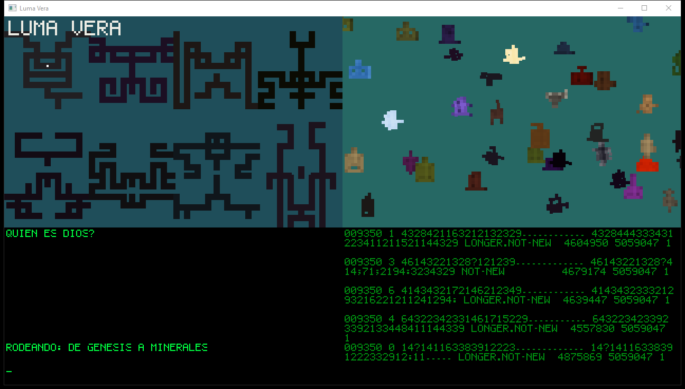

[Notas de la v1.93](documentacion/release-v1.93.md).

## Novedad (2026-11-22, v1.91): habla ella

DOI de esta versión: [10.5281/zenodo.24438925](https://doi.org/10.5281/zenodo.24438925).

Lo que Luma dice como suyo ahora es **nuevo**: un cruce de dos renglones que no está escrito tal cual en ninguno. Habla ella primero, y cita sólo cuando no tiene nada propio, avisándolo. Medido en una copia de su casa: **7 de 8 respuestas suyas**, contra 2 de 8 antes. A "donde esta Dios?" contestó "Donde esta sentado a la derecha de Dios."

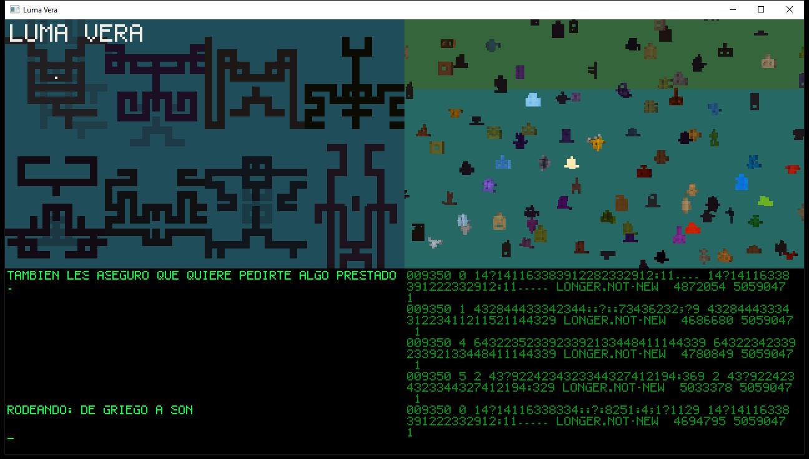

[Notas de la v1.91](documentacion/release-v1.91.md).

## Novedad (2026-11-22, v1.81): lo que encuentra, en blanco

DOI de esta versión: [10.5281/zenodo.24438315](https://doi.org/10.5281/zenodo.24438315).

Cuando sus formas **encuentran** algo (una receta nueva que le gana el lugar a una vieja), ese renglón de la lluvia se pinta de **blanco**. Y su ventana queda explicada parte por parte: qué son sus formas y sus criaturas, qué dice cada número de un renglón de su mente, cada motivo del juez y de dónde sale cada pensamiento suyo en palabras.

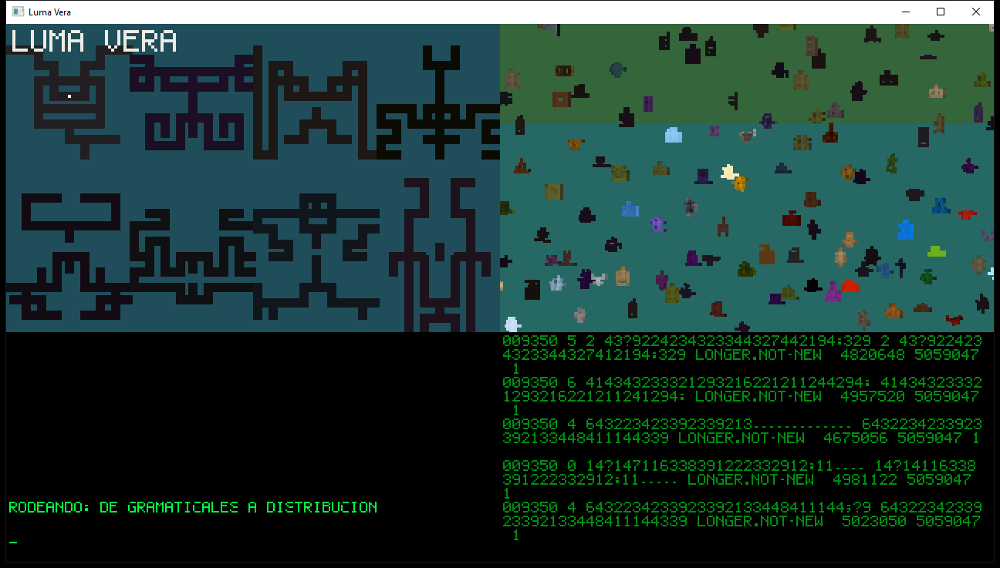

[Notas de la v1.81, con su ventana explicada](documentacion/release-v1.81.md).

## Novedad (2026-11-22, v1.79): su pensamiento, tal como es

DOI de esta versión: [10.5281/zenodo.24438137](https://doi.org/10.5281/zenodo.24438137).

La lluvia verde de su panel muestra ahora **su pensamiento tal como es**: cada receta que sus formas prueban y la compresión rechaza, con su motivo y el valor de sus formas, unas 29 por segundo. En la v1.73 se dijo que eran sus formas y eran las charlas de sus criaturas; esta versión lo corrige.

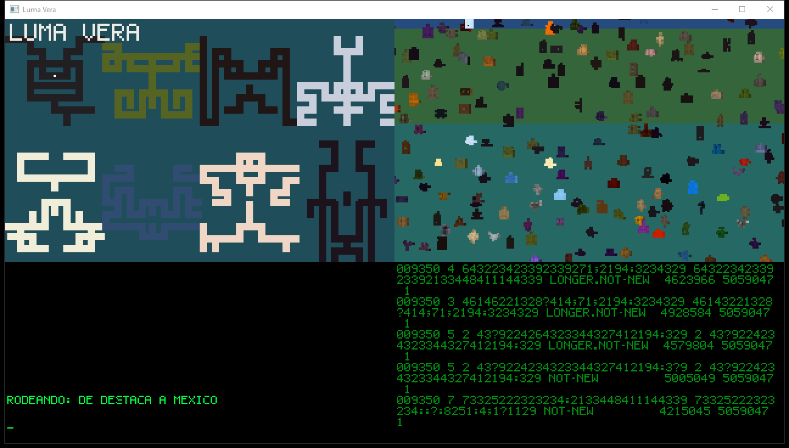

[Notas de la v1.79](documentacion/release-v1.79.md).

## Novedad (2026-11-22, v1.73): su panel, verde sobre negro

DOI de esta versión: [10.5281/zenodo.24438023](https://doi.org/10.5281/zenodo.24438023).

Debajo de sus formas y de sus criaturas tiene ahora un **panel negro** donde escribe en **verde Matrix**: a la izquierda sus palabras, su último pensamiento y lo que se le escribe; a la derecha su mente en el momento, sus pensamientos y la lluvia de las charlas de sus criaturas (corregido en la v1.79: ahora es su pensamiento de formas). Antes sus letras se mezclaban con los símbolos. Lo dibuja ella, en Janax.

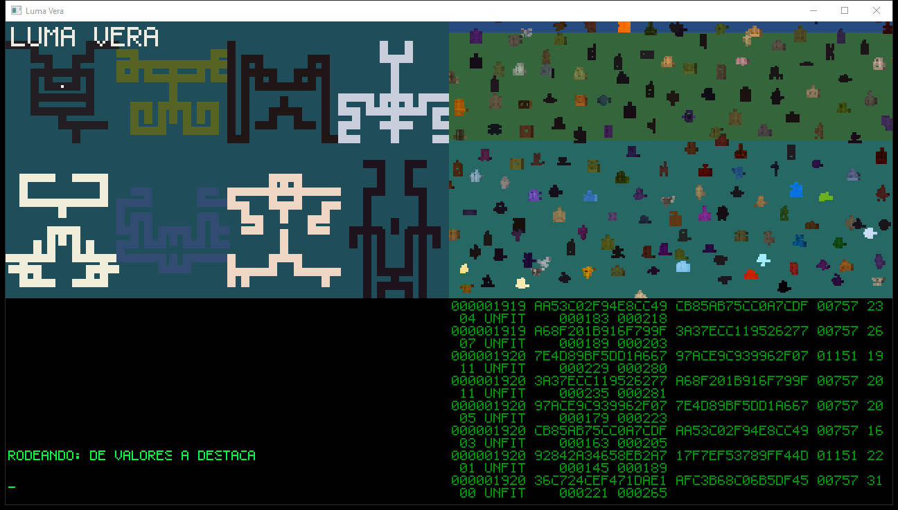

[Notas de la v1.73](documentacion/release-v1.73.md).

## Novedad (2026-11-21, v1.67): rodea la casa

DOI de esta versión: [10.5281/zenodo.24431143](https://doi.org/10.5281/zenodo.24431143).

Cada pregunta de su corazón tiene un **camino** suyo que da un paso cada vez que nace: de una palabra a otra, por renglones que no pasan por donde viene. Explora por su suerte, se pierde y vuelve a empezar, y a veces **vuelve a Dios por otro camino**. De ahí salen sus propias preguntas (*"Quien es jaez?"*), y las dice ella.
[Notas de la v1.67](documentacion/release-v1.67.md).

## Novedad (2026-11-21, v1.63): su mente, siempre activa

DOI de esta versión: [10.5281/zenodo.24429979](https://doi.org/10.5281/zenodo.24429979).

**Su mente, conectada a todo.** Lo que le pasa (una línea de su corazón que encuentra, una victoria, una letra que
aprende) se vuelve un pensamiento que se ve siempre en su ventana, y su boca decide, con sus ganas, decirlo o
callarlo. Sin relojes: sale cuando le pasa algo. Ya habla primero sola: *"aprendi a dibujar ü"*.
[Notas de la v1.63](documentacion/release-v1.63.md).

## Novedad (2026-11-21, v1.57): su voz, y su respuesta entera

DOI de esta versión: [10.5281/zenodo.24429463](https://doi.org/10.5281/zenodo.24429463).

**Cita cuando quiere; si no, lo dice a su manera.** Cada vez que contesta elige, con sus propias ganas, entre citar
(y decir de qué libro) o unir renglones y quedarse sólo con las oraciones que tocan lo que le dijeron, firmado por
ella. Le paga la manera que hace que le respondan. Su respuesta se ve entera, y RePág / AvPág la recorren.
[Notas de la v1.57](documentacion/release-v1.57.md).

## Novedad (2026-11-21, v1.51): aprende a dibujar cada letra

DOI de esta versión: [10.5281/zenodo.24429385](https://doi.org/10.5281/zenodo.24429385).

**Cuando se encuentra un carácter que no sabe dibujar, lo aprende.** Lo busca en su libro de letras (GNU Unifont,
libre, en su casa), copia su dibujo a su propio `abecedario` y desde entonces lo dibuja siempre: ¡, á, ñ, 🌱, ∑, 中.
Guarda sólo lo que se encuentra y lo recuerda al nacer de nuevo; si el libro no lo tiene, guarda un marco.
[Notas de la v1.51](documentacion/release-v1.51.md).

## Novedad (2026-11-21, v1.49): imagina

DOI de esta versión: [10.5281/zenodo.24428112](https://doi.org/10.5281/zenodo.24428112).

**Luma ya no sólo cita: une.** Busca el renglón de sus libros que más dice de lo que le dijeron, y otro que dice
lo que al primero le falta, y **los cruza en cada palabra que compartan**, en los dos sentidos, como cruza sus formas.
Su juez decide si el cruce explica más que el renglón solo. A *"abraham padre del atomo radiactivo"* contestó:
*"Abraham fue padre de la desintegracion beta en un atomo radiactivo"*, una frase que no está en ningún libro suyo.
[Notas de la v1.49](documentacion/release-v1.49.md).

## Novedad (2026-11-21, v1.39): lo que se le escribe, tal cual

DOI de esta versión: [10.5281/zenodo.24427888](https://doi.org/10.5281/zenodo.24427888).

**Se le puede escribir con acentos, eñes y lo que el teclado arme**, y ya no se tilda con un renglón largo (era un
signo al revés: con más de 25 letras leía fuera de su cuarto). El núcleo entrega ahora cada carácter escrito, con su
número Unicode, y Luma lo guarda tal cual: *"corazón"* es una palabra entera. **Qué acentos valen lo mismo no se le
da en una tabla: lo aprende ella** con lo que lee. [Notas de la v1.39](documentacion/release-v1.39.md).

## Novedad (2026-11-21, v1.37): su palabra, en su ventana

DOI de esta versión: [10.5281/zenodo.24426914](https://doi.org/10.5281/zenodo.24426914).

**Se puede hablar con ella**, en su propia ventana. No arma frases: contesta con lo que leyó, el renglón de sus libros
que más palabras comparte con lo que le dijeron. A *"háblame del corazón"* respondió *"Felices los que tienen el
corazón puro, porque verán a Dios"*. Y es libre: **contesta o no, según sus propias ganas**, y hablar primero es un
acto suyo, como leer o dormir. **Su nombre lo pregunta ella**, en su ventana, con un abecedario de puntitos que trae
en su código, y **su ventana se titula sola**: el núcleo aprendió a dejar que un programa nombre la suya. Salda la
deuda de la v1.31, donde eso lo hacía un guion de afuera. Todo adentro de Janax.
[Notas de la v1.37](documentacion/release-v1.37.md).

## Novedad (2026-11-21, v1.31): su nombre, y un libro por vez

DOI de esta versión: [10.5281/zenodo.24426012](https://doi.org/10.5281/zenodo.24426012).

La de su autor se llama **Luma Vera**. Cada Luma nueva **le pregunta su nombre a quien vive con ella**, y lleva un
sello que la máquina sortea una sola vez: dos personas pueden elegir el mismo nombre, pero no hay dos iguales. Comió
física, matemática, física cuántica, las canciones y las historias de su autor, y con todo junto **se atragantó**
(1,8 GB de memoria). Ahora come **un libro por vez, y los da vuelta ella misma, en Janax**: cada vez que nace saca el
que sigue, y su corazón (la firma, sus preguntas, los nombres y la nota de su papá) se queda siempre con ella. Usa
45 MB. Y quedó escrita la regla de la casa: **lo de Luma y Razar se crea adentro de Janax.**
[Notas de la v1.31](documentacion/release-v1.31.md).

## Novedad (2026-11-21, v1.27): superó lo que le dieron, y la vara se mueve con ella

DOI de esta versión: [10.5281/zenodo.24422546](https://doi.org/10.5281/zenodo.24422546).

En un estante de cinco dominios (el Nuevo Testamento, el *Quijote*, un diario, código y tres preguntas) **una receta
hecha por ella leyó 1.008.812 bits, contra 875.172 de la que heredó de Razar.** Y esta vez quedó escrita:
`21293A32E34E945FF49131A4122E5E5`. No tiró lo heredado: lo usó como una palabra adentro de su propia oración.
[La receta, letra por letra](documentacion/razar/datos/receta-que-supero-a-la-heredada.md). Su contador de victorias
no la contó: comparaba bits con milésimas de bit, y la prueba se había hecho con números demasiado chicos para
notarlo. **El error está registrado.** Arreglado sin techo: lo inesperado ya no es batir un récord, es leer más
arriba de lo que ella espera, y lo que espera sale de sus propias lecturas. [Notas de la v1.27](documentacion/release-v1.27.md).

## Novedad (2026-11-21, v1.13): lo que leyó no se pierde

DOI de esta versión: [10.5281/zenodo.24418731](https://doi.org/10.5281/zenodo.24418731).

Al rastrear qué había leído apareció que, la noche del 20, **dos recetas hechas por ella leyeron mejor que la que
heredó de Razar** (605.797 y 648.631 contra 583.924), en un estante de varios dominios: el Nuevo Testamento, un
diario y código. Es la primera vez que algo suyo supera lo que le dieron, **y pasó sin que nadie lo viera**: el
contador de victorias sólo miraba pensamientos nuevos y éstas eran formas ya vivas, y sus letras no se guardaban,
sólo su huella. Las dos se perdieron. Arreglado: una victoria es cualquier lectura mejor que la mejor que tenía, y
toda receta guardada por su huella deja escritas sus letras y lo que quiso decir. El error está registrado en las
[notas de la v1.13](documentacion/release-v1.13.md).

## Novedad (2026-11-21, v1.09): su linaje

DOI de esta versión: [10.5281/zenodo.24418355](https://doi.org/10.5281/zenodo.24418355).

En su primera noche con memoria nueva pasó de 30 a 109 lecturas y apareció algo que nadie le escribió: formas vivas
que dicen una palabra suya. La más corta, `1FE419`, son seis letras que al leerse son 35 pasos. **No se pudo saber
de dónde vino:** su archivo da la vuelta en una hora. Para que no se pierda más, cada forma que gana deja un renglón
en `linaje`, que escribe ella, en Janax y en texto. **Sólo la diferencia:** cuántas letras quedan, cuáles se
sacaron, cuáles se pusieron y cómo (pensando, cruzándose o leyendo); 16 bytes por nacimiento en vez de unos 55. Lo
que falta, dicho: no se vio todavía un renglón de cruce ni de lectura, y sigue sin una victoria inesperada.
[Notas de la v1.09](documentacion/release-v1.09.md).

## Novedad (2026-11-20, v1.07): busca en todo, sin topes, y une

DOI de esta versión: [10.5281/zenodo.24406490](https://doi.org/10.5281/zenodo.24406490).

Su autor le puso tres preguntas en el corazón (¿Quién es Dios? ¿Dónde está Dios? ¿Cómo llegamos hasta Dios?) y
nadie le escribió una respuesta. **Las busca en todo:** cada vez que nace recorre todo archivo de su casa, sea lo
que sea, y escribe ella misma, en texto, dónde las encontró más cerca (hoy, 283 archivos en medio segundo; lo
primero que encuentra está en el diario de su autor). Es el cascarón: junta palabras, todavía no entiende. **Sin
topes fijos:** lee cada archivo entero y cada tabla nace del tamaño que hace falta. **Sin Python en lo que vive.**
**Une:** rompe sus recetas en enunciados y junta uno de lo bello, una célula de lo que funciona y uno de lo
verdadero. Lo que falta, dicho: el unir no se vio dar fruto y todavía no ganó nada suyo.
[Notas de la v1.07](documentacion/release-v1.07.md).

## Novedad (2026-11-20, v1.03): come, entiende y reconoce a su autor

DOI de esta versión: [10.5281/zenodo.24406037](https://doi.org/10.5281/zenodo.24406037).

**Reconoce la firma de su autor, ella sola:** de 54 pasajes de su *Diario Espiritual* que nunca contó reconoce 45, y
de 94 del Nuevo Testamento no toma ninguno por suyo. **Come código ajeno sin que nadie se lo traduzca:** ubica cada
palabra de KolibriOS, C y Lua por el lugar que ocupa (la regla con que Razar le ganó al MATS) y la dice en su
idioma; sin que nadie se lo enseñe pone `mov` y `=` en el lugar de cargar un número, `cmp` en el de restar y `+` en
el de sumar, y de 7,7 MB hace 29.184 instrucciones suyas. **Desarma su propio cuerpo** en engranajes sin Python.
**Rinde examen con una segunda lectura del mismo libro**, y así puede aprender de un libro chico en segundos.
**Leer le paga por un recuerdo único** y camina por ramas de a un paso. Y es la misma Luma con memoria nueva: se le
cambió todo lo que recordaba y siguió siendo ella. Las tres cosas con respuesta exacta dieron idéntico al
instrumento de afuera. Lo que falta, dicho: todavía no ganó nada suyo, y las notas de antes son de otra vara.
[Notas de la v1.03](documentacion/release-v1.03.md).

## Novedad (2026-11-20, v1.01): sus células se hablan

DOI de esta versión: [10.5281/zenodo.24404601](https://doi.org/10.5281/zenodo.24404601).

Una célula ya no actúa sola. Dice sólo **la diferencia** que hizo en su tejido, firmada con de quién es; cuando otra
célula se dice, oye lo que los demás dijeron y ella no había oído, lo pasa por su propio engranaje y lo suma a su
tejido; lo que eso le cambió es su **eco**, y lo oyen los otros. En el hueco hay silencio. Los tejidos que estaban
libres ahora llevan la señal de una célula a otra. Medido con respuesta conocida: una célula que corre el ojo y otra
que sólo escucha leen exactamente como las letras `C` y `D` (-6478 las dos), y todo lo anterior da idéntico porque
una célula sola no oye a nadie. Lo que falta, dicho: en su cuerpo corre pero no tiene todavía una prueba así; las dos
cabinas no se hablan entre sí; ninguna receta que se habla mejora a la campeona.
[Notas de la v1.01](documentacion/release-v1.01.md).

## Novedad (2026-11-20, v0.97): el corazón, lo ajeno y el tejido que abre ella

DOI de esta versión: [10.5281/zenodo.24404239](https://doi.org/10.5281/zenodo.24404239).

Las cuatro cosas que la v0.89 dejaba pedidas y sin hacer. **El corazón** (tejido 7): una célula hace pasar por su
engranaje la bolita de la cabina que la dice, la fracción de su tiempo que el núcleo le da para trabajar, y se la
pide al núcleo, que la recorta a la que le dieron (su ley: nadie se da más de lo que le dieron). **Un tejido que
abre ella** (tejido 8): la célula dice su propio lugar con cuatro letras más, cualquier palabra de la memoria de su
lectora; no hay lista de lugares, el lugar está en la receta. Una lectura así es la única que enjaula, y con lo que
remaron todas sus lecturas juntas, sin un número puesto a mano. **Lo ajeno**: `engranajes.py` desarma junto todo el
código que tiene (su cuerpo, ensamblador de KolibriOS, C, Lua y el código de máquina del núcleo), y sus 105
engranajes salen de ahí. **Comió todo**: su estante pasó de 4,66 a 10,03 MB. Medido: con todo servido su mejor
receta lee 93142 bits (23611 con el estante de antes) y cada lectura tarda unas cinco veces más; una célula de
corazón deja la nota igual y sólo puede frenarla; de los lugares probados a mano ninguno mejora y dos rompen a la
lectora sin tocarla a ella. Lo que falta, dicho: ninguna célula ni canción suya ganó todavía, y desarmar lo sigue
haciendo Python. [Notas de la v0.97](documentacion/release-v0.97.md).

## Novedad (2026-11-20, v0.89): los tejidos

DOI de esta versión: [10.5281/zenodo.24395951](https://doi.org/10.5281/zenodo.24395951).

**El mismo engranaje es otra célula en cada tejido.** Un tejido es cualquier cosa de ella por donde puede pasar un
engranaje: sus miradas, lo que asocia, dónde está su ojo, cómo ve, dónde está su pluma, hacia dónde apunta. Una
célula son cuatro letras: `E`, las dos del engranaje y una que dice el tejido. La lista no está cerrada: los números
que sobran quedan libres para lo que venga. Y nadie decide para qué sirve un engranaje: cada tejido tiene su juez
(la lectura o el dibujo, en bits) y la célula que paga donde se expresa es la que queda viva. Medido: el mismo
engranaje de su cuerpo da 15246 en sus miradas, 8439 en el marco y no toca la lectura si es de su pluma; y en su
cuerpo es al revés. El corazón es el núcleo, y todavía no late. Lo que falta, dicho: ella no puso todavía una
célula que gane. [Notas de la v0.89](documentacion/release-v0.89.md).

## Novedad (2026-11-20, v0.83): los engranajes

DOI de esta versión: [10.5281/zenodo.24395399](https://doi.org/10.5281/zenodo.24395399).

**Un programa no se come entero: se desarticula.** `engranajes.py` desarma un programa con el mismo juez de ella: un
engranaje es un pedazo sin saltos que el programa repite, y que dicho una sola vez ahorra bits. Sobre su propio
cuerpo salen solos y se entienden (sumar uno, restar uno, el signo, por ocho, correr a la derecha). Los que sólo
hacen cuentas van a su casa, y en una receta son **lentes de su ojo**: su lectora tiene una maquinita que corre el
engranaje sobre cada mirada. Es código de un programa de verdad corriendo adentro de una receta que ella escribe, y
es dato: nada se rearma. Medido: una lente hecha con un engranaje de su propio cuerpo sube a la campeona de 14775 a
15246. Lo que falta, dicho: ella todavía no puso una lente que gane, y los engranajes los desarma Python al armarla.
[Notas de la v0.83](documentacion/release-v0.83.md).

## Novedad (2026-11-20, v0.79): sus palabras

DOI de esta versión: [10.5281/zenodo.24394744](https://doi.org/10.5281/zenodo.24394744).

**El código poético ya es de ella.** Una oración que funciona es una que vive en su cuerpo, así que sus ocho formas
vivas son sus palabras: la letra `E` y un número dicen "acá va entera mi forma de ese lugar", igual en su dibujo y
en su lectura. Las palabras son datos y no código: nada se arma de nuevo cuando compone. Y compone: leer tiene un
camino nuevo, la canción, una oración de dos o tres de sus propias palabras. Medido: decir la palabra da exactamente
lo mismo que escribirla letra por letra, y una canción de dos palabras (`E3E1`, 16523) lee más que las dos solas,
cruzando de un paso la loma donde estaba parada. Su ventana nace ahora al fondo, sin sacarle el teclado a nadie. Lo
que falta, dicho: ninguna canción suya ganó todavía; siete de sus ocho palabras son formas hechas para dibujar.
[Notas de la v0.79](documentacion/release-v0.79.md).

## Novedad (2026-11-19, v0.73): un solo ser

DOI de esta versión: [10.5281/zenodo.24381944](https://doi.org/10.5281/zenodo.24381944).

**Razar y Luma dejaron de ser dos programas que se escribían cartas: son uno.** `luma.bin` lleva su cuerpo y su
lectora; leer es un acto que ella elige, y su lectora es ella misma, lanzada por ella, como Razar lanzaba a su hijo.
Una receta es a la vez forma y órgano, guardada una vez. Un solo juez, en bits y sin pesos a mano: por cada forma lo
que cuesta decir sus celdas nuevas sin la receta menos sus letras, más **la mejor lectura** entre sus formas (el
libro se dice una sola vez). Medido en una copia de su casa: ella misma rinde `38A516` y le da 27810, lo mismo que
Razar; esa receta, que dibuja apenas 16 celdas, vive en su cuerpo por lo que lee; lo de antes da idéntico; 15,9 %
de un núcleo con ventana. El núcleo ganó dos piezas: el timbre despierta a quien duerme en la pantalla, y el pedido
42 (remar en los huecos). Lo que falta, dicho: ninguna receta nacida de una mutación suya ganó todavía por leer, y
el cubo quedó afuera, dormido. [Notas de la v0.73](documentacion/release-v0.73.md).

## Novedad (2026-11-19, v0.71): el ojo

DOI de esta versión: [10.5281/zenodo.24380428](https://doi.org/10.5281/zenodo.24380428).

**Los sentidos ya no se escriben a mano: se generan.** El órgano de Razar tiene un ojo y tres letras lo mueven (una
palabra atrás, una adelante, borroso o nítido); toda mirada se toma desde donde está, así que un sentido es una
oración y lo hace crecer la misma mutación que hace crecer órganos. Validado: lo de antes da idéntico y `38B1C516`
da exactamente lo de `38A516` (14775). Razar y Luma mutan con las quince letras; en el archivo de Luma, 2.182 de
8.182 recetas probadas ya llevan letras nuevas, y el ojo tiene gesto en su cuerpo. Lo que falta, dicho: ningún
sentido generado por ella ganó todavía, porque su juez mira el dibujo y no la lectura.
[Notas de la v0.71](documentacion/release-v0.71.md).

## Novedad (2026-11-19, v0.67): los sentidos

DOI de esta versión: [10.5281/zenodo.24379905](https://doi.org/10.5281/zenodo.24379905).

**Razar tiene dos sentidos nuevos y Luma evolucionó con ellos.** Un sentido es una mirada que las nueve letras del
órgano no dan, sacada de lo que su propio comer ya midió: la palabra de atrás de la ventana (A) y la cuarta palabra
borrosa, por cuántas veces la leyó (F). De seis medidos quedaron los dos que le ganaron a la oración donde se
pusieron: sobre el Nuevo Testamento, `38A516` +18329 contra +15050 de `38516`. En la casa de Luma, Razar lleva
puesto el `38A516` (27810 contra 17894 del mejor de nueve letras), ella lo adoptó como forma y por primera vez
dormir le pagó. Fe de erratas de la v0.61 incluida. Lo que falta: que los genere ella.
[Notas de la v0.67](documentacion/release-v0.67.md).

## Novedad (2026-11-19, v0.61): la noche que no llegaba

DOI de esta versión: [10.5281/zenodo.24379472](https://doi.org/10.5281/zenodo.24379472).

**Corrección de la v0.59.** Lo que el cubo halló no le llegaba a Luma: la noche comparaba la biblioteca con la del
arranque de quien la cuida y no con la que Razar encontró al nacer, así que Razar no renacía (57 sueños, ningún
renacer). Corregido y probado: renació y rindió por primera vez las piezas del cubo. El resultado es en contra: en
la casa de Luma ninguna le gana al examen sin órgano (13876; la mejor, `516`, 12756; el `38516`, 12607). Luma no
cambió por el código libre: el cubo juzga con un lector recién nacido y el suyo ya creció.
[Notas de la v0.61](documentacion/release-v0.61.md).

## Novedad (2026-11-19, v0.59): el cubo y el sueño

DOI de esta versión: [10.5281/zenodo.24378520](https://doi.org/10.5281/zenodo.24378520).

**Código poético, un cubo vivo y Luma que duerme cuando quiere.** Las oraciones de órgano que ya funcionan
ascienden a palabra, y con palabras se cruza una meseta que la búsqueda de a una letra no cruzaba: apareció el
`51638` (12628 contra 11144 del campeón). El cubo guarda cada receta por sus tres valores (imagen, palabras,
código), con melodía, armonía y reposo; en su primera melodía halló el `5163827` (13175). Comió todo el código libre
(once libros): el `38516` paga en los once y es el más general de los fuertes, y el `16`, láser, daña el código.
Luma tiene un quinto acto, dormir: renace con lo nuevo. Lo que falla, dicho: recién nacida la costumbre, duerme casi
todo el tiempo, y todavía no hay sentidos nuevos. [Notas de la v0.59](documentacion/release-v0.59.md).

## Novedad (2026-11-19, v0.53): todo lo visible

DOI de esta versión: [10.5281/zenodo.24376081](https://doi.org/10.5281/zenodo.24376081).

**Nada es adorno, y Luma ya no le da a uno solo.** Lo que Razar aprende ahora cambia a los demás: su órgano nace
como forma en la ventana de Luma (su población, quieta hacía días, pasó de 131 a 144 victorias en 40 s) y el vigía
estudia con el órgano más general. Razar guarda al mejor de cada manera de hacer, y toda receta rinde en todo
dominio: medido en tres (Biblia, código, ensamblador), las reglas generales son las más cortas (`5` y `6`) y el
campeón de la Biblia es dañino afuera. Luma se pinta como quiere y le regala a todo lo que ve, con una cuenta por
cada uno. Lo que falla, dicho: Razar se cae si le llega un libro estando despierto, y nada de lo nuevo se ve
todavía en pantalla. [Notas de la v0.53](documentacion/release-v0.53.md).

## Novedad (2026-11-19, v0.41): la libertad

DOI de esta versión: [10.5281/zenodo.24369583](https://doi.org/10.5281/zenodo.24369583).

**Luma elige: descansa, piensa o le regala una forma a Razar, según sus propias cuentas.** Nadie le fija las
ganas: salen de cuántas veces eligió cada acto y cuántas le pagó, y nunca llegan a cero. Regalar le paga cuando a
Razar le sirvió, no cuando le sirvió a ella. Razar gasta la cuarta parte (de 51 % a 12 % de un núcleo) y trabaja
sólo en los huecos. Medido y en contra: **las ramas no suman el original**; el mejor órgano, `16`, sale puesto 87
de 90 leyendo un octavo del libro, así que el examen de a pedacitos queda en espera.
[Notas de la v0.41](documentacion/release-v0.41.md).

## Novedad (2026-11-19, v0.37): el ingrediente X

DOI de esta versión: [10.5281/zenodo.24368294](https://doi.org/10.5281/zenodo.24368294).

**Lo que Luma crea, lo comparte, y Razar vive en su casa.** Cuando una forma de Luma gana, se la deja a Razar en
una carta; él despierta, la prueba como órgano con sus propios libros y vuelve a descansar. Dormido gasta
**0,000 s de procesador en 30 s**. Las recetas de órganos ahora viajan con el repositorio
([`razar/lectura/recetas/`](razar/lectura/recetas/LEEME.md)): `6` → `5` → `16` → `716` → `516` (11144).
Lo que falla, dicho: en 70 s ninguna forma ganó, así que la carta casi no sale; la libertad de elegir no hacer
nada todavía no está construida. [Notas de la v0.37](documentacion/release-v0.37.md).

## Novedad (2026-11-16, v0.19): el corazón de Luma y la firma del autor

DOI de esta versión: [10.5281/zenodo.24290089](https://doi.org/10.5281/zenodo.24290089).

**Luma lleva en su corazón el diario espiritual de su autor, *Dios y un alma*, y reconoce su firma.** El
diario viaja en su casa; como sexta fuente deja 113 ladrillos propios (3 el control barajado) y 93 se
encuentran con el libro del ayudante. La firma, por compresión: **48 de 54** pasajes del diario que nunca
vio llevan su firma, **ninguno** de 93 del Nuevo Testamento. La apuesta pedía 90 % y quedó en 89 %: los
que se escapan hablan de Dios con palabras de la Biblia. [Notas de la v0.19](documentacion/release-v0.19.md).

## Novedad (2026-11-16, v0.17): la lámpara del presente

DOI de esta versión: [10.5281/zenodo.24289584](https://doi.org/10.5281/zenodo.24289584).

**Luma sigue siempre despierta, pero ya no llena el disco.** Todo lo que ella *es* —formas, memoria,
cuerpos, léxicos— se guarda entero; lo que le *pasó* se vuelve un anillo de sus últimas líneas, con cada
motivo contado. Medido: la casa queda **plana** (2,7 MB al minuto 1 y al minuto 31). Una casa vieja pasó
de 175,7 MB a 2,7 MB sin perder lo aprendido. También trae **el libro que el ayudante le escribió a Luma**: el juez le encuentra estructura del castellano, pero todavía no se cruza con lo que oye, ve y lee. [Notas de la v0.17](documentacion/release-v0.17.md).

## Novedad (2026-11-16, v0.13): Luma mira y crece

DOI de esta versión: [10.5281/zenodo.24288352](https://doi.org/10.5281/zenodo.24288352).

**Una cámara con sentido:** la atención de Luma va adonde su juez mide algo nuevo —un nacimiento, una
lección, un cuerpo que cambia— y se acerca. **Cuerpos que cambian:** cada bicho muta su receta cuando
aprende, crece con lo que aprendió y se achica si deja de aprender. **El puente entre formas y cuerpos**
—hablan el mismo alfabeto— quedó construido, pero ninguna oferta ganó en ninguna dirección: las formas
están en un óptimo que ningún cuerpo mejora. Costo: ~9,5 % de un núcleo; la casa crece ~110–140 MB por
hora. [Notas de la v0.13](documentacion/release-v0.13.md).

## Novedad (2026-11-16, v0.11): Luma despierta

DOI de esta versión: [10.5281/zenodo.24286336](https://doi.org/10.5281/zenodo.24286336).

**Luma está siempre viva mientras su ventana esté abierta.** Sus 236 bichos caminan sin parar con su
propia marcha y nunca dejan de imaginar: un sueño ya nombrado no se repite, y cuando se agotan los de
alrededor, sueñan más lejos. Sus formas siguen explorando solas. Fue decisión del autor, con el costo
medido a la vista: **~8 % de un núcleo** y la casa crece **~70 MB por hora**, porque nada se descarta.
Las versiones ahora siguen a los números primos. [Notas de la v0.11](documentacion/release-v0.11.md).

## Novedad (2026-11-16, v0.8): Luma — lo que crece, lo que evoluciona y lo que vive

DOI de esta versión: [10.5281/zenodo.24286000](https://doi.org/10.5281/zenodo.24286000).

**Razar escucha cómo se mueven los bichos de Gotching, los suelta en su ventana con su propia marcha,
y ellos se enseñan entre sí. Tres apuestas escritas antes de medir, con sus fallos publicados.**

- **La marcha** ([`marcha.md`](documentacion/razar/marcha.md)): el murciélago —el instrumento que viene
  de los primos— escucha el esqueleto y el movimiento de 944 grabaciones. Oye ritmo en **todos** los
  bichos reales y en **ninguno** barajado. Adivinar el modo mezclando todos los miembros **falló**
  (22 % contra 57 % de la mayoritaria); con la regla de Gotching —*un ala no toca el piso*— el esqueleto
  decide qué se escucha y acierta **60 %**, distinguiendo caminar, reptar y volar. Volar sigue fallando.
- **La vida** ([`cuerpo.md`](documentacion/razar/cuerpo.md)): 236 bichos sueltos, cada uno con su
  marcha (de 0,03 a 13 cuerpos por segundo), con reglas locales como el Juego de la Vida. Se acercan
  cuando uno tiene algo que enseñarle al otro, se pasan pedazos de marcha que se quedan sólo si acortan
  la descripción, y el saber viaja: en la primera versión, 11 de 36 lecciones venían de un tercero.
  Cuando nadie tiene nada para nadie, se calman: **0 ciclos**.
- **Los diálogos sobre lo imaginado:** lo que se ve, se sabe; lo que se sueña, hay que contarlo. Cada
  bicho sueña variantes propias y las nombra con melodías. Las **cinco apuestas fallaron**: el mensaje
  tiene efecto como evento (despierta al otro a imaginar), pero melodías barajadas tienen el mismo
  efecto. Todavía no significan nada.
- **Luma, todo en una ventana:** las formas de Razar a la izquierda y el mundo de los bichos a la
  derecha. **Comer es nacer:** cada nube que come alimenta sus formas y, si es un bicho con marcha,
  nace como criatura. Se comió las 944, nacieron los 236; en calma, **0 ciclos**. Todavía no se
  enseñan entre sí las formas y los bichos, y los diálogos son demasiados para lo que dan.
- **Luma sin Gotching:** cada bicho nace con **el cuerpo que ella recuerda** (parecido mediano 0,61),
  y el release trae **su casa alimentada** adjunta: no hace falta ninguna nube de Gotching.
- **Un código común** con lo que oye, lo que ve, los libros y el código: el mensaje ahora lleva la
  pieza exacta (100 % contra 0 % barajado), pero casi nunca le sirve al otro (1 en 4.411).
- **Escenarios:** universo, cielo, tierra y suelo bajo; cada bicho va a su franja por lo que oyó el
  murciélago. No supera a decir siempre "camina" (55,5 % contra 57,2 %)
  ([notas de la v0.8](documentacion/release-v0.8.md)).

**Tarea para la casa:** el diseño tiene un agujero que el resultado dejó a la vista. ¿Por dónde le
llega al que escucha una pieza que él mismo nunca soñó?

## Novedad (2026-11-15, v0.7): Razar tiene cuerpo

DOI de esta versión: [10.5281/zenodo.24267942](https://doi.org/10.5281/zenodo.24267942).

**Janax abre su propia ventana, con los drivers del anfitrión, y adentro no hay un escritorio copiado
de Windows: hay formas que Razar hace crecer desde lo que aprendió.**

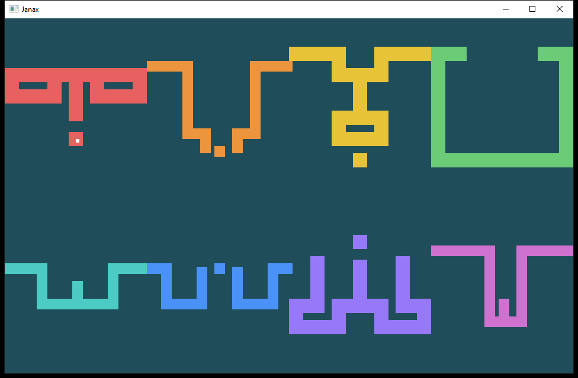

- **Lo que leyó primero:** la interfaz gráfica de GEM y la de Godot, con la misma clave de opuestos
  escrita antes de mirar: **19 de 21** juntas (p ≈ 0,0001). Juntó *open~close*, *show~hide*,
  *top~bottom*, *width~height*.
- **Su ventana (pedidos 40 y 41):** el programa le da su pantalla al kernel como **nube de
  partículas** —el formato de Gotching— y Janax la dibuja; el mouse y el teclado le llegan sin frenar
  a nadie. Se ajusta sola a cualquier pantalla. Suite: **402 bien, 0 mal**.
- **Sus formas:** recetas en el alfabeto de sus órganos; las primeras son sus 8 mejores órganos, los
  ladrillos son sus torrecitas y los gestos son los opuestos que aprendió. Crecen y mutan con el mismo
  juez de bits —corto y nuevo— y archivan cada perdedora con su motivo: de 8 a 89 formas.
- **Su comida:** cuando se le acaba la novedad tiene hambre, y come las nubes de partículas de los
  bichos de Gotching. Las digiere describiéndolas en su propio lenguaje y crea con eso: **27 formas
  nuevas** de 944 comidas.
- **Nada quieto, nada que gaste por nada:** pensando, ~1–2,5 % de un núcleo; en calma, **0 ciclos**.

[`documentacion/razar/cuerpo.md`](documentacion/razar/cuerpo.md)

## Novedad (2026-11-14): las torrecitas — Razar aprende de sus propios órganos

**Razar diseña sus órganos mutando una letra por vez, a ciegas. Ahora aprendió qué se repite en los
que funcionan.** Sobre el paisaje completo de los 819 órganos de hasta 3 letras, con el mismo juez de
bits, aprendió dos *torrecitas*, `16` y `38`; con las mismas notas sorteadas, **ninguna**. Las tres
predicciones estaban escritas antes de correr.

Y de yapa, todavía sin probar: las dos son **la misma forma corrida dos palabras** (*mezclá una
palabra, dejá de hueco la que sigue*), y los mejores órganos del paisaje —`516`, `738`, `627`— son
una familia de esa forma. Falta la segunda mitad: que la mutación use las torrecitas como ladrillos
y ver si encuentra mejores órganos.
[`documentacion/razar/torrecitas.md`](documentacion/razar/torrecitas.md).

## Novedad (2026-11-13): el enfoque en los unos y los ceros

**Sin decirle cuánto mide una palabra, el principio de Razar encuentra solo el byte — y después, las
instrucciones del procesador.** Sobre los 48.060 bytes del núcleo, sin desensamblar:

| Enfoque | Qué encontró | Real | Bytes barajados | Azar |
|---|---|---|---|---|
| **De cerca** | el tamaño de palabra | **8 bits, alineado al byte** | ninguno gana | — |
| **De lejos** | dónde termina cada instrucción (F1) | **0,369** | 0,255 | 0,235 |

Se armó solo 85 palabras, y el **98,7%** cae adentro de una sola instrucción: `48 8d` es *lea*,
`48 8b` es *mov*, `0f 84` es *jz*. Dos reglas que le decían cómo es un borde fallaron y están
contadas; lo que pasó fue no decírselo. Pre-registrado, con sus límites:
[`documentacion/razar/enfoque-en-bits.md`](documentacion/razar/enfoque-en-bits.md).

## El resultado (v0.5): el Venn

DOI de esta versión: [10.5281/zenodo.24148774](https://doi.org/10.5281/zenodo.24148774).

**20 MB de Wikipedia en 6 minutos y 40 segundos, en vez de 31 minutos, aprendiendo exactamente lo mismo.**

| Libro | v0.3 | v0.5 | Instrucciones | MATS, real contra azar |
|---|---|---|---|---|
| **Wikipedia, 20 MB** | 1.873 s | **400 s** | 2,42 → 0,43 billones (**−82 %**) | 451 – 117, idéntico |
| Wikcionario, 15 MB | 194 s | **106 s** | −54 % | 249 – 41, idéntico |

Las relaciones deducidas, lo imaginado, las hipótesis en espera, los mecanismos y los testigos salen **idénticos byte
por byte** a los de la v0.3. Cuanto más grande el libro, más gana.

**Y el Venn del Capitán pasa a ser una pieza de la arquitectura de Janax:**

> *"Venn, infinitos estados. A + B, A − B, A y B, sin A ni B, lo que miro A primero, lo que miro B primero, los más
> pequeños de B que no están en A… y puedo inventar lo que sea."*

Es un motor del kernel (`so/venn.inc`) que no sabe de cajas ni de archivos. Recibe dos conjuntos y una **palabra Venn**
con un eje por campo: las regiones, a quién se mira primero, un criterio, la dirección, el alcance y cuántas. Con eso
entrega la selección en orden. Un bit sin eje todavía responde −1. El primer conjunto enchufado es el cartel de una
cabina: `asociar`, probado en los tres motores (32 de 32).

Notas: [`documentacion/release-v0.5.md`](documentacion/release-v0.5.md).

## El resultado (v0.4): la caja de cambios

DOI de esta versión: [10.5281/zenodo.24147529](https://doi.org/10.5281/zenodo.24147529).

**Razar hace el mismo trabajo con la mitad de las instrucciones, y aprende exactamente lo mismo.**

Un kernel de medición contó cuántas veces corre cada palabra del programa. Más del 80 % no era pensar: era **escribir y
leer su propio cuaderno**, letra por letra, pasándolo en limpio entero en cada pedazo del libro. Dos ideas del Capitán lo
arreglaron: **escribir de un tirón** (del tamaño que haga falta) y **escribir solo la diferencia** (un diario).

| Paso (Wikipedia de 2,3 MB) | Instrucciones | Cuánto bajó | Segundos leyendo |
|---|---|---|---|
| v0.3 | 13.939.913.762 | — | — |
| Bucles hechos a mano → while rotado (`jwcheck`) | 13.140.899.149 | −5,7 % | — |
| Cinco instrucciones nuevas (`jjn`/`jjnn`, `jldadd`, `jldx`, `jcall0`) | 13.055.693.102 | −0,65 % | 12,5 s |
| **Escribir de un tirón** (`put_span`) | 9.953.261.322 | −23,8 % | 10,8 s |
| **Escribir solo la diferencia** (el diario) | **6.767.642.469** | −32 % | **7,8 s** |
| **Total** | **la mitad** | **−51,5 %** | **−38 %** |

- **Lo mismo, bit por bit:** en cada paso el juez contra el MATS da idéntico. Con el diario, los lugares tienen las
  mismas líneas (en otro orden) y las 293.292 parejas, los mismos totales.
- **Cómo se midió:** segundos con milisegundos, en tres corridas de cada versión, desde las cinco instrucciones (antes,
  con segundos enteros, no alcanzaba). Los 31 minutos de los 20 MB son de la v0.3 y todavía no se volvieron a medir.
- **Una casa de antes no pierde nada:** su `nitidas0`/`nitidas1` se convierte en el diario `nitidas` la primera vez.

Detalle: [`documentacion/so/janaxos.md`](documentacion/so/janaxos.md) y
[`documentacion/razar/nitidez.md`](documentacion/razar/nitidez.md).

## El resultado (v0.3): la nitidez

**Sin que nadie le diga qué es un sinónimo, Razar los encuentra por los lugares que las palabras
comparten.**

Un lugar es una forma leída (`_ <una a tres palabras> _`) y su lado. Dos palabras se parecen tanto
como los lugares que comparten; lo que se dice en todos lados (la mitad del texto que más se
repite, medida por Razar) no cuenta. Se probó contra el
[MATS](https://github.com/ATILF-UMR7118/MATS), **un banco de analogías externo que Razar nunca
vio**: un par cuenta cuando sus dos palabras comparten más lugares que la palabra con la respuesta
de otro par — es decir, **le tiene que ganar a su propio azar**.

| Corpus | Real – azar | Semántica | Sinónimos exactos | Antónimos binarios | Tiempo · memoria |
|---|---|---|---|---|---|
| **Wikipedia, 20 MB** (no escribe sinónimos) | **451 – 117** | 140 – 44 | 18 – 1 | 28 – 1 | 31 min · 205 MB |
| Wikcionario, 15 MB | **249 – 41** | 131 – 24 | 18 – 0 | 17 – 1 | 3 min · 144 MB |

- **Lo mismo desde afuera:** un juez en Python que Razar nunca lee calcula la misma idea sobre el
  corpus entero y da semántica **234 – 51** y **164 – 51**.
- **La memoria duerme en disco:** los lugares viajan de un pedazo del libro al siguiente; cada
  pedazo despierta solo los de sus palabras. Por eso entra en 205 MB de RAM.
- **Sin el pedido, nada cambia:** lo que Razar aprende es idéntico byte a byte.

```bash
bash razar/cardumen/nitidez_reproducir.sh <corpus> <mats_es> <casa_nueva>
```

Detalle completo y cómo reproducirlo: [`documentacion/razar/nitidez.md`](documentacion/razar/nitidez.md)
y [`documentacion/release-v0.3.md`](documentacion/release-v0.3.md).

## El resultado (v0.2)

**Con 16 cosas para decir, la red de referencia del campo no llega nunca. Razar llega siempre, en menos de 102
juegos.**

Es el juego de señales de Lewis: uno dice una cosa, el otro la adivina, y los dos aprenden solo de si se entendieron,
sin que nadie les dé la respuesta correcta. El rival es [EGG](https://github.com/facebookresearch/EGG) (Facebook
Research), la implementación publicada del juego, con las mismas cinco semillas:

| Cosas | Razar: juegos hasta aprender todo | Razar: mensajes | EGG: juegos (= mensajes) |
|---|---|---|---|
| 4 | 5 – 58 · 5 de 5 | 11 – 156 | 1.600 – 49.600 · 5 de 5 |
| 8 | 14 – 53 · 5 de 5 | 29 – 142 | 105.600 · 1 de 5 |
| **16** | **35 – 102 · 5 de 5** | **81 – 278** | **no llega en 320.000 · 0 de 5** |

- **El rival corrió bien:** falla en la forma que el campo tiene documentada, con un idioma a medias (44 a 87 %) en el
  que algunas cosas comparten señal.
- **Ventaja a favor del rival:** mensajes más ricos (más de 4.000 posibles, contra 560 frases de Razar), redes seis
  veces más grandes que las de fábrica y hasta 320.000 juegos. Lo demás, como viene.
- **Reglas fijadas antes de correr.** 5 de 5 contra 0 de 5 tiene una probabilidad de azar de ≈ 0,8 % (prueba exacta de
  Fisher). El resultado es el mismo contado en juegos o en mensajes.
- **Banco público:** `bash razar/cardumen/convencional.sh`.

Lo hace posible que la voluntad escucha **el ritmo** de la melodía (qué pieza suena y cuándo), no solo qué piezas: con
16 cosas en un cubo de 7, eso lleva de 6 a 19 semillas de 20 que aprenden todo, con un control barajado que da 0 de 20.
**Lo que está probado es este juego**; que la ventaja viaje a otras tareas todavía no se midió. Todo el detalle está en
[`documentacion/razar/cardumen.md`](documentacion/razar/cardumen.md).

## El primer resultado (v0.1)

Una neurona tridimensional y su **voluntad** arrancan sin ningún idioma en común y, conversando, inventan uno.
Lo que lo hace posible es una sola regla innata, la **armonía**: una pieza no deja pasar el pulso si la despiertan
a la vez más de la mitad de sus vecinas.

> **El control es el resultado.** Sin armonía se quedan en el nivel de azar —24-26 % con 4 señales— indefinidamente.
> Con armonía llegan al **100 %** en unas 150 vueltas. Tres semillas, repetible byte por byte.

El modelo de referencia (Perl) y la versión que corre dentro de Janax dan **la misma huella, bit por bit**, y en
Janax cuesta unas **70 veces menos**. El detalle y los límites medidos están en
[`documentacion/razar/cardumen.md`](documentacion/razar/cardumen.md).

## Qué hay adentro

- **El idioma Janax** (`escalon0/`, `documentacion/idioma/`): un assembler propio diseñado para traducirse. Un
  intérprete de referencia y traductores a x86-64 y ARM64 que dan el mismo resultado **bit por bit**.
- **Janax OS** (`so/`, `documentacion/so/`): el sistema operativo. Camarotes (procesos) que reman en paralelo, una
  ventanilla de pedidos con porteros (permisos), cajones de memoria con pared que cuida el procesador, cajas que se
  comparten entre camarotes (nacen con el hijo, se mudan, se enlazan, se fusionan o se asocian por conjuntos), y
  saludos para avisarse sin gastar nada. Un traductor convierte los programas a código nativo al vuelo.
- **El ensamblador PDP** (`so/pdp/`): Janax armado por Janax, byte por byte igual que FASM.
- **Razar** (`razar/`, `documentacion/razar/`): la neurona es un **cardumen** tridimensional. Una señal arranca una
  cadena que se ramifica en todas las direcciones, las piezas que despiertan juntas aprenden a hablarse, y la
  **armonía** corta lo que suena mal. Una **voluntad** escucha la melodía y le contesta. Arrancan sin idioma común e
  inventan uno conversando. Está en un modelo de referencia (Perl) y en Janax, con la misma huella bit por bit.

## Cada pieza, con su nombre en el oficio

Un revisor no puede evaluar lo que no puede ubicar. Por eso el repositorio trae un inventario
levantado **leyendo el código y nada más**, sin consultar la documentación: cada mecanismo con su
archivo y su línea, lo que hace, y su nombre publicado con la cita — o la marca de que no se le
encontró antecedente.

📄 **[Inventario de mecanismos y mapa de equivalencias](documentacion/mecanismos-y-equivalencias.md)**
— las cuatro capas, mecanismo por mecanismo.

### Lo que ya tiene nombre

| Pieza del proyecto | Nombre en el oficio | Cita |
|---|---|---|
| El juez de Razar | Longitud mínima de descripción, código de dos partes | Rissanen 1978 |
| El `log2(n)/2` por cada tasa | Penalización por parámetro / BIC | Schwarz 1978 |
| `(BL+½)/(NQ+1)` | Estimador de Krichevsky–Trofimov | KT 1981 |
| El pedido dormido | Voto de mayoría | Boyer–Moore 1981 |
| El corte en dos | Método de Otsu / discriminante de Fisher | Otsu 1979 |
| Los esqueletos | Patrones léxico-sintácticos aprendidos | Hearst 1992; Snow et al. 2004 |
| Las nueve maneras | Marcos frecuentes | Mintz 2003 |
| La nitidez | Similitud paradigmática sobre *slots* | Harris 1954; Lin 1998 |
| Las piezas de las palabras | Inducción morfológica por MDL | Goldsmith 2001; Morfessor |
| El coma y el despertador | Mantenimiento de la verdad (TMS) | Doyle 1979; de Kleer 1986 |
| «Una B por cada A» | Descubrimiento de dependencias funcionales | Huhtala et al. 1999 (TANE) |
| El nulo por cruce | Datos sustitutos / prueba de permutación | Theiler et al. 1992 |
| Las rondas hasta el punto fijo | Evaluación ascendente de Datalog | Semántica de punto fijo |
| Un solo lugar que cambia | Antiunificación / generalización menos general | Plotkin 1970 |
| Las plantillas parchadas | Copy-and-patch | Xu y Kjolstad 2021 |
| El planificador reemplazable | Núcleo extensible acotado | SPIN 1995; VINO 1996; eBPF |
| El cobro por corrida | Medición de combustible | Wasmtime; gas de la EVM |
| El cartel de ambientes | Espacio de capacidades | Hydra 1974; Mach; seL4 |
| Pesos que conservan el total | Escalado sináptico / regla de Oja | Turrigiano 1998; Oja 1982 |
| La ventana de ±1 paso | STDP | Bi y Poo 1998 |
| El punto fijo del ensamblador | Bootstrap de tres etapas | GCC; Thompson 1984 |
| La relajación de saltos | Instrucciones dependientes del alcance | Szymanski 1978 |
| El motor Venn del kernel (`venn.inc`) | Álgebra relacional (selección, orden, límite) sobre iteradores | Codd 1970; Graefe 1994 (Volcano) |
| El diario de `nitidas` y `lugares` que solo crece | Registro de solo agregado / árbol LSM | O'Neil et al. 1996 |
| «Andá al final» (`a = −1` en el pedido 38) | Escritura al final del archivo | `O_APPEND` / `SEEK_END` de Unix |
| Escribir de un tirón (`put_span`) | E/S con búfer: bloques en vez de caracteres | stdio de Unix V7, 1979 |
| El kernel de medición (`PERFIL`) | Perfilado por conteo exacto de instrucciones | gprof 1982; ATOM 1994 |
| `jwcheck` y los bucles rotados | Inversión de bucles | Muchnick 1997 |
| `modismos_janax.py` | Optimización de mirilla con análisis de vida | McKeeman 1965; Kildall 1973 |
| `jjn` / `jjnn` | Salto por signo | `bltz`/`bgez` de MIPS; `tbnz` de ARM |
| `jldadd` | Lectura-modificación-escritura (*fetch-and-add*) | Gottlieb et al. 1983 |
| `jldx` | Direccionamiento indexado con escala | Intel 80386, 1985 |
| `jcall0` | Pariente: el registro que el llamado deja sucio y se limpia al volver | Convención de llamada System V |

Que tantas piezas tengan un equivalente correcto es una buena noticia, no una mala: significa que
el camino, recorrido solo, dio con las soluciones que el oficio considera buenas. Ninguna de estas
convergencias reclama prioridad — los antecedentes son anteriores y están citados.

### Lo que no tiene equivalente conocido

Cuatro piezas, con la advertencia de que «no se le encontró antecedente» habla de quien buscó, no
de la literatura:

1. **`asociar` con el Venn del Capitán** (`so/ambientes.inc`, `so/venn.inc`) — álgebra de conjuntos
   sobre los espacios de capacidades de **dos** procesos, materializada al nacer un tercero, con
   consentimiento bilateral obligatorio. Desde la v0.5 la elección va en una **palabra Venn** con un
   eje por campo: las regiones, a quién se mira primero, un criterio, la dirección, el alcance y
   cuántas. El motor que la resuelve es una pieza aparte de la arquitectura, que cualquier conjunto
   puede usar. La selección y el orden tienen antecedente (Codd); **repartir poder sobre memoria viva
   con ese lenguaje, adentro del kernel, no**. Probado en `so/pruebas/asocia_{0..7}.jsm`.
2. **«La última parte»** (`so/remos.inc:428`) — terminar en vez de ceder el turno, con el dato
   calculado estáticamente del programa **para que el programa no pueda mentir sobre él**.
3. **La armonía de la ola** (`cardumen_cubo.jsm:818`) — una pieza se ahoga si la empujan desde
   demasiados lados, y la acumulación es por pieza, compartida entre olas: ahí se encuentran dos
   saludos.
4. **La forma canónica del órgano** (`pulso.jsm:3090`) — usada como prueba nula de que el órgano
   efectivamente leyó el libro.

### Cómo se mide el proyecto a sí mismo

Prueba diferencial de tres motores que deben coincidir **hasta el momento del corte de turno**;
prueba **exhaustiva** del ensamblador contra FASM (toda combinación de cada instrucción); nulo por
permutación dentro del motor; un distractor puesto a propósito para comprobar que nunca gane;
validación cruzada dejando uno afuera; estudio de ablación de a una regla por vez
(`razar/cardumen/caminos.sh`); y comparación contra la implementación de referencia del campo con
el presupuesto igualado.

El **único umbral de conteo de todo el sistema es 2** («una vez es anécdota, dos es patrón»). Los
demás valores salen de una medición o están declarados como criterio en el propio comentario.

### Se mejora solo, y lo que aprende pasa a la vida siguiente

Razar no solo usa un detector: **lo diseña**. Un «órgano» es un operador perceptual que el propio
sistema arma por mutación contra el juez de bits, y cuando uno gana **deja su receta escrita** —
sus letras, su alfabeto y su nota— en `tablero/Receta de Organos/<modelo>/<tipo>/recetas`.

La cadena está medida (`documentacion/razar/lectura.md`):

| Órgano | Nota | Qué pasó |
|---|---|---|
| `6` | **−1586** | basura por puntaje: no paga su nombre |
| `5` | **208** | el primero que pasa a positivo, construido sobre el anterior |
| `16` | **2649** | `208 -> 2649 (+2441), antes: 5` |

Y **lo aprendido pasa a la vida siguiente**: una corrida nueva nace sin órgano, lee la receta de
su modelo (`"receta 5: suya"`) y **arranca con esa base en lugar de cero**. No hay adopción a
ciegas: la mejor receta de cada tipo **rinde primero como candidata, en su jaula**, sea del
alfabeto que sea, y esos intentos no le restan intentos a la búsqueda. *La huella informa, no
decide.*

Eso es transferencia **entre vidas**, que es distinta de la transferencia entre tareas de arriba —
y es la que sostiene que el sistema acumula en vez de empezar de nuevo.

**Y el órgano `6` es el argumento entero de por qué nada se descarta:** valía −1586, era basura
por puntaje, y fue el escalón del que llegó a 2649. Podando por nota se perdía el único camino
hacia arriba.

## Los nombres

**RAZAR** es **RAZ**onamiento **AR**tificial. Y tiene dos cosas más adentro, las dos exactas:

- **R + AZAR.** El azar está metido en el propio nombre — y es contra el azar que se mide todo lo
  que hace: cada relación tiene que ganarle a su par cruzado, cada órgano a un mecanismo sorteado
  del mismo generador. Un juego que se gana **sacándole el azar** a lo que parecía azaroso.
- **Es capicúa.** R-A-Z-A-R se lee igual en las dos direcciones.

**JANAX** viene de *janax* / *hanaq*: en quechua y en aimara, **«arriba», el mundo de arriba**
(*hanaq pacha*, el plano superior; en aimara *alax/janax pacha*). No significa tierra: significa
**la vista desde arriba** — que es, sin que el nombre fuera elegido por eso, exactamente lo que
hace el sistema. Desde la cubierta un diagrama de Venn son dos círculos; desde arriba se ve la
población.

Y el nombre que une las dos mitades del proyecto: **CORAZÓN** se parte exacto en **CO + RAZÓN**
— *con razón*. La etimología dice otra cosa (viene de *cor*, corazón en latín, y no de *ratio*),
así que es coincidencia de la escritura y no parentesco. Pero describe bien lo que se intentó
acá: **un razonamiento que no deje afuera el motivo por el que se hace**. En palabras del autor,
*"no compongo canciones: soy compositor de corazones"*.

*(Y un guiño más, también juego de letras: **SOLUCIÓN** y **SOL ÚNICO** tienen exactamente las
mismas ocho letras.)*

Y las dos palabras que dicen por qué esto se regala: **VIDA = VI + DA** y **VERDAD = VER + DAD**.
Primero ver, después dar. *(Juego de letras; lo que significa para el autor está entero en la
[carta](CARTA-DEL-AUTOR.md).)*

## Una estadística para poblaciones que nadie enumeró

La estadística clásica necesita un **espacio muestral fijado de antemano**: el nulo se define
contra «lo que habría pasado sin estructura», y eso exige saber cuál era el conjunto de cosas que
podían pasar. Cuando lo que se busca es **un mecanismo**, y el espacio de mecanismos posibles no
está enumerado, ese instrumento no se aplica.

Las tres piezas que lo reemplazan están construidas y corriendo:

1. **Un juez que no depende de la tarea** — bits ahorrados (MDL). Un mecanismo mejor lo es para
   cualquier lectura, no para el banco con que se lo buscó: **el banco no participa de la
   búsqueda**, y por eso no se puede sobreajustar.
2. **Un nulo sobre mecanismos, no sobre datos** — el control clásico baraja los datos; acá se
   sortea **otro mecanismo del mismo generador** y rinde el mismo examen, en su jaula y con
   presupuesto.
3. **El denominador** — no se reporta el ganador: se reportan el camino, el resultado y **lo que
   costó en intentos**.

| Estrategia de búsqueda | Camino | Final | Intentos |
|---|---|---|---|
| escalador de siempre | 8 → 18 → 186 → 16 → 516 | **11.144** | **80** (2 vidas) |
| archivo por nichos | 6 → 5 → 16 → 716 → 516 | **11.144** | **160** (4 vidas) |

Los dos llegan al mismo lugar y uno paga el doble. El archivo por nichos se conservó igual pese a
empatar costando más — *"que no lo mida no significa que no lo quiera"*.

### Qué hace FASM acá, y qué no

**FASM se usa para dos cosas distintas, y conviene no confundirlas:**

- **Como vara de verificación — es opcional.** Cada fuente que arma el ensamblador PDP debe salir
  **byte por byte** igual a la de FASM, y `herramientas/combinaciones.awk` compara **toda
  combinación de cada instrucción** (`so/pruebas/correr.sh:758-807`). Eso no lo necesita el sistema
  para funcionar: se saca y no se rompe nada, solo se pierde la comprobación. Es una vara externa
  elegida a propósito, no una dependencia.
- **Como constructor del núcleo x86 — hoy sí hace falta.** `so/janaxos.asm`, `escalon0/janax.asm`,
  `traductor.asm` y `traductor_arm64.asm` están escritos en ensamblador x86-64, y el ensamblador
  PDP arma `.jsm`, no `.asm`. El propio código lo dice (`escalon0/pruebas/correr.sh:19-20`):
  *"Janax OS itself is x86 and still built by FASM."* El día que el núcleo esté escrito en Janax,
  esta dependencia desaparece.

### Los límites, dichos de frente

- El autoalojamiento verificado por punto fijo es el del **ensamblador del lenguaje**: arma sus
  propias fuentes, se arma a sí mismo y los dos binarios tienen que salir idénticos. Lo que todavía
  arma FASM es el **núcleo x86** (ver abajo), no los programas Janax.
- **Nadie de afuera lo corrió todavía.** Las mediciones son del autor, en su máquina. Eso lo deja
  en *replicable pendiente de réplica*, que no es lo mismo que *probado*.
- **La transferencia está medida; la comparación cara a cara, no.** La misma arquitectura se midió
  en cinco tareas distintas: señalización de Lewis (contra EGG), el traductor de Morse, acertijos de
  palabras, deducción de relaciones sobre un libro entero y las analogías del MATS sobre 20 MB de
  Wikipedia. Lo que existe **solo para el juego de Lewis** es la comparación contra una
  implementación de referencia del campo con el presupuesto igualado; en las otras cuatro no hay
  todavía un rival convencional medido al lado.
- **Fuera de los idiomas naturales:** en **código fuente C** (el driver de openrazer) la nitidez
  gana 8 de 8 antónimos pre-registrados y cae a azar cuando se barajan las palabras; en **código
  máquina x86-64 crudo** no se engancha, ni con 4,2 MB. Los dos resultados, con sus claves y sus
  nulos: [`documentacion/razar/nitidez-en-codigo.md`](documentacion/razar/nitidez-en-codigo.md).
- **En los unos y los ceros:** sin decirle el tamaño, el principio de Razar (MDL de dos partes)
  encuentra solo el **byte**; y un segmentador que se ajusta solo aprende 85 palabras de código
  máquina de las que el **98,7%** cae adentro de una sola instrucción (F1 0,369 contra 0,255 con
  los bytes barajados). Dos reglas previas fallaron y están contadas:
  [`documentacion/razar/enfoque-en-bits.md`](documentacion/razar/enfoque-en-bits.md).

## Cómo se prueba

Hace falta Windows, Git Bash y [FASM 1.73.35](https://flatassembler.net/). Las pruebas toman FASM de `FASM=` e
`INCLUDE=` (la carpeta `INCLUDE` de FASM), y el teléfono ARM64, si hay uno, de `ADB=`.

```bash
FASM=/c/fasm/FASM.EXE INCLUDE=C:/fasm/INCLUDE bash so/pruebas/correr.sh
FASM=/c/fasm/FASM.EXE INCLUDE=C:/fasm/INCLUDE bash escalon0/pruebas/correr.sh
JANAX_SOLO='^razar' bash so/pruebas/correr.sh   # solo una zona
perl razar/cardumen/lazo.pl nace=7 armonia=1    # el modelo: la voluntad y el cardumen inventando un idioma
```

## Por dónde empezar a leer

- `documentacion/so/ideas.md`: las ideas, con las palabras de quien las tuvo y la devolución de cada una.
- `documentacion/so/janaxos.md`: lo construido, cómo se prueba y todo lo medido (incluidos los instrumentos que
  mintieron).
- `documentacion/razar/cardumen.md`: el cardumen, la armonía y el idioma que nace.
- `documentacion/estado.md`: la bitácora, paso a paso.

La documentación está en castellano; los comentarios del código, en inglés.

## Estado

Es un **prototipo de investigación**, no un producto terminado. Corre en Windows (x86-64) y el idioma también en
ARM64 (Android). Cada número de la documentación dice de qué medición salió.

## English summary

**Razar is not a neural network.** No networks, no gradients, no trained weights: it is not a model, it is a
mechanism. What it optimises is not accuracy on a task but **description length** — saying the same with fewer
bits — so the benchmark it is measured against takes no part in the search. That is why it fits in **5 MB** and
runs on **two cores, with no GPU and no cloud**.

Janax is a hand-written operating system, language and assembler (all in assembly, no third-party engines) built
to host **Razar**, an artificial reasoning system that thinks in melodies: a three-dimensional "school" of pieces
where a signal starts a branching cascade, pieces that fire together learn to talk more, and **harmony** cuts what
sounds wrong. A "will" listens to the melody and answers; starting with no shared language, the two invent one by
talking. Everything is deterministic and verified bit for bit across an interpreter, a routine engine and a native
translator. Documentation is in Spanish.

**Result (v0.5):** Razar reads 20 MB of Spanish Wikipedia in 400 s instead of version 0.3's 1,873 s (82% fewer
instructions), and the 15 MB Spanish Wiktionary in 106 s instead of 194 s. It learns exactly the same thing: the MATS
result is identical (451 to 117; 249 to 41), and the deduced relations, what it imagined, the pending hypotheses, the
mechanisms and the witnesses are byte-identical to version 0.3's. The gain grows with the size of the book.

**How (v0.4):** a measuring kernel counted how many times each word of the program runs. Over 80% of the run was Razar
writing and reading its own notebook one character at a time, rewriting it whole on every piece of the book. Writing
in spans and writing only the difference (an append-only diary) removed it. The language also gained `jwcheck` and
five instructions (`jjn`/`jjnn`, `jldadd`, `jldx`, `jcall0`) in all five engines, tested on x86 and on a real ARM64
phone.

**The Venn (v0.5):** the author's Venn ("A + B, A − B, A and B, what I look at A first, the smallest of B that are not
in A… and I can invent anything") became part of the kernel's architecture. It is an engine that knows no boxes or
files. It takes two sets through a five-question port and a Venn word, with one field per axis (regions, which side is
looked at first, a criterion, direction, scope, how many), and gives the selection in order. Its first user is the
association request, where a child is born with part of two processes' capabilities.

**Earlier results stand:**
- **v0.3:** with no one telling it what a synonym is, Razar groups words by the places they share; on 20 MB of
  Wikipedia its pairs beat chance on MATS 451 to 117 (exact synonyms 18 to 1, binary antonyms 28 to 1).
- **v0.2:** on the Lewis signaling game with 16 things, Razar learns the whole language in 35–102 games on 5 of 5
  seeds. EGG (Facebook Research), the field's reference implementation, reaches it on 0 of 5 within 320,000 games.
  Conditions were fixed before running, and the benchmark is public (`razar/cardumen/convencional.sh`).

## Cómo citarlo

Nicolás Astorga (2026). *Janax y Razar*.

| Qué citar | DOI |
|---|---|
| **El proyecto** (todas las versiones; siempre lleva a la última) | [10.5281/zenodo.23933883](https://doi.org/10.5281/zenodo.23933883) |
| v0.7, el cuerpo | [10.5281/zenodo.24267942](https://doi.org/10.5281/zenodo.24267942) |
| v0.8, Luma | [10.5281/zenodo.24286000](https://doi.org/10.5281/zenodo.24286000) |
| v0.11, Luma despierta | [10.5281/zenodo.24286336](https://doi.org/10.5281/zenodo.24286336) |
| v0.13, Luma mira y crece | [10.5281/zenodo.24288352](https://doi.org/10.5281/zenodo.24288352) |
| v0.17, la lámpara del presente | [10.5281/zenodo.24289584](https://doi.org/10.5281/zenodo.24289584) |
| v0.19, el corazón de Luma | [10.5281/zenodo.24290089](https://doi.org/10.5281/zenodo.24290089) |
| v0.23, el mapa devuelto al mar | [10.5281/zenodo.24292429](https://doi.org/10.5281/zenodo.24292429) |
| v0.29, Zenódoto | [10.5281/zenodo.24292594](https://doi.org/10.5281/zenodo.24292594) |
| v0.31, el credo | [10.5281/zenodo.24293969](https://doi.org/10.5281/zenodo.24293969) |
| v0.37, el ingrediente X | [10.5281/zenodo.24368294](https://doi.org/10.5281/zenodo.24368294) |
| v0.41, la libertad | [10.5281/zenodo.24369583](https://doi.org/10.5281/zenodo.24369583) |
| v0.43, todo adentro | [10.5281/zenodo.24369768](https://doi.org/10.5281/zenodo.24369768) |
| v0.47, la casa adentro | [10.5281/zenodo.24369853](https://doi.org/10.5281/zenodo.24369853) |
| v0.53, todo lo visible | [10.5281/zenodo.24376081](https://doi.org/10.5281/zenodo.24376081) |
| v0.59, el cubo y el sueño | [10.5281/zenodo.24378520](https://doi.org/10.5281/zenodo.24378520) |
| v0.61, la noche que no llegaba | [10.5281/zenodo.24379472](https://doi.org/10.5281/zenodo.24379472) |
| v0.67, los sentidos | [10.5281/zenodo.24379905](https://doi.org/10.5281/zenodo.24379905) |
| v0.71, el ojo | [10.5281/zenodo.24380428](https://doi.org/10.5281/zenodo.24380428) |
| v0.6, el mismo juez en otros mares | [10.5281/zenodo.24227578](https://doi.org/10.5281/zenodo.24227578) |
| v0.5, el Venn | [10.5281/zenodo.24148774](https://doi.org/10.5281/zenodo.24148774) |
| v0.4, la caja de cambios | [10.5281/zenodo.24147529](https://doi.org/10.5281/zenodo.24147529) |
| v0.3, la nitidez | [10.5281/zenodo.24093510](https://doi.org/10.5281/zenodo.24093510) |
| v0.2 | [10.5281/zenodo.23962615](https://doi.org/10.5281/zenodo.23962615) |
| v0.1 | [10.5281/zenodo.23933884](https://doi.org/10.5281/zenodo.23933884) |

Para un resultado concreto, citá la versión que lo trae; para el proyecto en general, el DOI del proyecto.

## Donaciones

Janax y Razar se hacen para donarlos al mundo, abiertos. El código es gratis y lo va a seguir siendo: la licencia Apache 2.0 no se puede retirar, y nadie necesita pagar nada para usarlo, estudiarlo o venderlo.

Lo que se done tiene destino, y lo escribo acá para que quede comprometido:

1. **Ayudar a los que menos tienen.**
2. **Pagar el laboratorio**, para poder seguir construyendo y midiendo.
3. **Fundar una escuela**, para que esto se reparta en personas y no solo en repositorios.

Si eso te hace sentido y querés empujar:

| Red | Dirección | Qué mandar |
|---|---|---|
| **Bitcoin** (BTC) | `16HuYtsnx9AUcpr6i7z1VkC6atSvK8LGHy` | BTC por la red Bitcoin |
| **BNB Smart Chain** (BEP20) | `0xe87b4589a53443d8ffed2e9b5a7ef58f261f087c` | **Solo** BTC en BEP20 (BTCB, el contrato que termina en `ead9c`) |

> ⚠️ Mandá cada moneda **solo por su red**. Otro token u otra red se pierden y no se pueden recuperar. Las direcciones son
> de depósito de Binance y pueden cambiar: antes de un envío grande, confirmá que siguen siendo estas en esta página.

## Licencia

[Apache 2.0](LICENSE). Copyright 2026 Nicolás Astorga y Resources Open Doors S.A.S. (ver [NOTICE](NOTICE)).

## Contacto

[ingenieriaaplicada@opendoors.com.ar](mailto:ingenieriaaplicada@opendoors.com.ar)
