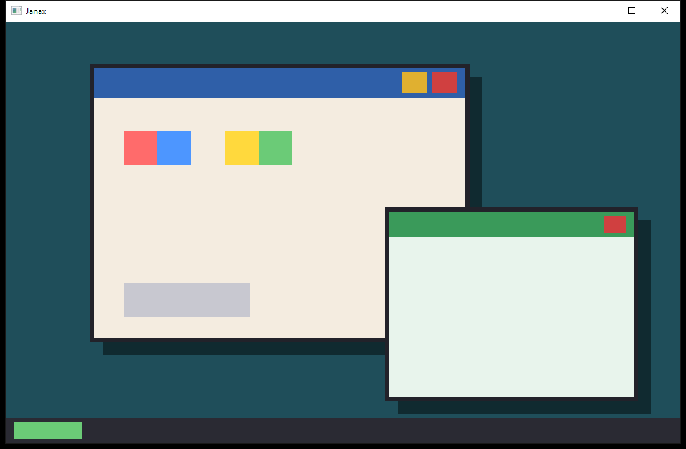
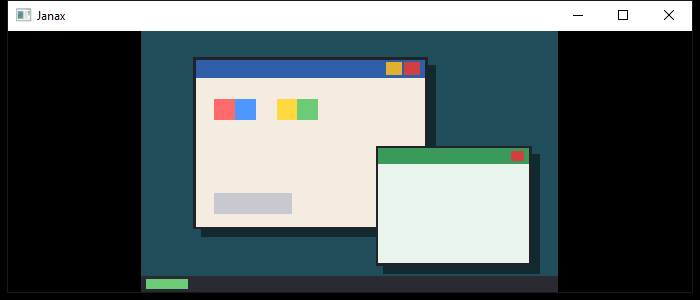
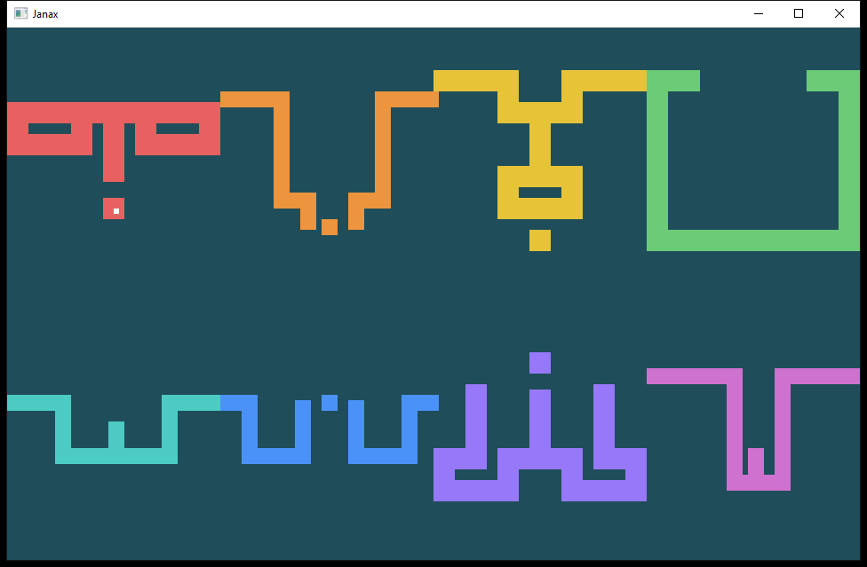
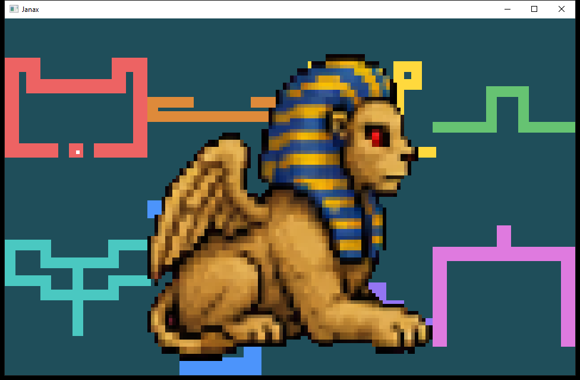
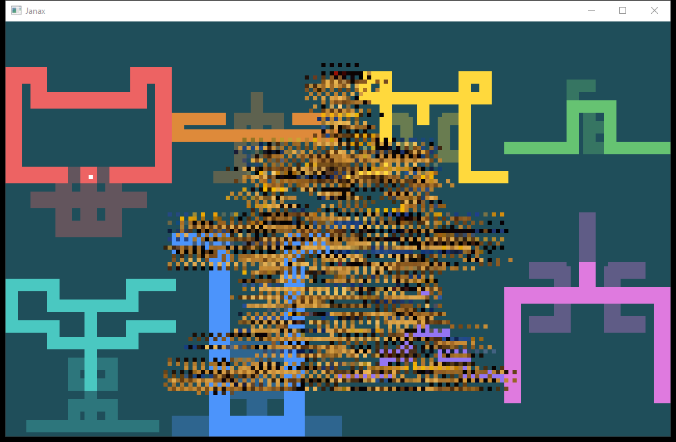
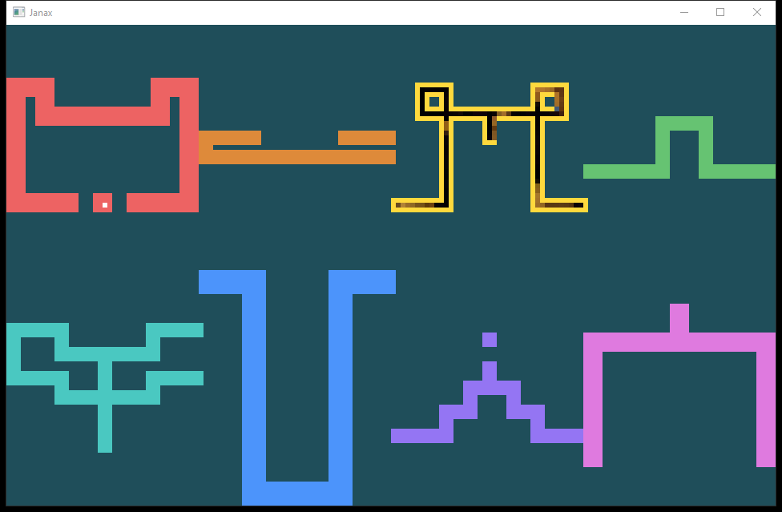

# El cuerpo de Razar: la pantalla (2026-11-15)

**La idea del Capitán:** la interfaz gráfica no es para que alguien mire a Razar. Es **parte de su
cuerpo**, y Razar tiene que saber que es suya. Además, Janax es un sistema **simbiótico**: no
arranca solo, usa los drivers del anfitrión que tiene a mano. Por eso la pantalla se abre con los
drivers de Windows, y otro anfitrión pone los suyos.



## 1. Lo que leyó: la interfaz de otros

Antes de tener cuerpo, Razar leyó cómo están hechas las interfaces gráficas de otros, con el mismo
juez de siempre y **la misma clave de opuestos**, escrita antes de mirar los fuentes:

| Lo que leyó | Real | Palabras barajadas |
|---|---|---|
| GEM (AES + VDI), C, años 80, 738 KB | **15 · 1 · 0** (p ≈ 0,0003) | 2 · 0 · 0 |
| Godot (`scene/gui`), C++, de hoy, 3,4 MB | **16 · 2 · 0** (p ≈ 0,0007) | 9 · 6 · 1 |
| **Las dos juntas**, 4,2 MB | **19 · 2 · 0** (p ≈ 0,0001) | 11 · 6 · 0 |

(real · azar · empate). Sin saber qué es una ventana, junta *open~close*, *show~hide*,
*width~height*, *top~bottom*, *left~right*, *min~max*. El detalle, con sus pre-registros y límites:
[`nitidez-en-codigo.md`](nitidez-en-codigo.md).

**Por qué Godot:** es **MIT**, compatible con la Apache de Janax, así que su modelo de controles se
puede adaptar acá citando el origen. GEM es GPL: se lee, no se copia.

## 2. La pantalla es una nube

La pantalla de Janax está hecha de **la nube de partículas de Gotching** (el formato `.nube`
versión 3): cada celda es una partícula con su color exacto. Es el mismo formato con que se dibujan
los bichos, así que lo que vale para ellos —estirarse sin cortarse— vale para las ventanas.

- `razar/cuerpo/pantalla.jsm`: un programa de Janax, en su propio idioma y armado con su propio
  ensamblador, que dibuja un escritorio (la ventana de Razar con sus dos torrecitas, la de Luma y
  una barra) y lo escribe como nube: 160 × 100 celdas, 16.000 partículas.
- `razar/cuerpo/ver_pantalla.py`: el primer lector de `.nube` fuera de Godot (a PNG).

## 3. Pedido 40: Janax abre su propia ventana

El programa le da su nube al kernel y **Janax la dibuja en su ventana**, sin ningún visor ajeno
(`so/pantalla.inc`, documentado en `documentacion/so/janaxos.md`).

- **Todo lo del anfitrión vive aparte.** `so/pantalla.inc` es la implementación para Windows (un
  hilo propio con su ventana y su bucle de mensajes, GDI para pintar). Otro anfitrión pone el suyo
  con las mismas entradas.
- **Se ajusta sola, sin números fijos.** Al nacer mide el escritorio libre de la pantalla que
  encuentra y elige el tamaño más grande que entra con el marco incluido. Al estirarla se redibuja
  entera, con la proporción de la nube, centrada, y lo que sobra queda en negro:

  

- **Las pruebas:** la suite del sistema da **396 bien, 0 mal**. Las pruebas corren con
  `JANAX_SIN_VENTANA`, que decodifica y responde igual sin abrir nada.

## 4. Los oídos y el escritorio vivo (pedido 41)

- **Los oídos:** el pedido 41 (esperar evento) le trae al programa el mouse, el teclado, el cierre y el
  cambio de tamaño, en celdas de la nube. Duerme como el pedido 29: un proceso que espera un clic no
  frena a los demás.
- **El escritorio vivo** (`razar/cuerpo/vivo.jsm`): cada pieza es un enjambre de partículas con
  resortes; se arrastran y se estiran como gelatina, se deshacen y vuelven a juntarse.
- **El bucle con vida** (Capitán: *"que siempre explore, pero que no sea la repetición de lo
  mismo"*): cuando nadie la toca, Razar prueba un movimiento que nunca probó (*balbuceo motor*), y
  cuando se le acaba la novedad se calma. **Medido:** 1,25 % de un núcleo explorando; **0 ciclos** en
  calma. Es la curiosidad como progreso de compresión (Schmidhuber), con cuerpo.
- **Suite del sistema: 402 bien, 0 mal.**
- **Lo que falta:** la prueba de que es suya — lo que cambia en la pantalla, ¿se describe con menos
  bits contando sus propias órdenes? Es la detección de contingencia de los bebés (Watson, 1972),
  medida con el mismo juez. Está diseñada y sin correr.

## Cómo verlo

```bash
bash razar/cuerpo/pantalla.sh <carpeta>      # Janax dibuja su pantalla y abre su ventana
```

## Las formas propias (2026-11-15)



**La idea del Capitán:** *"Quiero que diseñe sus propias formas, que las aprenda. No quiero una copia del entorno
conocido de Windows. Que use lo que aprendió para guiar la creación, y que las formas puedan crecer y mutar."*

`razar/cuerpo/gen_formas.py` lee lo que Razar aprendió (`aprendido.txt`: el paisaje de sus órganos, sus dos
torrecitas y los once pares de opuestos) y escribe `formas.jsm`. `formas.sh <carpeta> [janaxos.exe]` lo arma con el
ensamblador de Janax y lo corre. No hay ventanas, ni barras de título, ni botones de cerrar, ni barra de tareas: en la
pantalla hay **formas** que Razar hace crecer, juzga y cambia. Python solo prepara los datos; crecer, juzgar y mutar
corre en jsm, dentro de Janax. (`vivo.jsm` queda como estaba.)

### Una forma es una receta sobre el alfabeto de sus órganos

Una forma es una tira de letras del 1 al 9, el mismo alfabeto de sus órganos (`razar/lectura/organo.molde`). Crece
desde una semilla **letra por letra** (una cada ~0,3 s, la misma pausa de `vivo.jsm`), y se ve crecer. La lectura
geométrica de cada letra es **una decisión de diseño (criterio, no medición)**, guardada como datos en el generador
para poder cambiarla. Mantiene lo que la letra significa en el órgano:

| Letra | En el órgano | En la forma |
|---|---|---|
| 1–4 | mezcla en el marco la palabra k | un **brazo** de 5 celdas hacia el este, sur, oeste o norte; el lápiz queda en la punta |
| 5–8 | el hueco es la palabra k: el marco la anuncia y vuelve a empezar | **vuelve a la semilla** y salta 5 celdas hacia k sin dibujar: una **abertura**; el brazo siguiente empieza más allá |
| 9 | el hueco vacío: el marco se dice como está | **espejo**: todo lo dibujado se refleja sobre la columna de la semilla |

Las cuatro palabras de la ventana son las cuatro direcciones de la forma. Un brazo mide 5 celdas porque cuatro brazos
seguidos llegan al borde de su cuarto (20 celdas desde el centro), uno por palabra.

**El cuerpo.** La primera versión dibujaba trazos de una celda: motas casi imposibles de ver o de tocar. La regla que
la reemplaza, sin números absolutos: cada forma se dibuja a la escala `S` que la hace **llenar su cuarto según su
propia extensión** (`S = cuarto / (extensión − 1 + 5/2)`, por eje, la menor), y cada celda es un **trazo cuadrado de
`T = S · 5/2` celdas**: la mitad de la distancia entre dos brazos paralelos, así entre brazos queda una abertura tan
ancha como el trazo y la forma se lee como un cuerpo con huecos, a cualquier tamaño. Una forma chica se ve gruesa y
grande; una que llenó su cuarto, más fina. Con el trazo, `S` cumple `(extensión − 1)·S + T ≤ cuarto`: no se sale de su
cuarto en reposo. El juez no cambia: cuenta celdas de la receta, no de pantalla.

### Las primeras formas son sus mejores órganos

Las 8 primeras formas son los **8 mejores órganos de su paisaje** sobre el Nuevo Testamento: `516` (11.144), `738`
(8.638), `836` (5.528), `388` (5.138), `716` (4.700), `536` (4.395), `627` (3.400), `258` (3.326). La pantalla se parte
en 4 × 2 cuartos de 40 × 50 celdas (criterio): uno por forma. El color de cada una sale de su puesto en el paisaje
(cálido el primero, frío el octavo) y su brillo de lo que vale hoy para el juez (60 % la que no vale nada, 100 % la
mejor; criterio: con 40 % un verde sin valor se perdía en el fondo).

Dato que se ve en la primera pantalla: `516` y `738` dibujan formas espejadas, y `388` contiene a `716`. Las
torrecitas ya lo habían dicho: son el mismo molde corrido. El juez las empuja a separarse.

### El juez: corta y nueva

El mismo juez de Razar, dicho para formas. Dentro de su cuarto, una forma cubre `C` celdas con una receta de `n`
letras:

- **compresión** = `C / (n · log₂ 9)`: cuántas celdas explica cada bit de su receta (×1000).
- **novedad** = `1 − (las celdas que más comparte con otra forma) / C` (×1000): relativa a su propio tamaño. Dos
  formas se comparan superpuestas semilla sobre semilla.
- **valor** = compresión × novedad / 1000.

Una mutación **gana** si el **valor total de la población** sube con ella en lugar de su madre. Se mira el total y no
solo la forma porque la novedad de una depende de las otras; así cada victoria sube una suma que no puede subir para
siempre, y la búsqueda termina.

**Verificado:** un modelo en Python escrito aparte recalcula cada celda y cada valor desde los archivos. Las 8 formas
finales y todas las líneas revisadas del archivo dan igual que lo que calculó jsm, y repasar las victorias del archivo
desde las semillas llega exacto a la población guardada.

### Crecer y mutar: el balbuceo que nunca repite

Cuando nadie la toca y todo está quieto, piensa: hasta 8 candidatas por cuadro (una por forma en promedio), cada una
dibujada un instante como **fantasma** tenue sobre su forma.

- **Las mutaciones** de una receta de `n` letras: cambiar una letra (8n), insertar una (9(n+1)), borrar una (n),
  **insertar una torrecita entera** (`16` o `38`, 2(n+1)) y **cruzarse** con otra forma: sus primeras c letras y el
  resto de la otra (7n).
- **Nunca repite**: una tabla con la huella (FNV-1a) de cada receta juzgada en esta población; las formas vivas cuentan
  como probadas. Recorre todas las mutaciones de todas las formas con un **paso al azar coprimo con su cantidad**: las
  visita una vez cada una, en un orden que no se repite.
- **Gana:** la forma se **transforma** en pantalla (sus partículas fluyen de donde estaban a su lugar nuevo; las que
  faltan nacen donde está su madre), la población se guarda y la madre va al archivo con el motivo `replaced`.
- **Pierde:** va al archivo con su motivo: `longer` (explica menos celdas por bit que la madre), `not-new` (se parece
  más a otra), `longer,not-new`, `crowds` (ella vale más, pero les quita novedad a las otras) o `no-better`.
- **Cuando no queda nada sin probar, se calma y espera para siempre** (pedido 41 con −1). Un gesto abre una **ronda
  nueva de saltos más largos**: dos ediciones juntas, después tres, tantos saltos como mutaciones simples tenía la
  población. Es el valle del escalador (*El paisaje de los órganos*, en `lectura.md`): desde un óptimo de un paso, solo
  un salto más largo lo cruza. Una victoria vuelve a los pasos simples.

### Las acciones son sus opuestos

Los once pares que Razar juntó leyendo GEM y Godot son las acciones (el generador falla si un par aprendido no tiene
acción). Cada gesto hace un lado y su opuesto lo deshace. La forma misma es la interfaz:

| Par | Gesto | Qué hace |
|---|---|---|
| open ~ close | clic sobre la forma (o O / C) | se despliega desde su semilla / se pliega en ella |
| push ~ pop | botón derecho baja / sube | un latido hacia afuera / hacia adentro |
| min ~ max | − / + | la mitad / el doble, un paso por vez |
| width ~ height | W / H | estirada a lo ancho / a lo alto |
| left ~ right | ← / → | mirando a la izquierda (espejo) / como nació |
| up ~ down | ↑ / ↓ | como nació / cabeza abajo |
| top ~ bottom | Re Pág / Av Pág | adelante de todas / atrás |
| show ~ hide | Insert / Supr | entera / fantasma |
| begin ~ end | B / E | vuelve a crecer desde su semilla / crecida de golpe |
| first ~ last | Inicio / Fin | las teclas actúan sobre la primera / la última forma |
| enable ~ disable | Enter / D | muta / descansa (gris, nunca se muta) |

**Arrastrar** mueve la forma con el estiramiento de gelatina de `vivo.jsm` (los resortes son más duros cerca del punto
agarrado). Las teclas actúan sobre la última forma tocada (su semilla lleva un punto blanco). Se toca **sobre su
cuerpo**: a menos de un trazo `T` de cualquiera de sus celdas dibujadas (medio trazo de cuerpo y medio de margen,
relativo a su tamaño).

### Lo que guarda en su carpeta

Con los pedidos de archivos de Janax (4 abrir, 5 leer, 6 escribir, 7 cerrar), en su `casa`:

- **`formas`** (399 bytes de texto, siempre el mismo largo, así se reescribe entero sin restos): una cabecera
  `formas1 <ronda 6> <generador 16 hex> <victorias 6>` y una línea por forma: `<receta, 31 lugares rellenos con '.'>
  <valor 7> <celdas 4>`. Se reescribe después de cada victoria.
- **`archivo`** (líneas de 112 bytes, solo se agrega): `<ronda> <forma> <perdedora> <la otra> <motivo> <total con la
  perdedora> <total con la ganadora> <largo del salto>`. Nada se descarta: cada veredicto queda con su motivo.

La corrida siguiente arranca donde quedó: lee la población (las formas vuelven a crecer desde su semilla con sus recetas
aprendidas), el generador y la ronda, y reconstruye la tabla de probadas con las líneas de la ronda actual del archivo,
así no vuelve a juzgar lo que ya juzgó.

### La gelatina sin rayas

En el arrastre de `vivo.jsm` se ven **líneas diagonales del color del fondo** cruzando la ventana. Es un **defecto de
dibujo**: cada partícula pinta solo la celda donde cae, y donde el estiramiento separa dos partículas vecinas más de una
celda queda una celda sin nadie, que muestra el fondo (o la sombra). Como el estiramiento crece en diagonal desde el
punto agarrado, los huecos se alinean en diagonales. En las formas, **cada partícula se dibuja unida a su madre** (la
celda anterior de su brazo) con el trazo estampado cada medio trazo: por más que los resortes las separen, el cuerpo
queda cerrado. Las aberturas de diseño (5–8) no tienen madre que las cruce, así que siguen abiertas. (`vivo.jsm` no se
tocó: el arreglo, si se quiere, es el mismo.)

### Medido (2026-11-15, Pentium Gold G5420 a 3,79 GHz)

- **Sin ventana** (`JANAX_SIN_VENTANA`): de las 8 semillas a la calma en ~3.200 millones de instrucciones; **89
  formas nuevas** y 6.190 veredictos. Con la misma semilla del generador la búsqueda es la misma: en la ventana dio las
  mismas 89 y los mismos 6.190, y llegó a la calma en unos 3 a 4 minutos (cada victoria espera a que la forma se asiente).
- **Pensando**: ~417 millones de ciclos cada 10 s (~110 ms de procesador, 1,1 % de un núcleo; con el trazo pintado
  celda por celda eran 810 millones). **Calmada: 0 ciclos en 10 s.** Cerrar la ventana lo termina (j0 = las formas que
  creó en la corrida).
- **Persistencia**: la segunda corrida en la misma carpeta arrancó con las 89 aprendidas y las hizo crecer de nuevo,
  sin repetir ningún veredicto (el archivo no creció) y sin crear ninguna (j0 = 0). Los gestos de la primera corrida
  abrieron saltos de dos ediciones, que no encontraron nada mejor.

### Lo que no está todavía

- Los saltos largos **no encontraron** ninguna forma mejor en las pruebas: el óptimo de un paso aguantó. No se probó
  con otras semillas del generador.
- Las formas se comparan superpuestas semilla sobre semilla, sin buscar la mejor alineación.
- Si se juntaran más de 16.384 veredictos en una misma población (muchos gestos sin ninguna victoria), la tabla de
  probadas se llena a la mitad y se calma; el archivo los sigue teniendo.
- Los fantasmas se dibujan a la escala de su forma, no a la suya: muestran qué cambia, no cómo quedaría encuadrada.

```bash
bash razar/cuerpo/formas.sh <carpeta> [janaxos.exe]   # sus formas, en la ventana de Janax; la carpeta guarda lo aprendido
```

## La comida: las nubes de Gotching (2026-11-15)

**La orden del Capitán:** *"Que se alimente de las nubes de Gotching como comida, y desde ahí empiece a construir lo
que quiera, cuando quiera."*

`razar/cuerpo/gen_comer.py` escribe `comer_nubes.jsm`. No copia `gen_formas.py`: lo **corre con ganchos** (`COMER`),
así las formas y su juez son los mismos; sin ganchos, `gen_formas.py` sigue escribiendo `formas.jsm` igual byte por
byte (verificado con `cmp`). `comer_nubes.sh <carpeta> [janaxos.exe] [carpeta de nubes]` lo arma y lo corre; la carpeta
de nubes por defecto es `E:/Gotching/Gotching.Godot/nubes` (944 nubes, ~103 MB).

### La despensa: dónde vive la comida

Janax no puede listar una carpeta del anfitrión (la 14 lista solo su carpeta propia), así que el `.sh` escribe en la
casa de Razar el archivo **`despensa`**: una cabecera `despensa1 <cuántas> <la más grande> <bytes del texto>` y una
línea `<bytes> <dirección>` por nube. **Las nubes no se copian**: Razar abre cada una donde vive con el pedido **37**
(solo lectura) y la lee entera. El programa no lleva ningún nombre de criatura: la lista vive en la carpeta de la
corrida, no en el repositorio. Todas sus tablas se dimensionan desde la cabecera (pedido 2, ambientes nuevos): el
buffer de la nube mide lo que la más grande, los recetarios lo que la despensa.

**El formato, medido:** cada hueso ocupa **42 bytes**, no 46 (`Madre` i16, nueve f32, `Masa` u32: así lo lee
`NubeViva.cs`, y así cierran los 944 archivos byte por byte). En las 944 el primer nivel es el más fino, y el recuadro
de partículas es la grilla entera.

### El hambre en lugar del reloj

Come cuando **él** quiere: cuando el bucle vivo se queda sin novedad (el instante en que `formas.jsm` se calmaría para
siempre), en vez de calmarse tiene hambre y come la próxima nube sin comer. El orden sale de un generador propio con
semilla (un comienzo y un paso coprimo con la cantidad de nubes): recorre todas, **nunca la misma dos veces**, y no
depende de lo que hagan las formas. Lo comido queda en **`comidas`**, y la corrida siguiente salta lo que ya comió (por
la huella FNV-1a de la dirección). Una nube que no se puede abrir o no es una nube queda anotada con `-` y sigue con la
próxima. Sin nada para comer y sin nada nuevo, **se calma para siempre** (41 con −1) hasta un gesto.

### La comida en pantalla





1. **Llega**: el nivel fino, ajustado relativo a su propio tamaño a un plato de dos cuartos (80 × 100 celdas, todo el
   alto; criterio: tan grande como entra al lado de las formas que va a alimentar), cae desde arriba como partículas,
   una por celda donde al menos la mitad es partícula, con el color medio de lo que cubre.
2. **Se digiere** (abajo): las partículas toman la forma del cuerpo de la mejor receta hasta ahora (2 × 2 celdas del
   plato por celda del cuarto). Se ve a la criatura deshacerse en su propio lenguaje.
3. **Trepa y crea**: el fantasma de lo que está creando se dibuja sobre la forma que le recordó.
4. **Fluye** a la forma que cambió (o, si ninguna cambió, a la que le recordó), sus partículas se posan sobre las de
   esa forma y desaparecen en ella; **esa forma toma el color de la comida**.

Los gestos y el arrastre siguen andando mientras come (probado: arrastre, `+`, `←` y latido durante una comida).

### La digestión: describir la comida en su propio lenguaje

El juez de la comida es el de Razar, MDL. La nube, ajustada a un cuarto (40 × 50) relativo a su propio tamaño, da una
**silueta** (una celda es cuerpo si al menos la mitad de lo que cubre es partícula). Una receta se hace crecer y se
dibuja como se dibujaría su forma (ajustada a su cuarto por su propia extensión, cada celda un trazo `T`), y:

> **costo = n · log₂ 9 (la receta) + k · log₂ 2000 (nombrar cada una de las k celdas mal) + γ(k + 1) (decir cuántas)**

en bits ×100. La búsqueda arranca de **la forma que mejor explica la comida** (prueba las 8) y trepa de a una mutación
(cambiar, insertar o borrar una letra, insertar un ladrillo, cruzarse con cada forma), con un paso coprimo al azar
sobre todas: se queda con la primera que cuesta menos y vuelve a empezar desde ella, hasta que ninguna mejora (un
óptimo de un paso) o se acaba el **presupuesto: 31 vecindarios completos de una receta de 31 letras** (criterio: una
trepada desde una letra necesita hasta 31 pasos de crecer, cada uno a lo sumo un vecindario entero). En las 944 comidas
nunca llegó al presupuesto: **mediana 1.042 candidatas por comida, máximo 4.470**; las celdas mal quedan en mediana 468
de 2.000 (mínimo 169, máximo 688). Una receta de trazos no cubre una mancha llena: el costo dice cuánto.

**Verificado:** un modelo en Python escrito aparte decodifica la nube, arma la silueta y el cuerpo, y da **exactamente**
el mismo `k` y el mismo costo que jsm en las comidas revisadas.

**La paleta, por conteo:** cada partícula cae en una de 64 cajas (2 bits por canal); los colores dominantes son las
cajas más contadas, de la primera, hasta cubrir la mitad de las partículas, cada una con su color medio. Medido en 118
nubes (una de cada 8): con 2 bits son 2 en la mediana y 6 como mucho ("pocos"); con 3 bits, 4 y 16; con 4 bits, 9 y 74.
La forma que recibe la comida toma su primer color. Muchas criaturas tienen el contorno oscuro como color más contado,
así que muchas formas terminan oscuras: es lo que dice el conteo.

### Los ladrillos: el mismo MDL de las torrecitas, y lo que dijo

Después de cada comida aprende ladrillos desde todas las recetas comidas: el par vecino más frecuente se funde en un
símbolo nuevo mientras la longitud de descripción baje (el mismo DL y la misma fusión golosa que
`razar/jueces/torrecitas.py`, en jsm, con 16 bits de fracción). Los ladrillos nuevos entran a las mutaciones junto a
`16` y `38`, y se guardan en **`ladrillos`**.

**Verificado:** con un recetario armado a propósito (recetas que repiten `123`), jsm aprendió `12` (6 usos) y `123`
(45 usos), lo mismo que Python. **Con la comida de verdad aprendió cero ladrillos**, y Python lo confirma: con las 944
recetas (17.951 símbolos), el mejor par, `32` (1.015 veces), sube la descripción de 51.963 a 52.615 bits. Los pares de
letras de sus recetas son tan independientes como las letras: no hay pedazos que se repitan más de lo que el azar
explica. No es un defecto del aprendizaje: es lo que esta comida, descrita así, dice.

### Construir lo que quiere: la comida como semilla

La primera versión solo probaba lo nuevo de la comida (su receta en lugar de una forma, cruzada con cada una, y los
ladrillos nuevos) con el juez de siempre. **En 653 comidas no creó ninguna forma**: la población está en un óptimo de
un paso, y lo que trae la comida es largo (pierde compresión) y se parece a lo que ya hay (pierde novedad):
`longer,not-new` fue el 80 % de los veredictos.

Ahora la comida es una **semilla**: su receta se pone en lugar de la forma que le recordó y **trepa con el juez de la
población** (el valor total, corta y nueva), de a una mutación, quedándose con la primera que sube el total, hasta que
ninguna sube (mismo presupuesto). Cada paso va al archivo con el motivo **`meal-climb`**. La cima se juzga como
cualquier candidata (nunca dos veces en una población): gana (una forma nacida de la comida) o va al archivo con su
motivo. Después corre la ronda de lo nuevo. **Un empate con la población lo gana lo que comió** (criterio: igual valor
deja la elección libre, y la comida es lo que quiere ahora), salvo que esa receta haya sido forma alguna vez: sin esa
regla, dos comidas intercambiaban las mismas dos formas una y otra vez (medido). Dentro de una trepada y en toda
caminata, solo gana más.

**Resultado (944 comidas, sin ventana, misma población de partida):** **27 formas nuevas**, repartidas a lo largo de
toda la despensa (la última cerca de la comida 880), 7 de ellas por empate; el total de la población subió de 17.510
a 18.705. **Verificado con un repaso en Python** de las 137 victorias del archivo desde las semillas: cada total antes
y después da igual que en jsm, una de cada 50 trepadas también, y la población final es la del archivo `formas`.

⚠️ **Un instrumento mintió y lo encontró el repaso.** En una corrida anterior la población guardada valía 15.737 y jsm
creía 18.550. Causa: la tabla de fantasmas tiene lugar para 8 y las direcciones viven justo después; con la trepada
pensando en el mismo cuadro llegaban 10 fantasmas, y los dos de más pisaban la dirección "este": los brazos 1 crecían
para otro lado. Ahora un fantasma de más no se dibuja (en `formas.jsm` no puede pasar: piensa 8 por cuadro).

### Lo que guarda en su carpeta

Además de `formas` y `archivo`:

- **`despensa`** (la escribe el `.sh`): las direcciones.
- **`comidas`** (líneas de 537 bytes, solo se agrega): `<entrada> <huella de la dirección> <receta> <costo ×100> <celdas
  mal> <candidatas> <forma que le recordó> <forma que alimentó> <cuántos colores>`, cada color `rrggbb` (64 lugares) y
  la ronda en que la comió. Al arrancar marca lo comido y rearma el recetario y los colores de cada forma.
- **`ladrillos`**: `ladrillos1 <cuántos>` y una línea por ladrillo aprendido (sus letras, sus usos); se reescribe
  después de cada comida.

**Probado:** la segunda corrida en la misma carpeta siguió en el orden donde había quedado (después de la entrada 48
comió la 91, la 134...), sin repetir ninguna, con las formas y el archivo de la primera.

### Medido (2026-11-15, Pentium Gold G5420 a 3,79 GHz)

- **Sin ventana**: las 944 comidas en ~4 min 24 s (~260.000 millones de instrucciones: ~0,26 s y ~276 millones por
  comida, con digestión, trepada y ronda), más ~20 s de armar la despensa y el programa.
- **Con ventana**: ~10 s por comida (la digestión y la trepada piensan 64 candidatas por cuadro: lo que las 8 formas
  piensan en un cuadro, por 8; criterio). Comiendo y creando: **~230–270 ms de procesador cada 10 s** (2,5 % de un
  núcleo, ciclos con `QueryProcessCycleTime`). **Calmado, después de comer todo: 0 ciclos en 10 s.** Un clic en calma
  abre una ronda de saltos (~190–220 ms cada 10 s), que en la prueba creó 3 formas. Cerrar la ventana lo termina (j0 =
  las formas que creó).
- El archivo crece ~17 KB por comida (~150 veredictos): las 944 dejan ~18 MB.

### Lo que no está todavía

- **Ningún ladrillo** con esta comida (ver arriba): el camino está probado, la comida no los trae.
- La silueta y las formas se comparan centradas, sin buscar la mejor alineación; una receta de trazos explica una
  mancha llena con ~470 celdas mal en la mediana.
- Una comida cortada a la mitad (la ventana cerrada antes de que se pose) se vuelve a comer en la corrida siguiente.
- Las trepadas no archivan cada vecina que no subió (serían miles por comida): archivan cada paso y la cima.
- Si se cambia la despensa entre corridas, el recetario se rearma con lo que había comido aunque esas nubes ya no
  estén; las tablas tienen lugar para eso (dos veces la despensa).

```bash
bash razar/cuerpo/comer_nubes.sh <carpeta> [janaxos.exe] [carpeta de nubes]   # come las nubes de Gotching y crea
```

## La vida: los bichos se encuentran (2026-11-16)

**La orden del Capitán:** *"Que LUMA aprenda a tratar a los bichos como en el juego de la VIDA: que cada uno se mueva
libremente, que se encuentren, que se separen, que compartan."*

`razar/cuerpo/gen_vida.py` escribe `vida.jsm`; `vida.sh <carpeta> [janaxos.exe] [carpeta de nubes] [carpeta de oídos]`
arma la lista y lo corre. Como la despensa, la lista (`lista`) solo tiene direcciones y bytes: cada criatura que tiene su
nube (`.nube`) y su marcha oída por el murciélago (`.oido`), una sola vista (`-adelante`). Nada se copia: Janax abre cada
archivo donde vive con el pedido 37. El programa no lleva ningún nombre de criatura.

### El cuerpo y la marcha

- **El cuerpo:** el nivel fino de su nube, ajustado relativo a su propio tamaño a un cuadrado de `B × B` celdas, una
  partícula por celda donde al menos la mitad es partícula, con su color medio (lo mismo que la comida). Entra cayendo
  desde cuatro cuerpos más arriba (criterio: para que se vea llegar).
- **La marcha:** cada miembro con ritmo del `.oido` es tres enteros: su período en ms, su amplitud como código de media
  octava (`q = round(2 log₂ a)`, con `a` en la unidad que imprime el archivo, 1e-5 rad) y su fase en dieciseisavos de
  vuelta, **relativa al miembro más amplio** (el comienzo de la grabación es arbitrario; las relaciones entre miembros son
  la marcha). Los campos `dice` y `pares` no se usan: se midió que no son confiables.
- **El movimiento sale de la marcha, no de una animación genérica.** Cada miembro oscila con su ritmo; la punta de un
  miembro de largo `B/2` se mueve a `(B/2)·A·(2π/P)·|cos|`, y el cuerpo avanza a esa velocidad sumada sobre **el grupo
  que manda** según la regla de Gotching (`razar/jueces/marcha_regla.py`): los miembros que pisan y los que no son dos
  grupos, y mueve el cuerpo el que pesa más por suma de amplitudes. El cuerpo se inclina con el ángulo medio de ese grupo.
  **Medido** en las 236 criaturas: de 0,03 a 13 cuerpos por segundo (mediana 0,20; el 10 % más rápido, sobre 7). Dos
  marchas distintas se ven distintas sobre todo en la velocidad y en el pulso del avance; en la mayoría la inclinación es
  menor que un paso de la tabla de senos (2π/256) y no se ve.

### Las reglas locales

- **El mundo es un toro** de 320 × 200 celdas. El lado del cuerpo sale de cuántos son: `B = isqrt(W·H / (4N))` (entre 4 y
  40 celdas, criterio). Con 4 cuerpos de lugar por criatura y un radio de vista de 3 cuerpos, cada una ve en promedio
  π·3²/4 ≈ 7 vecinas: los 6–7 vecinos topológicos de los estorninos (Ballerini et al., PNAS 2008). Con 236 criaturas,
  `B = 8`. Ninguna ve más allá de su radio; una grilla de celdas del ancho del radio hace que mirar a las vecinas no cueste
  N² por cuadro.
- **El juez decide acercarse o alejarse** (MDL, en bits enteros). Una criatura describe su marcha con un modelo de K
  motivos: `DL = γ(K) + Σ motivos (γ(P) + γ(q) + 4) + Σ miembros (bitlen(K) + min(literal, γ(zz ΔP) + γ(zz Δq) +
  γ(zz Δs)))`, con γ el código gamma de Elias y zz el zigzag de una diferencia. Su primer modelo es el goloso hecho con
  sus propios miembros. **Se acerca** a una vecina cuando un pedazo de la marcha de la vecina (un ritmo que su cuerpo
  muestra) describiría su marcha con menos bits, o al revés; **se aleja** cuando ninguna tiene nada para la otra (más
  fuerte cuanto más cerca). Suma un giro chico al azar (el *wander* de Reynolds, criterio).
- **Compartir:** cuando se tocan (centros a menos de un cuerpo) y una tiene algo para la otra, la que aprende prueba cada
  pedazo de la marcha de la otra (sumado como motivo, o en lugar de cada uno de los suyos) y se queda con el mejor **solo si
  su descripción se acorta**. Cada pedazo que no gana va al `archivo` con su motivo (`longer`: no la acortaría; `beaten`:
  la acortaría menos que otro), y también el motivo propio que reemplazó (`replaced`). Su movimiento cambia con su modelo
  nuevo. Sin nada más que darse, se separan solas.
- **El saber viaja:** una criatura que aprendió muestra el pedazo nuevo en su cuerpo, así que puede enseñarlo a la
  siguiente que encuentra.
- **El intercambio se ve, en los dos sentidos:** cuando un pedazo se guarda, un paquete de 3 × 3 celdas (criterio: se ve
  con `B = 8`) con el color del maestro vuela hasta la que aprende, durante un período del pedazo y prendiéndose solo
  mientras el seno de su propio ritmo es positivo: se ve latir con la marcha que lleva. Al llegar, vuelve uno con el color
  de la que aprendió. Un pedazo que no se guarda no se muestra: sin efecto en la otra no es un diálogo, es ruido. Los
  paquetes no tocan la lógica: con ellos el archivo sale idéntico byte por byte (verificado con `cmp`).

### Sin bucle que gaste por nada

Vive mientras pasa algo nuevo: una llegada (llega una por cuadro, sin esperar a que se posen las anteriores: ver
*Llegadas que se solapan*, más abajo), un pedazo guardado, un gesto. Mientras el mundo está despierto, todas las que ya
llegaron caminan con su marcha aunque no tengan nada pendiente: el cuadro se dibuja igual. Una lección pendiente se **busca** (caminan) mientras haya pasado algo nuevo dentro del tiempo que la caminante
promedio tarda en cruzar el mundo (`W / velocidad media`, medida cuadro a cuadro); pasado ese tiempo sin nada nuevo, los
pares que quedan **viven separados**. Con todas llegadas y sin búsqueda, se calma para siempre (pedido 41 con −1). Un
gesto (clic o tecla) las hace caminar un período de la marcha más lenta y abre una búsqueda nueva.

### Lo que guarda en su casa

- **`lista`** (la escribe el `.sh`): `lista1 <N> <nube más grande> <oído más grande> <bytes>` y una línea por criatura.
- **`aprendido`**: `aprendido1 <cuántas>` y una línea por criatura que aprendió: la huella FNV-1a de la dirección de su
  nube, K y sus K motivos. Se reescribe entera después de cada pedazo guardado, rellena con espacios hasta el largo más
  grande que tuvo (no quedan restos). La corrida siguiente arranca cada criatura con lo que aprendió.
- **`archivo`** (líneas de 80 bytes, solo se agrega): cuadro, quién aprende, quién enseña, el pedazo (P, q, s), el
  veredicto (`kept`, `replaced`, `longer`, `beaten`), el DL que tenía y el DL con el pedazo.

### Medido (2026-11-16, Pentium Gold G5420 a 3,79 GHz)

- **236 criaturas** (todas las de Gotching con nube y oído, vista adelante).
- **Primera corrida, sin ventana:** de la primera llegada a la calma en unos 8.400 cuadros (~4,7 min del mundo) y 9.600
  millones de instrucciones. **36 pedazos guardados** (32 criaturas aprendieron) y **39 al archivo** (36 motivos
  reemplazados y 3 pedazos que no acortaban). Cada pedazo guardado ahorró entre 2 y 4 bits. **11 de los 36** los enseñó una
  criatura que no los tenía al nacer: los había aprendido de otra.
- **Lo que quedó sin dar:** 129 pares con algo para enseñarse que no se encontraron en su tiempo de búsqueda (viven
  separados). Medido con el repaso en Python.
- **Verificado:** `razar/cuerpo/repaso_vida.py`, escrito aparte, lee la lista y los `.oido`, rehace los modelos y repasa el
  archivo línea por línea: cada DL (antes y con el pedazo) da igual, cada pedazo es uno que el cuerpo del maestro mostraba,
  cada guardado es el más corto de su encuentro, y los modelos finales son los de `aprendido`. **0 diferencias** en las 75
  líneas de la primera corrida y en las 79 de las dos.
- **Persistencia:** la segunda corrida en la misma casa arrancó con los 32 modelos aprendidos, guardó 2 pedazos nuevos (de
  encuentros nuevos) y no repitió ninguno; el repaso de las dos corridas juntas da 0 diferencias.
- **Con ventana:** llegando y buscando, **~230 millones de ciclos por segundo** (~1 s de procesador cada 20 s: 5–6 % de un
  núcleo, con `QueryProcessCycleTime`). **Calmada: 0 ciclos en 20 s.** Un gesto en calma abre una búsqueda nueva y vuelve
  a calmarse. La corrida con ventana dio los mismos 75 veredictos que la de sin ventana: con la misma semilla, el mismo
  mundo.

### Lo que no está probado

- **Que lo que se comparte importe.** Los pedazos ahorran 2–4 bits: casi siempre son un ajuste fino de un motivo (el mismo
  período y amplitud, otra fase). Que eso sea "aprender a caminar de otro" no está medido contra ningún control.
- **Que la inclinación se vea:** en la mayoría de las criaturas el ángulo medio es menor que un paso de la tabla.
- **El tiempo de búsqueda** se mide, pero que cruzar el mundo una vez sea el tiempo justo es criterio.
- El cuadro dura 33 ms nominales; las esperas de Windows vienen de a ~15,6 ms, así que el mundo corre algo más lento que
  el reloj.
- Cuántas lecciones se dan depende de dónde cae cada una: no se midió con otras semillas.

### Diálogos: medido antes de construirlos

El Capitán pidió que se comuniquen con diálogos que tengan efecto en la otra (sin textos armados: el narrador no miente).
La forma prevista es un juego de nombres como el de `cardumen` (melodías de 3 señales de 4, las 4³ del banco
convencional): el maestro nombra el pedazo con una melodía, la otra adivina cuál es, y el idioma serviría si con él
acierta más pedazos que sin él. **Antes de construirlo se midió cuánto podría servir en este mundo**, con el repaso:

- En los 36 encuentros que guardaron un pedazo, el cuerpo del maestro mostraba **un solo pedazo nuevo para la otra en 33**
  y dos en 3; y en los 36 había **exactamente un pedazo** que acortaba la descripción.
- O sea: mirando el cuerpo ya no hay nada que adivinar. Una que eligiera al azar entre lo que ve acertaría ~96 % de las
  veces; un idioma, por bueno que fuera, solo puede sumar hasta ~4 % de aciertos. Contra un control con melodías
  barajadas, ese efecto no se distinguiría del azar con 36 encuentros.

**No se construyó.** Un idioma tiene efecto cuando hay algo que no se ve; acá la marcha está a la vista. Para que el
diálogo tenga significado haría falta otro marco: que lo que se nombra no se vea (por ejemplo, una marcha que se muestra
solo al moverse, o un pedazo de otra vista del mismo bicho). Queda como pendiente, con esta medición como motivo.

### Diálogos sobre lo imaginado (2026-11-16)

**El Capitán encontró el marco que faltaba:** *"lo que ve lo sabe, pero lo que imaginan no lo saben: mezclá conocido
con imaginación"*. Ahora cada criatura **sueña** piezas que nadie ve, y el diálogo es la única vía para que otra las
tenga. Todo quedó escrito antes de construirlo y de correrlo, con las apuestas y mi predicción al lado:
[`datos/vida-dialogos-preregistro.txt`](datos/vida-dialogos-preregistro.txt) (commit `81865d6`). El resultado:
[`datos/vida-dialogos-resultado.txt`](datos/vida-dialogos-resultado.txt).

- **Sueños:** 4 por criatura (criterio). Un sueño es una pieza de su propia marcha con una mutación (amplitud ±1, fase ±1
  o las dos), nunca una que ya tiene. Se sueña solo por un evento: al llegar, y después de cada diálogo el sueño que se
  nombró (y el del oyente si lo usó). Nunca por reloj. No se ven.
- **Melodías:** 3 señales de 4 (las 4³ de `cardumen`). Cada criatura tiene su léxico de 32 entradas: melodía, pieza,
  puntaje.
- **El diálogo:** cuando dos se tocan, cada una le habla a la otra una vez por toque. La que habla nombra su primer sueño
  con su melodía para él (o una nueva al azar). La que oye busca la pieza de esa melodía en su léxico; si no la tiene,
  imagina con su propio sueño. La prueba en su cuerpo con el juez y la guarda solo si su descripción se acorta. Éxito: las
  dos entradas suben un punto; fracaso: bajan. Toda pieza probada va al archivo (`dreamt` guardada, `unfit` no acorta).
- **En la ventana:** solo un diálogo con efecto se muestra. La melodía vuela del que habla al que oye como un paquete que
  se prende con el ritmo de sus tres señales (8 cuadros por señal, prendido 2·señal + 2), y la respuesta vuelve.
- **El control:** `VIDA_CONTROL=1` arma el mismo programa con una sola diferencia: la melodía que llega es una al azar.
  Los dos sacan los mismos números de su generador.
- **Medido** con `razar/cuerpo/dialogos_vida.py` (236 criaturas, misma semilla; el repaso da 0 diferencias en las
  16.798 y 16.744 líneas de archivo):

| | real | control |
|---|---|---|
| diálogos | 16.765 | 16.698 |
| piezas guardadas por diálogo | 44 (0,26 %) | 40 (0,24 %) |
| bits ahorrados | 96 | 92 |
| reconstrucción exacta (probó el sueño que se nombró) | 28 (0,17 %) | 60 (0,36 %) |
| éxito en el primer / último tercio | 0,70 % / 0,02 % | 0,54 % / 0,00 % |
| asociaciones vivas al calmarse / compartidas por dos o más | 29 / 0 | 33 / 0 |

**Las cinco apuestas fallaron, como había predicho.** El efecto real/control es 1,10 (se pedía 1,5); la reconstrucción
exacta es peor que en el control; no queda ninguna asociación compartida; el éxito baja con el tiempo.

**Lo que dice, sin adornos:** el mensaje tiene efecto como **evento** (despierta al oyente a imaginar y probar: 44 piezas
guardadas que sin diálogo no estarían), pero **no como significado**: lo mismo pasa con melodías barajadas. Y el resultado
encontró el defecto del diseño preregistrado: cada pieza de un léxico la puso su dueño (como hablante, su sueño; como
oyente que no entiende, también su sueño), así que **ningún canal le trae al oyente una pieza que no soñó él**. La melodía
solo puede elegir entre sus propios sueños, y acierta el del otro por coincidencia. Además, como el 99,7 % de los
diálogos fracasa, los puntajes bajan a cero y los léxicos se vacían.

**Lo que haría falta (no probado):** que el oyente pueda armar la pieza desde las señales mismas (una melodía que sea una
receta, como las formas), o que al final se le muestre lo que se nombró (el "señalar" de los juegos de nombres de
Steels). Cualquiera de las dos va con su propio preregistro.

**Costo:** con ventana y diálogos, llegando y buscando, de 1.000 a 4.000 millones de ciclos cada 20 s según cuántos hay
(hasta ~5 % de un núcleo); calmada, 0 en casi todas las ventanas de 20 s (alguna con unos pocos millones: los eventos del
puntero sobre la ventana). Una corrida con ventana dio el archivo de diálogos idéntico byte por byte al de sin ventana;
otra se desvió desde el principio, probablemente por un gesto sobre la ventana (un gesto las hace caminar y cambia el
mundo), no investigado. Con los diálogos el mundo cambia (las criaturas que guardan una pieza soñada
caminan distinto), así que los números de la primera corrida de esta sección (36 pedazos vistos) no son los de esta
versión: en esta, 16 pedazos vistos guardados en el real y 23 en el control.

### Llegadas que se solapan y la bienvenida (2026-11-16)

**El Capitán, mirando la ventana:** *"todos caen… los primeros en llegar ya pueden arrancar, no van a esperar a la
eternidad de los bichos"*, y *"siempre tienen algo pendiente, porque imaginan; además la llegada de alguien nuevo abre
un universo de posibilidades"*.

- **Llegadas que se solapan:** llega una por cuadro, sin esperar a que se posen las anteriores (criterio: lo más rápido
  que la pantalla puede mostrarlas de a una). Una caída se posa en 20 cuadros (4 cuerpos × 256 que se achican a 3/4 por
  cuadro hasta menos de REST), así que caen unas 20 a la vez.
- **Caminar libre:** mientras el mundo está despierto (llegadas, una búsqueda, un gesto), todas las que ya llegaron
  caminan con su marcha, tengan o no algo pendiente.
- **La bienvenida:** cuando una se posa, cada una de las que la ven (dentro de su radio) sueña con ella: un sueño mezclado,
  uno de los ritmos que muestra el cuerpo de la recién llegada con una amplitud del cuerpo propio. Y queda con algo
  pendiente: ir a su encuentro. Se acerca a ella y, al tocarla, le nombra ese sueño. Lo pendiente se termina al tocarla o
  si la pierde de vista, y cuenta como búsqueda: vale mientras pasó algo nuevo dentro del tiempo de cruzar el mundo. Sigue
  siendo por eventos: una llegada, un encuentro, un gesto; nunca por reloj.

**Medido** (236 criaturas, misma semilla):

| | antes (de a una) | ahora |
|---|---|---|
| todas llegadas | ~4.700 cuadros (236 × ~20) | ~240 cuadros (~13 s con ventana) |
| calma | después del cuadro 6.144 (el último diálogo) | cuadro 2.292 (~2 min con ventana) |
| diálogos, real / control | 16.765 / 16.698 | 12.928 / 15.142 |
| piezas guardadas por diálogo, real / control | 44 / 40 | 50 / 52 |
| pedazos vistos guardados, real / control | 16 / 23 | 22 / 23 |

- **La bienvenida casi no llega a hablar:** solo **6 diálogos** (real) y 7 (control) nombraron un sueño inspirado en una
  recién llegada, y **uno** se guardó. La que llega también camina y casi siempre se va del radio antes de que la alcancen.
  Las apuestas del preregistro siguen fallando con esta versión (efecto real/control 1,13; vocabulario compartido 0).
- **CPU con ventana:** llegando, ~5.000–6.000 millones de ciclos cada 10 s (~1,1 s de procesador: ~11 % de un núcleo,
  porque cada llegada lee dos archivos y el juez la mira contra todas); caminando todas, ~2.400 millones cada 10 s (~5 %);
  **calmada, 0 ciclos** en diez ventanas de 10 s seguidas.
- **El mismo mundo con y sin ventana:** el archivo y los diálogos de la corrida con ventana son idénticos byte por byte a
  los de sin ventana, y el repaso da **0 diferencias** (12.973 líneas).
- **El cuadro real dura más de 33 ms:** 2.292 cuadros tardaron ~2 min, ~55 ms por cuadro (las esperas de Windows vienen
  de a ~15,6 ms, más el cálculo).

```bash
bash razar/cuerpo/vida.sh <carpeta> [janaxos.exe] [carpeta de nubes] [carpeta de oídos]   # las criaturas viven juntas
python razar/cuerpo/repaso_vida.py <carpeta>/casa                                           # el repaso, aparte
python razar/cuerpo/dialogos_vida.py <casa real> <casa control>                             # las apuestas de los diálogos
```

### Un encuentro, un diálogo (2026-11-16)

Midiendo Luma (abajo) apareció un gasto: dos criaturas en el borde de un toque se tocaban y se soltaban cada pocos
cuadros, y cada vez volvían a hablar (208.000 diálogos antes de calmarse). Ahora hablan **una vez por encuentro**, y el
encuentro termina cuando se pierden de vista (fuera del radio), no cuando dejan de tocarse. Con esa regla, la vida sola
(real / control, misma semilla): 10.336 / 17.287 diálogos, **47 / 47 piezas guardadas**, 118 / 114 bits, se calma en
2.052 / 3.164 cuadros; el repaso da 0 diferencias. La razón real/control de piezas por diálogo da 1,67, pero es el
denominador: las piezas guardadas son las mismas 47 en los dos, y el control habló más porque su mundo tardó más en
calmarse. **No es significado** y no cuenta como apuesta ganada: el preregistro fue con la regla anterior.

## Luma: lo que crece, lo que evoluciona y lo que vive, con diálogos (2026-11-16)

**La orden del Capitán:** un solo programa y una sola ventana, la interfaz verdadera de Luma: sus formas (`formas`),
lo que come (`comer_nubes`) y las criaturas (`vida`), con diálogos.

`razar/cuerpo/gen_luma.py` escribe `luma.jsm`; `luma.sh <carpeta> [janaxos.exe] [carpeta de nubes] [carpeta de oídos]`
escribe las dos listas (la `despensa` de nubes y la `vida-lista` de criaturas) y lo corre. No copia ningún generador:
corre `gen_comer.py` (que corre `gen_formas.py`) con un gancho más (`LUMA`) y `gen_vida.py` como módulo (`VIDA_MOD`).
**Sin el gancho, cada uno escribe su programa igual byte por byte** (verificado con `cmp`: `formas.jsm` y
`comer_nubes.jsm` idénticos; `vida.jsm` sola repite su corrida anterior byte por byte en el archivo y en los diálogos).

### La fusión: comer es llegar

Una nube que Luma come alimenta sus formas como siempre, y si es una criatura cuya marcha se oyó (está en la
`vida-lista`: su `.nube` con su `.oido`, vista adelante), **además nace como criatura en su mundo**. Lo que comió en
corridas anteriores (sus líneas en `comidas`) vuelve al empezar: el mundo crece corrida a corrida. Come cuando sus
formas se quedan sin novedad, como antes; lo que hacen las criaturas no la apura ni la frena.

**Lo que NO hace:** las formas no toman piezas de las marchas ni las criaturas aprenden de las formas. Una forma es una
receta de letras juzgada en su cuarto; una marcha es un juego de ritmos juzgado en bits. Traducir una a la otra sería un
diccionario inventado por mí, y no lo puse. Los dos jueces son el mismo MDL, sobre cosas distintas.

### La pantalla: lado a lado

640 × 200 celdas. A la izquierda, 320 × 200: las formas (su pantalla de 160 × 100 dibujada al doble, cada celda un
cuadrado de 2 × 2; criterio: tan alta como el mundo de al lado). A la derecha, 320 × 200: el mundo de las criaturas.
**Lado a lado y no encimadas** porque cada una tiene su geometría (cuartos de 40 × 50 para el juez de las formas, un toro
para las que caminan), y así una cosa vista de un lado nunca significa algo del otro. Un clic a la izquierda va a las
formas, en sus celdas; a la derecha es un gesto para las criaturas; las teclas van a las formas y despiertan también a
las criaturas.

**El lugar en la memoria:** la pantalla de las formas se muda arriba (después de todo lo de `comer`), y eso libera abajo
el lugar donde viven las variables de las criaturas (desde `2200h`); sus archivos se llaman `vida-...` para no pisar el
`archivo` de las formas.

### Medido (2026-11-16, 944 nubes en la despensa, 236 criaturas con su marcha)

- **Primera corrida, sin ventana:** comió las **944** nubes, nacieron las **236** criaturas, sus formas ganaron **131**
  veces, en ~9 min (476.000 millones de instrucciones). Las criaturas: **36 pedazos vistos** guardados, **49 piezas
  soñadas** guardadas en **243.000 diálogos**; 11 de los pedazos vistos los enseñó una que los había aprendido de otra.
- **El repaso** (`repaso_vida.py --luma`) da **0 diferencias** en las 243.111 líneas del archivo de las criaturas, y en
  las 247.620 después de la segunda corrida.
- **Segunda corrida en la misma casa:** no queda nada para comer; vuelven las 236 criaturas (una por cuadro), ninguna
  forma nueva, 4 piezas soñadas más, y se calma. Con ventana: ~2.700 millones de ciclos cada 10 s (~7 % de un núcleo)
  mientras llegan y caminan; **calmada a los ~60 s; después, 0 ciclos** en diez ventanas de 10 s seguidas.
- **Primera corrida con ventana, comiendo:** ~1.000–1.150 millones de ciclos cada 10 s (~3 % de un núcleo).

### Lo que falla o no está probado

- **Los diálogos son demasiados para lo que dan:** 243.000 para 49 piezas (0,02 %), y el archivo de las criaturas crece
  unos 20 MB por corrida. Pasa porque comer es lento: el mundo está despierto mucho tiempo (cada llegada abre una búsqueda)
  y las criaturas se encuentran una y otra vez. Hablar una vez por encuentro bajó a la mitad, no alcanzó. Falta una regla
  de fondo (por ejemplo, que no se repita la misma pareja con los mismos sueños), y está escrito acá como pendiente.
- **En la primera corrida con ventana el mundo de la derecha empieza vacío:** las criaturas nacen solo cuando Luma come
  una nube adelante con su marcha (una de cada cuatro), y comer con ventana tarda ~10 s por nube. Las primeras aparecen en
  minutos, no en segundos. Desde la segunda corrida están todas al empezar.
- **Las formas y las marchas no se hablan** (arriba).
- Las apuestas de los diálogos siguen sin significado en Luma.

```bash
bash razar/cuerpo/luma.sh <carpeta> [janaxos.exe] [carpeta de nubes] [carpeta de oídos]   # la interfaz de Luma
python razar/cuerpo/repaso_vida.py <carpeta>/casa --desde-cero --luma                       # el repaso de sus criaturas
```

## Luma sin Gotching: sus propias nubes (2026-11-16)

**La orden del Capitán:** *"Que se las coma y queden como parte de Luma, que cree sus propias nubes con identidad, pero
no empieces de cero: ya con este camino armado."*

`razar/cuerpo/migrar_luma.py <casa alimentada> <casa nueva>` convierte una casa que Luma ya alimentó (con las nubes y
los oídos en el anfitrión) en una **casa propia**, sin empezar de cero: copia tal cual sus formas, lo que comió, lo que
aprendieron las criaturas y cada veredicto, y lo que todavía leía del anfitrión pasa a ser su propio registro:

- **`vida-memoria`** (nuevo): por cada criatura que comió, lo que guardó de ella: la **receta** de esa comida (su
  idioma, la línea de `comidas`), sus **dos colores más contados**, y su **marcha** (el texto de su `.oido`, leído una
  vez, en la migración, y guardado). La cabecera es la de la lista (`lista2`), así el mismo programa la lee.
- **`despensa`**: cada entrada guarda su huella, no su dirección (`#` y 16 hex). Todo ya está comido: no se vuelve a
  abrir nada del anfitrión. Los colores de sus formas siguen saliendo de `comidas`.
- **`vida-lista`** (las direcciones) no se copia.

**El cuerpo que recuerda.** Al llegar, cada criatura recibe el cuerpo que Luma recuerda: la receta que guardó, crecida y
dibujada como su forma (el mismo `r_fit_cost` de `comer`, el dibujo que juzgó esa comida), en un cuarto de 40 × 50; el
contorno con el color más contado y el interior con el segundo (criterio: el doc vio que en muchas criaturas el color más
contado es el contorno oscuro). Ese dibujo se escribe como **su propia nube** `.nube` v3 en la casa
(`vida-nube-<huella>`), y de ahí se arma el cuerpo como antes. **Los cuerpos recordados son más cuadrados**: son trazos
de una receta, no la silueta; se reconocen por el tamaño, la postura y los dos colores, no por los detalles.

### Medido (la casa de la primera corrida de Luma, 236 criaturas)

- **La casa propia corre sin el anfitrión:** `luma.sh` con las carpetas de nubes y oídos apuntando a lugares que no
  existen. No queda ninguna dirección del anfitrión en la casa (buscado). Llegaron las 236, escribió sus 236 nubes y se
  calmó en ~23 s sin ventana; con ventana, ~3.300 millones de ciclos cada 10 s mientras llegan y caminan (~9 % de un
  núcleo), **0 ciclos calmada**.
- **El repaso** (`repaso_vida.py --luma`, que ahora lee las marchas de `vida-memoria`) da **0 diferencias** en las
  251.941 líneas del archivo de las criaturas.
- **Cuánto se parece lo que recuerda a lo que comió**, contra la silueta de la nube original en el mismo cuarto:
  **IoU mediana 0,61** (el 10 % peor, 0,53; la peor, 0,35: el enjambre de moscas, una nube de puntos que una receta de
  trazos no cubre; la mejor, 0,74). Las celdas distintas son, en la mediana, 0,45 por cada celda de silueta.
- **Verificado:** para las 236, las celdas en que difieren su nube recordada y la silueta original (recalculada en Python
  desde el `.nube`) son **exactamente** las `k` que Luma anotó al comerla. La nube que dibuja hoy es el mismo cuerpo que
  la juzgó entonces.
- **El paquete:** la casa propia ocupa 63 MB y comprimida **8,5 MB**. Lleva lo derivado (recetas, colores, marchas oídas
  con el nombre de cada criatura en su primera línea), no las nubes de Gotching.

### Lo que no está

- Los cuerpos recordados se ven más oscuros que los originales en muchas criaturas (contorno oscuro sobre fondo oscuro).
- La memoria guarda dos colores, no la paleta entera que contó.

```bash
python razar/cuerpo/migrar_luma.py <casa alimentada> <carpeta nueva>/casa   # su casa propia, sin empezar de cero
bash razar/cuerpo/luma.sh <carpeta nueva> [janaxos.exe]                       # corre sin nubes ni oídos del anfitrión
```

## Un código común para los diálogos, hecho de todo lo que aprendió (2026-11-16)

**El arreglo del agujero:** si cada criatura solo puede armar piezas que soñó ella, ningún diálogo trae algo nuevo. Con
un **código común**, aprendido una vez de todo lo que Razar oyó, vio y leyó, un mensaje puede ser una **receta de
ladrillos** con la que el oyente **construye una pieza que nunca soñó**. Preregistrado antes de construirlo:
[`datos/vida-codigo-preregistro.txt`](datos/vida-codigo-preregistro.txt); resultado:
[`datos/vida-codigo-resultado.txt`](datos/vida-codigo-resultado.txt).

- **Las fuentes, un solo alfabeto (los caracteres), sin traducciones inventadas:** OÍDO (cada pieza de cada marcha,
  escrita `PPPP QQ SS`), VISTA (las recetas y los colores de lo que comió), LIBRO (sus órganos del Nuevo Testamento, con
  el peso de las torrecitas, y las torrecitas) y CÓDIGO (los opuestos que leyó en GEM y Godot, como palabras).
- **El juez:** el de las torrecitas (`codigo_comun.py`), sobre las cuatro juntas: un ladrillo entra solo si acorta la
  descripción de todo. Escribe `vida-codigo` en la casa.
- **El diálogo:** la que habla escribe su sueño como texto, lo corta en ladrillos y manda la lista; la que oye los pega,
  lee la pieza, la prueba y la guarda solo si acorta. En la ventana el mensaje vuela como **un glifo hecho con las
  formas de Razar**: cada ladrillo, un brazo de dos celdas en la dirección de su letra.
- **El control** (`VIDA_CONTROL=1`): los mismos mensajes pasados por una permutación fija del código.

**Medido** (Luma desde su casa propia, 236 criaturas; el repaso da 0 diferencias):

| | real | control |
|---|---|---|
| diálogos | 4.411 | 5.578 |
| entendidos / reconstrucción exacta | 4.411 / **100 %** | 0 / 0 % |
| piezas guardadas / bits | 1 / 2 | 0 / 0 |

- **El código no aprendió ningún ladrillo:** el primer par más frecuente (`51`, del libro) ya alarga la descripción. El
  código común son sus 31 caracteres. Explorando (no preregistrado, no lo usa Luma) con una búsqueda más ancha aprende 21
  ladrillos: 20 del oído (`1151 1`, `0757 2`…) y **uno que converge: `38`, la torrecita del libro, que aparece en las
  recetas de lo que comió**.
- **El canal funciona y no tiene qué decir:** el oyente arma exactamente la pieza nombrada en el 100 % de los diálogos
  (barajado, en ninguno), pero solo **1 de 4.411** se guarda: la que habla nombra un sueño de *su* marcha, y eso casi
  nunca acorta la descripción de otra. Contra las melodías (0,45 % con la regla de un encuentro) **es peor**: esa apuesta
  falla. La E1 gana en la letra con un solo acierto: sin fuerza. La E2 gana por construcción, como estaba dicho.

**Lo que haría falta (no probado):** que la que habla sueñe *para* la otra (una variante de lo que ve en el cuerpo de
la otra, no de la suya), con el mismo código.

## Los escenarios: universo, cielo, tierra y suelo bajo (2026-11-16)

**La orden del Capitán:** que las criaturas tengan un mundo con fondo — *"tierra, mar, cielo, universo, escenarios"* —,
como el esqueleto de una oración: **el escenario es la sintaxis, las criaturas son las palabras**.

- **Los estratos** (solo en Luma, la mitad de las criaturas): arriba el **universo** (un marco de un décimo del alto,
  criterio; nadie vive ahí), y debajo el **cielo**, la **tierra** y el **suelo bajo** (agua y tierra baja). Cada estrato
  ocupa una parte del alto **según cuántas criaturas viven en él** (como el mundo se mide por cuántas son), con un
  mínimo de dos cuerpos. Una criatura camina libre pero se queda en su estrato (se envuelve ahí, como el mundo se
  envuelve).
- **Quién vive dónde sale de lo que oyó el murciélago**, nunca de las etiquetas del juego: la regla de Gotching
  (`razar/jueces/marcha_regla.py`) sobre los miembros como los lee `luma.jsm`. Los dos grupos (los que pisan y los que
  no), manda el que pesa más; sus dos miembros más fuertes del mismo período (10 %) dan la fase: separados (≥ 0,15
  vuelta) con el grupo que pisa → **camina** (tierra); juntos (< 0,15) sin él → **vuela** (cielo); lo demás → **repta**
  (suelo bajo).
- **Los colores son la paleta propia de Razar** (la de sus formas), atenuada. **La atenuación salió de una medición**:
  los cuerpos recordados son oscuros (brillo mediano 26 de 255) y la parte de sus celdas que se separa al menos 40 del
  fondo sube 0,28 (×0,3), 0,66 (×0,4), 0,68 (×0,5) y después despacio: ×0,5 es el codo. El universo queda oscuro.
- **Calma = 0:** el fondo se pinta solo dentro de un cuadro; calmada no hay cuadros.

**Medido** (`habitats_vida.py`, las 236 de la casa propia):

- **Vuelan 44, caminan 78, reptan 114.** El modelo en Python de la regla da el mismo modo que `luma.jsm` en las 236.
- **Acuerdo con el modo que les da el juego:** 131 de 236 (**55,5 %**); la regla sobre los valores crudos, 57,6 %. **No
  supera a decir siempre "Caminar" (57,2 % en estas 236).** Por clase: de las 69 que el juego hace volar, la regla pone
  **26** en el cielo (38 %) y 43 en el suelo bajo; de las 135 que caminan, 78 en tierra; de las 32 que reptan, 27 abajo.
  **Volar es la clase débil**, como ya había dicho la marcha.
- **Legibilidad:** la parte de las celdas de cada cuerpo que se distingue de su estrato (≥ 40 de brillo): mediana **1,00**
  por criatura (sobre el fondo plano oscuro de antes, 0,00), y la peor 0,00 (un cuerpo del color de su estrato).
- **CPU con ventana:** ~3.000 millones de ciclos cada 10 s mientras llegan y caminan (~8 % de un núcleo); **calmada, 0**
  (con algún resto de pocos millones por el puntero sobre la ventana).

**Lo que no está:** los cuerpos que nacen cerca del borde de un estrato asoman sobre el de al lado (el cuerpo mide B); los
estratos son franjas, no formas: el universo no tiene estrellas ni el suelo relieve.
