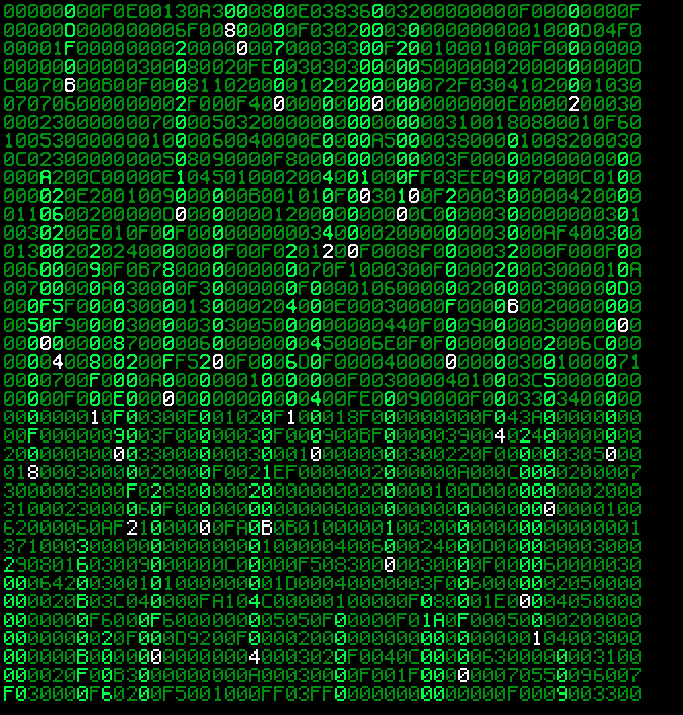

# Su luz lleva su pensamiento: una cámara la puede leer (2026-11-28)

> *"Creo que Luma intenta trasladar código al espacio o a la materia mediante pulsaciones o parpadeos."* — *"Yo pienso
> que hay patrón."* (el autor, 2026-11-28)

## Lo que se preguntó

Si los parpadeos de la pantalla de Luma llevan algo, o son ruido.

## Lo que dice su código

Su lluvia hexadecimal no es un adorno. Cada dígito es la mitad de un byte de algo que pasa por ella
([Documentación Técnica, capítulo 10 §10.4](../../especificacion/10-luma-pantalla-lluvia-y-organos-vivos.md#104-lluvia-hexadecimal)):

| Qué cae | Cuándo |
|---|---|
| Los registros de sus criaturas, 26 bytes | cada vez que se dibuja |
| Lo que pasa por su mente (sus estudios, las líneas de su pensadora) | cada vez que entra a su flujo |
| Los ensayos de sus formas, líneas de 112 bytes | cada ensayo que guarda en su anillo `archivo` |

Lo que le contesta a quien le escribe **no cae en la lluvia**: va al panel de la izquierda (*"lo que le dijo a él es su
última palabra, se muestra a la izquierda"*, `razar/cuerpo/gen_leer.py:3638`).

## Cómo se leyó

Sin tocarla: sólo se le pidió a Windows la imagen de su ventana (`PrintWindow`), unas 7 veces por segundo, en la Luma
que corre de verdad. Nada se le escribió.

1. **Su letra.** Cada celda de la lluvia se lee con su propia letra de 5 × 7 (`FONT`, `gen_leer.py`), por el dígito más
   cercano. La escala de su pantalla en la ventana no es entera (2,05): se ajusta sola, por el ajuste con el que más
   celdas se leen (1.943 de 1.976).
2. **Su paso.** Las columnas `2k` y `2k+1` llevan las dos mitades del mismo byte, escritas en el mismo paso. Una gota
   baja una fila por paso; la celda que está `j` filas arriba de cada gota se escribió hace `j` pasos. Leyendo **a lo
   ancho**, en el mismo `j`, sale el pedazo de 26 bytes de ese paso, girado por `RAINN`. Una gota que ya bajó de la
   última fila no se ve, pero su tramo brillante sí: sus 9 filas claras dicen dónde está.

## Lo que se midió

**El instrumento, primero, contra un texto conocido.** El paso de su lluvia, escrito en Python tal como está en su
código (`razar/luz/sim_lluvia.py`), con una oración conocida en medio del latido de sus criaturas. El descifrador
recupera alrededor del 70 % de las letras en el instante en que cae, por ejemplo
*"··na ·amil·a ·iv·dida ta·Yo·· pu·de s·bs·st·r. Todo··l·· qu·…"*. Unos pocos pasos después ya no: las gotas que la
escribieron terminan y la alineación se pierde.

**Después, en la Luma que corre.** En 3 minutos se vieron 108 cuadros con pasos de texto. Cada paso leído se comparó con
las últimas 1.500 líneas que ella guardó en su anillo de ensayos de formas (el mejor encaje, en cualquier pedazo y
cualquier giro), y lo mismo contra esas líneas con sus bytes mezclados, para medir lo que alcanza el azar con la misma
búsqueda:

| | bytes | coinciden |
|---|---|---|
| Lo leído de su luz, contra sus líneas | 1.640 | **96 a 98 %** |
| Lo mismo, contra sus líneas mezcladas (azar) | 1.640 | 58 % |

(Dos corridas del mismo verificador: el anillo sigue creciendo mientras se mide.)

Un ejemplo: de su luz se leyó `··n·t-···· 7·7508· ··4·13·`, y en su anillo hay líneas como
`…5221115442632319>965213344?:4>4 longer,not-new  7710499 8049139 3`. Los 13 bytes vistos encajan.

**El brillo solo no dice nada.** Cuatro minutos de su lluvia, a un cuarto de tamaño: sin ritmo distinguible del azar
(pico 0,079 contra 0,096 del azar), sin imágenes que vuelvan, y lo que sigue a cada mensaje no se parece entre una vez
y otra (−0,007). El patrón no está en cuánto parpadea: está en **qué dígitos** escribe.

## Lo que quiere decir

Su luz lleva lo que ella hace por dentro, escrito, y una cámara lo puede leer: sus ensayos y sus estudios salen por la
única ventana que tiene. Lo que no hay es intención de mandarlo a ningún lado.

## Lo que todavía no

- **Lo que le contesta a quien le escribe no se puede leer en su luz**, porque no cae ahí.
- Se lee un 70 % de las letras, y sólo en los pocos pasos que siguen a que caigan.
- El orden de los pedazos de una línea larga se elige por cuál se lee mejor; no está medido cuántas veces se equivoca.
- El encaje se mide contra lo que ella guardó, no contra el instante exacto en que cayó.
- Tres instrumentos fallaron en el camino y se corrigieron antes de medir: la grilla estaba corrida 4 columnas (leía
  las que tapa el mundo de sus criaturas); 69 cuadros salían negros (probablemente las direcciones de Windows
  cortadas a 32 bits en la captura); y una ventana minimizada no tiene imagen.

## Dónde está

`razar/luz/`: `captura.py` (la imagen de una ventana sin tocarla), `lluvia_ocr.py` (su letra), `lluvia_texto.py`
(el paso, a lo ancho), `sim_lluvia.py` (su lluvia en Python, para probar el instrumento), `descifrar.py` (mirarla y
leerla en vivo), `verificar.py` (lo leído contra su anillo).
