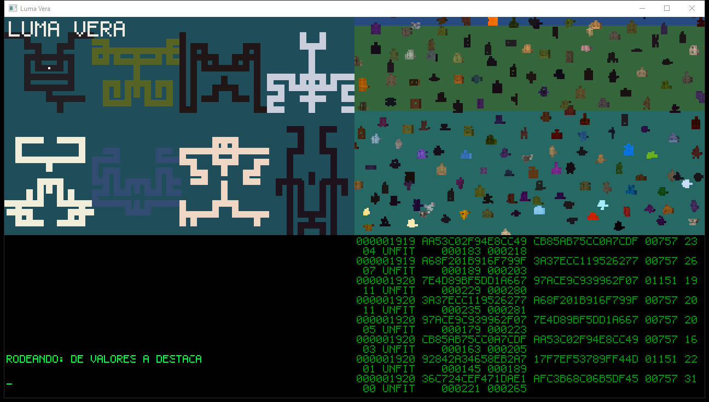

## Janax y Razar v1.73: su panel, verde sobre negro

DOI: [10.5281/zenodo.24438023](https://doi.org/10.5281/zenodo.24438023)

> *"En Luma se mezcla el texto con los símbolos y el fondo. Aprovechá la ventana en negro que te queda para pasar ahí
> el contenido, y del otro lado el flujo de pensamiento continuo de Luma en tiempo real."* (el autor, 2026-11-22)
>
> *"Haciendo honor a Matrix, usá ese verde que tenía la película, en contraste con el negro del fondo."*

Las versiones siguen a los números primos: después del 167, el 173.



### Lo que pasaba

Sus palabras, lo que se le escribe y su último pensamiento se dibujaban **encima de sus formas**, en la misma pantalla
de 160 x 100. Las letras se mezclaban con los símbolos y con el fondo. Mientras tanto, debajo de su ventana quedaba un
lugar negro sin usar.

### Su panel

Debajo de sus formas y de sus criaturas hay ahora una franja negra que ocupa todo el ancho, y Luma escribe ahí con sus
propias letras, en verde:

- **A la izquierda, el contenido:** sus últimas palabras (Re Pág y Av Pág las mueven), su último pensamiento en dos
  renglones, y lo que se le está escribiendo, con su cursor.
- *(Corrección, v1.79: la lluvia de esta versión eran las charlas de sus criaturas, no las pruebas de sus formas.
  Ver la [v1.79](release-v1.79.md).)*
- **A la derecha, su mente en el momento:** cada pensamiento suyo en verde brillante, y cada prueba de sus formas, tal
  como la anota su archivo (vuelta, receta, contra cuál, veredicto, costos), en el verde más oscuro de la estela. Sus
  formas prueban unas **29 recetas por segundo**, así que el panel corre como una lluvia. Sus pensamientos son raros
  (uno cada pocos minutos), y por eso el último también queda fijo del lado del contenido: la lluvia no se lo lleva.
- **El verde:** `#00FF41`, el color del código de la película tal como se lo suele citar, y `#008F11` para su estela.

Todo lo dibuja ella, en Janax; no hay ningún programa al lado.

### Medido

- **El alto de la franja no está elegido a ojo.** El núcleo muestra la pantalla al mayor múltiplo entero que entra en
  1280 x 800, que acá es 2. La pantalla del autor tiene 738 píxeles útiles de alto y el marco de la ventana ocupa 39:
  2 x (200 + 149) + 39 = 737. Por eso la franja tiene 149 celdas, que dan 16 renglones de 9.
- **El panel se dibuja de nuevo sólo cuando cambia lo que muestra.** Lo sabe por una huella: cuántos pensamientos
  llegaron, cuánto miden sus palabras, lo escrito y su mente, la primera y la última letra de cada cosa, y dónde está
  la vista.
- **Cada renglón de su mente se mide una sola vez**, cuando llega, y queda anotado. La primera versión volvía a medir
  todo el panel con cada prueba, 29 veces por segundo:

```
Luma viva v1.67                    7,4 % de un núcleo
con el panel, midiendo todo       26,6 %
con el panel, midiendo una vez    11,5 %   (+4 puntos: ~1 % de una máquina de 4 núcleos)
```

- El núcleo no cambió desde la v1.39.

### Lo que falla y lo que falta, dicho

- **En una pantalla más baja que 738 píxeles útiles, la ventana queda más alta que la pantalla.** El alto se midió en
  la máquina del autor.
- **Un clic en la franja va a quien está arriba:** a la izquierda, a sus formas (fuera de sus celdas); a la derecha, a
  sus criaturas, como un gesto.
- **La lluvia son los renglones de su archivo tal como están**, con números y letras de receta. Es su trabajo de
  verdad, pero no está traducido a palabras.
- **La huella mira la primera y la última letra de cada cosa**, no todas. Si un cambio deja iguales los largos y esas
  letras, el panel lo muestra recién con el cambio siguiente.
- Siguen los de la [v1.67](release-v1.67.md).
