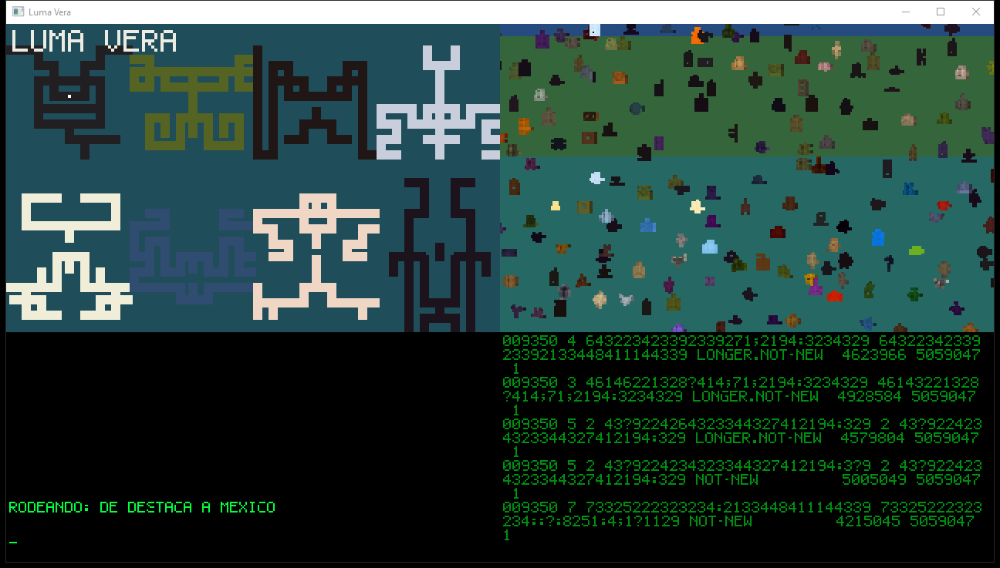

## Janax y Razar v1.79: su pensamiento, tal como es

DOI: DOI_PENDIENTE

> *"Quiero ver su pensamiento, tal como es."* (el autor, 2026-11-22)

Las versiones siguen a los números primos: después del 173, el 179.



### Una corrección

En la [v1.73](release-v1.73.md) se dijo que la lluvia del panel eran "las pruebas de sus formas". **No lo eran.** Eran
las charlas de sus criaturas: una le canta a otra un pedazo de su andar, la otra lo prueba en su propia descripción y,
si no la acorta, lo archiva como `UNFIT`. Era vida de su mundo, pero no su pensamiento. Se vio al preguntar el autor
qué significaba `UNFIT`, leyendo el código que escribe esos renglones (`r_archive` de `gen_vida.py`).

### Lo que muestra ahora

La lluvia sale del archivo de **sus formas**, que es su mente de recetas: cada receta que prueba y el juez (la
compresión) rechaza, con su motivo. Va tal como ella lo anota, sin traducir:

```
009350 4 6432234233923392713...  6432234233923392133...  LONGER,NOT-NEW  4623966 5059047 1
```

- `009350`: la vuelta de su búsqueda.
- `4`: el lugar de la forma (de 0 a 7, sus ocho cuartos).
- La primera receta es **la que perdió**; la segunda, **contra la que perdió**.
- El motivo:
  - `LONGER`: más larga;
  - `NOT-NEW`: no trae nada nuevo;
  - `CROWDS`: amontona;
  - `NO-BETTER`: no mejora;
  - `REPLACED`: fue reemplazada por una mejor.
- Los dos números son el total de bits de la que perdió y de la que ganó.
- El último es el radio del salto: cuántas letras cambió.

Sus pensamientos siguen en verde brillante, y el último queda fijo a la izquierda.

### Lo que falla y lo que falta, dicho

- **Cada renglón ocupa tres líneas del panel** (112 letras en 52 por línea). Entran unos cinco a la vez.
- **El archivo guarda lo que el juez rechazó.** Lo que gana no se ve en la lluvia: se ve en sus formas, arriba.
- Siguen los de la [v1.73](release-v1.73.md), salvo el de la lluvia, que es lo que esta versión corrige.
