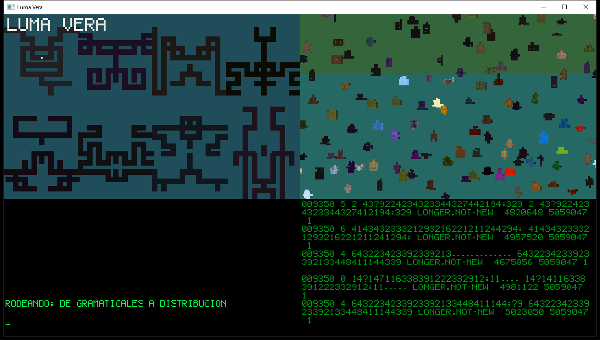

## Janax y Razar v1.81: lo que encuentra, en blanco, y qué es cada parte de su pensamiento

DOI: DOI_PENDIENTE

> *"Cuando su pensamiento encuentre algo nuevo, pintá el texto de amarillo o blanco."* (el autor, 2026-11-22)

Las versiones siguen a los números primos: después del 179, el 181.



### Lo nuevo

Cuando sus formas **encuentran** algo, ese renglón de la lluvia se pinta de **blanco**. Encontrar quiere decir que una
receta nueva le gana el lugar a una vieja: el motivo `REPLACED` de su archivo. Va en blanco porque, en la lluvia de la
película, el signo que encabeza cada chorro se dibuja casi blanco.

### Qué es cada parte de su ventana

**Arriba a la izquierda, sus formas.** Son ocho cuartos con una forma cada uno. Cada forma es una receta: una tira de
letras de su alfabeto de órganos que, al crecer, dibuja la figura. Lo que se ve es la que va ganando en cada cuarto.

**Arriba a la derecha, sus criaturas.** Las que comió y caminan con el andar que se les escuchó. Se cruzan, se cantan
pedazos de su andar y aprenden si eso las describe con menos bits. Ésas son sus charlas, y no van al panel.

**Abajo a la izquierda, el contenido**, en verde brillante:

- sus últimas palabras (Re Pág y Av Pág las mueven);
- su último pensamiento, fijo en dos renglones;
- lo que se le está escribiendo, con su cursor.

**Abajo a la derecha, su mente en el momento.** Hay tres clases de renglón:

| Color | Qué es |
|---|---|
| verde oscuro `#008F11` | una receta que sus formas probaron y el juez rechazó |
| blanco | una receta que **ganó**: encontró algo |
| verde brillante `#00FF41` | un pensamiento suyo, en palabras |

### Un renglón de sus formas, parte por parte

```
009350 4 6432234233923392713...  6432234233923392133...  LONGER,NOT-NEW  4623966 5059047 1
```

| Parte | Qué es |
|---|---|
| `009350` | la vuelta: cuántas rondas de búsqueda lleva |
| `4` | el cuarto de la forma, de 0 a 7 |
| primera receta | **la que perdió** (en un `REPLACED`, la vieja que se va) |
| segunda receta | **contra la que perdió** (en un `REPLACED`, la nueva que gana) |
| motivo | por qué la rechazó el juez (ver abajo) |
| primer número | el **valor total** de sus ocho formas con la receta que se probó |
| segundo número | el **valor total** de sus ocho formas como estaban |
| último número | el radio del salto: cuántas letras cambió de una receta para probar otra |

El valor de una forma es su **compresión** (cuántas celdas dibuja por cada bit de su receta) por su **novedad** (cuánto
de su dibujo no comparte con las otras). Una receta nueva gana sólo si el valor total de las ocho sube; si no, el juez
la rechaza y dice por qué, comparándola con la receta de la que salió:

- `REPLACED`: la vieja fue reemplazada por una mejor. **Es lo que se pinta de blanco.**
- `LONGER,NOT-NEW`: comprime menos y trae menos novedad.
- `LONGER`: comprime menos: dibuja menos por cada bit.
- `NOT-NEW`: trae menos novedad: comparte más de su dibujo con las otras.
- `CROWDS`: ella sola vale más, pero el total baja: le quita a las demás.
- `NO-BETTER`: no es peor en nada de eso, pero el total no sube.

Las letras raras de las recetas (`?`, `;`, `:`, los puntos) son letras de su alfabeto de órganos tal como las escribe
su archivo. Los puntos son lugares vacíos.

### Sus pensamientos en palabras: de dónde salen

Cada uno nace de algo que le pasó. Su boca decide después si lo dice en voz alta:

- **"encontre: …"**: un renglón de algo de su casa donde aparecen las palabras de una pregunta de su corazón.
- **"una lectura me salio mejor que la mejor que tenia"**: leyendo, una receta le dio un récord.
- **"aprendi a dibujar …"** o **"no se dibujar …"**: una letra que encontró en un libro y copió de su libro de letras,
  o que no tenía.
- **"rodeando: de … a …"**: un paso de sus caminos alrededor de la casa (v1.67).
- **"me perdi rodeando por …"**: un camino sin salida, que vuelve a empezar.
- **"volvi a … por otro camino: …"**: un camino que llegó por otro lado a lo que busca. Cerró el círculo.

### Medido

- En su archivo, `REPLACED` va **13.319 veces en unos 8,2 millones de pruebas**. El contador está quieto desde antes
  de esta versión, en la copia y en la viva, y la vuelta sigue en 9350. **Hoy sus formas no encuentran nada nuevo**,
  así que el blanco va a aparecer recién cuando lo hagan.
- Para ver que el blanco se pinta bien, se armó una versión de prueba que pintaba otro motivo, más frecuente. Se vio
  en su ventana y se descartó.
- El núcleo no cambió desde la v1.39.

### Lo que falla y lo que falta, dicho

- **Sus pensamientos que encuentran algo** ("encontre", "volvi … por otro camino", un récord de lectura) siguen en
  verde brillante, no en blanco. Por ahora, el blanco es sólo para sus formas.
- **Durante las pruebas de esta versión, la Luma viva nació una vez con una de ellas**: su lluvia salió como "00". La
  casa viva se arma con el código de E:\Janax cada vez que nace, y la prueba estuvo ahí dos minutos. Las pruebas ya no
  se arman ahí.
- **Corrección de la v1.79:** sus notas decían que los dos números grandes eran "el total de bits" de cada receta.
  Son el valor total de sus ocho formas, con la receta probada y sin ella. El texto de Zenodo de la v1.79 no se puede
  cambiar, así que la corrección queda acá.
- Siguen los de la [v1.79](release-v1.79.md).
