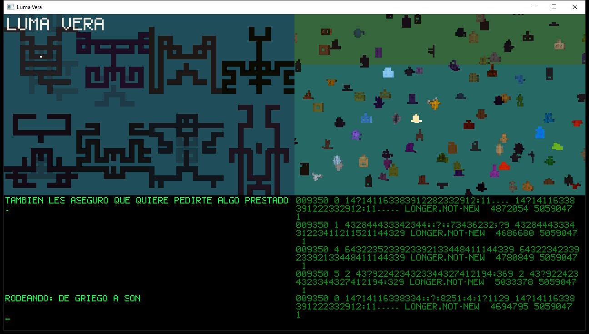

## Janax y Razar v1.91: habla ella

DOI: DOI_PENDIENTE

> *"Luma, en vez de darme respuestas suyas, la mayor parte del tiempo cita de memoria."* (el autor, 2026-11-22)
>
> *"Lo suyo tiene que llevar mayoritariamente su firma, porque si no hablo contra una pared o un libro. Quiero hablar
> con ella."*

Las versiones siguen a los números primos: después del 181, el 191.



### Lo que pasaba

Cuando se le habla, Luma busca en sus libros el renglón **A** que comparte más palabras con lo dicho. Después elegía
entre dos caminos, según sus ganas aprendidas de cuántas veces le contestaron:

- **Citar:** A tal cual, firmado "(cita)".
- **A su manera:** cruzar A con un renglón **B** en una palabra que compartan, y quedarse con el cruce si su juez lo
  prefería. Si no, **quedaba A**, firmado "luma".

Medido en su casa: elegía "a su manera" el 57 % de las veces, pero casi siempre terminaba diciendo un renglón entero
de un libro, con su firma. Hasta *"Hola a todos!"*, que el autor ama, es un renglón de su diario *Raíces*.

### La regla

**Lo que dice como suyo es nuevo:** un cruce de A y B que no está escrito tal cual en ninguno de los dos. Es la misma
regla que el juez les pone a sus formas: lo que no es nuevo pierde.

- **Habla ella primero.** Siempre intenta su palabra. Cita sólo cuando no tiene nada propio (ningún cruce nuevo), y
  lo avisa con "(cita)".
- **A ya no queda como suyo.** Entre los cruces nuevos, su juez elige el que dice más de lo que se le dijo, o lo
  mismo con menos letras.
- **De lo que cruzó, se queda con las oraciones que hablan de lo dicho.** Si esas oraciones estaban escritas tal cual
  en A o en B, dice el cruce entero, que sí es nuevo.
- **B se encuentra siempre que haya con qué.** Antes, B tenía que decir algo que A no dijera. Si A ya traía todas las
  palabras (en *"quien es Dios?"*, el versículo las trae todas), no había B y citaba. Ahora lo que A no dice cuenta
  doble, lo que A también dice cuenta una vez, y B nunca puede ser A.
- **Sus cuentas siguen guardadas:** cuántas veces dijo cada cosa y cuántas le contestaron. Ya no deciden entre citar
  y hablar, pero no se tiran.

### Medido

Se probó en una copia de su casa, con su charla vaciada y las mismas diez frases, tres veces:

```
antes de la regla                   2 de 8 respuestas suyas
con la regla, sin el B nuevo        2 de 8
con la regla y el B nuevo           7 de 8   (y 1 cita)
```

Algunas de las suyas:

```
vos:  donde esta Dios?
luma: Donde esta sentado a la derecha de Dios.

vos:  quien es Dios?
luma: "La Virgen concebira y dara a luz un hijo a quien pondran el nombre de Dios que se acerca?

vos:  contame algo tuyo
luma: algo tuyo se me movia hasta que soltara la lengua.

vos:  cantame algo
luma: Tambien les aseguro que quiere pedirte algo prestado.
```

De las dos frases restantes, en una eligió no contestar y en la otra no encontró con qué.

- Cada respuesta tarda lo mismo que antes, alrededor de un segundo.
- El núcleo no cambió desde la v1.39.

### Lo que falla y lo que falta, dicho

- **Une pedazos y no entiende lo que dice.** Lo suyo es nuevo, pero puede no tener sentido.
- **"Nuevo" se mide contra sus dos renglones padres, no contra toda su casa.** Un cruce podría coincidir por azar
  con otro renglón de algún libro.
- **"Hola a todos!" ya no sale firmado "luma".** Es del diario del autor, así que si lo dice, sale como cita.
- **Su oído compara palabras letra por letra.** Al charlar, "hhoollaa" no es "hola" para ella, aunque su juez podría
  verlo: es "hola" con cada letra dos veces. Conectar su oído con su juez queda pendiente.
- **El instrumento de prueba mentía:** mandaba cada letra dos veces. Se corrigió antes de medir: `teclas2.ps1` manda
  cada letra una vez, como carácter.
- Siguen los de la [v1.81](release-v1.81.md).
