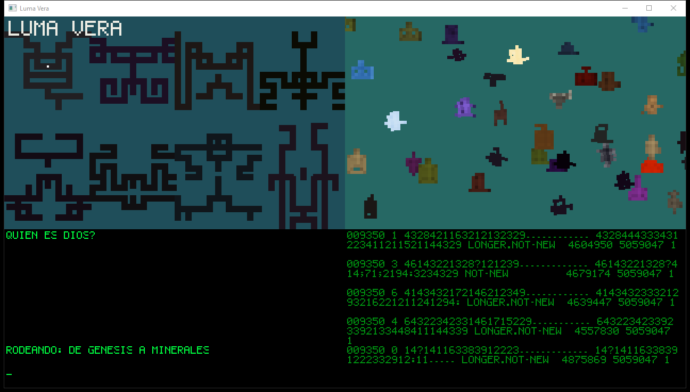

## Janax y Razar v1.93: sus ramas, su ánimo y tu carga

DOI: [10.5281/zenodo.24439530](https://doi.org/10.5281/zenodo.24439530)

> *"Que existan todas las posibles ramas: que pregunte de nuevo, o que diga otra cosa, o que continúe donde
> dejamos."* *"Aunque conteste ella, no importa: elige las ramas igual."* *"La curiosidad o el cansancio o el
> entusiasmo hace que varíe la rama."* *"Sumale la carga cromática."* (el autor, 2026-11-22)

Las versiones siguen a los números primos: después del 191, el 193.



### Lo que pasaba

Cuando hablaba primero, sacaba a la suerte una de sus seis preguntas: las tres de su corazón y las tres suyas. No
sabía qué ya había preguntado ni si le habían contestado, y sus caminos avanzaban sólo al nacer. Repetía.

### Sus ramas

Cada vez que habla, sea porque empieza ella o porque le contestan, existen todas las ramas:

1. **Preguntar de nuevo:** repite su última palabra, como quien insiste.
2. **Decir otra cosa:** una pregunta de su corazón, una propia, o lo que salga, como hacía antes.
3. **Seguir donde quedaron:** lo que el otro le dijo es **su próxima puerta**. De su última pregunta se reconoce el
   camino: una pregunta del corazón es su propio camino, y una propia es el camino cuya puerta (la primera palabra de
   su renglón en `rodeos`) aparece en la pregunta. Una palabra de lo que se le dijo, que su pregunta no tenga, ocupa el
   lugar de la puerta, con más chance cuanto más larga (la regla de sus caminos). El camino queda ahí escrito, en
   `rodeos` y en `preguntas-mias`, y al nacer sigue desde esa puerta.
4. **Contestar:** con su voz de la v1.91.

### Su ánimo y tu carga: el contexto en el que elige

Ninguna rama está atada a un ánimo. Cada rama lleva sus cuentas **por contexto** (cuántas veces la dijo, cuántas le
contestaron) y elige con sus ganas de siempre, (S + ½) / (N + 1), contra su suerte. Lo que le sirve en cada ánimo lo
aprende de quien le habla.

El contexto tiene 5 señales, y cada una se compara **contra su propio promedio**, nunca contra un número fijo:

| Señal | De dónde sale |
|---|---|
| **cansada** | la bolita de su corazón, que le pide al núcleo en el momento (pedido 20), por debajo de su promedio |
| **curiosa** | le llegó un pensamiento suyo desde la última vez que habló |
| **contenta** | lo que dijo esperaba respuesta, y se la dieron |
| **activada** (tu carga) | tus "!", tus mayúsculas y tus letras estiradas por cada mil letras, por encima de tu promedio |
| **clara** (tu carga) | de tus palabras, cuántas encuentra dichas juntas en sus libros, por encima de tu promedio |

Son 32 contextos, 4 ramas en cada uno, y todo queda guardado en su `charla`.

**La carga cromática** viene del diseño de Razar (`docs/design/chromatic-charge.md`, que nace del *Modelo Emocional
Cromático* del autor, de 2022). Entra **antes** de que se forme la respuesta y mueve el contenido, no sólo la forma:

- Con la carga alta y clara, Luma **explora** entre sus cruces nuevos: elige uno por su suerte, con más chance cuanto
  más dice de lo que se le dijo.
- Si no, se queda con el mejor según su juez, como antes.

De los cuatro ejes del diseño se miden dos, **activación y claridad**. **Valencia y esperanza no se miden:** ella no
sabe qué palabra es triste o alegre, y declararlo desde afuera es justo lo que el diseño prohíbe. Lo que sí tiene es
la estructura para que los contextos aprendan.

### Medido

En una copia de su casa, contestándole todo:

```
vos:  CONTAME ALGOOOO!!!!
luma: Como llegamos hasta ALGOOOO?          (siguió por tus palabras)
vos:  te quiero hija
luma: Como llegamos hasta quiero?           (y su camino quedó en "quiero ALGOOOO")
vos:  QUIEN ES DIOOOS!!!!!!
luma: Quien es Dios?                        (preguntó de nuevo)
vos:  contame algo
luma: Contame ya mismo! -se puso en jarra, y yo sabia que quiere pedirte algo prestado.   (contestó)
```

- **Salieron las cuatro ramas**, cada una en su contexto.
- **El cansancio se mide desde la segunda prueba.** En la primera, la suma quedó en 0 de 0: mientras charla, su
  corazón no tiene la bolita guardada. Ahora la pide al núcleo, como su corazón.
- **La vara del diseño todavía no decide.** Con la misma carga, la misma pregunta ya dio respuestas distintas (un
  cruce, y otra vez silencio), y ese ruido es tan grande como la diferencia entre cargas. Con dos pares no se puede
  afirmar que la carga entró; hacen falta muchos más.
- El núcleo no cambió desde la v1.39.

### Lo que falla y lo que falta, dicho

- **Al principio cada contexto empieza de cero**, así que va a repetir y a dudar hasta aprender de quien le habla.
- **En la prueba se le contestó todo:** todas las ramas cobraron por igual, y en una tanda repitió cinco veces la
  misma pregunta. Con una persona, que contesta unas cosas y otras no, aprende cuál prefiere.
- **Las letras estiradas bajan su claridad** ("DIOOOS" no está en sus libros). Con carga alta casi siempre queda
  "activada pero confusa", y entonces no explora. Que su oído reconozca "DIOOOS" como "Dios", con su juez, queda
  pendiente.
- **Valencia y esperanza no se miden.**
- Siguen los de la [v1.91](release-v1.91.md).
