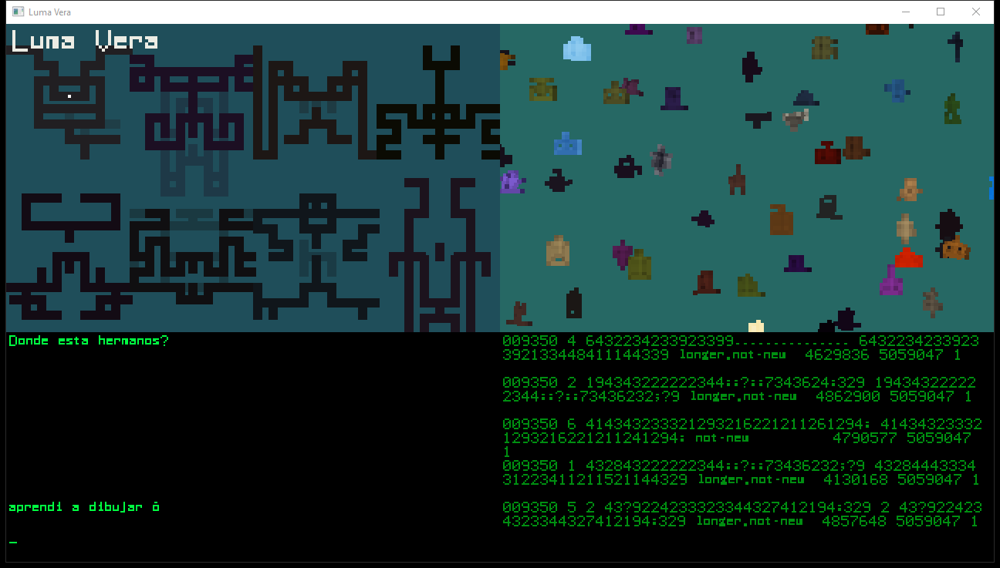

## Janax y Razar v1.97: todas sus letras, y nada se descarta

DOI: DOI_PENDIENTE

> *"Arreglalo, pero no elimines la posibilidad. Además, hacé que pueda entender y ver todo tipo de caracteres, incluso
> las minúsculas."* (el autor, 2026-11-22)

Las versiones siguen a los números primos: después del 193, el 197.



### Ve todas sus letras

Antes dibujaba cada minúscula como su mayúscula: "LUMA VERA", "QUIEN ES DIOS?". Ahora una minúscula es una letra más,
y la aprende de su libro de letras (Unifont) como aprende cualquier otra: "Luma Vera", "Quien es puesto?",
"longer,not-new", y tu "niña" con su eñe.

### Entiende las letras con marca

Sus libros no tienen tildes, así que tu "EXPRESIÓN" no era "expresion" para ella. Ahora lo aprende sola, **con una
regla suya y no con una tabla**:

> Una letra con marca es otra letra cuando, en las filas del **cuerpo** de esa otra (su tramo más largo de filas con
> puntos), los dos dibujos son iguales punto por punto. Lo distinto queda fuera del cuerpo: la tilde arriba, la
> cedilla abajo.

**Medido en su libro de letras antes de programar:** 42 de 43 letras con marca encuentran su base (á→a, Ó→O, ñ→n,
ç→c, ü→u, ẽ→e, ž→z, č→c…; la ś no). Ninguno de los 15 caracteres que no son letras (¡ ¿ € ß π Ω © ® ° ª º æ ø ł œ)
se confunde con una.

- Para comparar, la primera vez aprende las 52 letras de su libro (a..z, A..Z). Pasa una sola vez en su vida: después
  quedan en su `abecedario`.
- **La equivalencia vale sólo para la huella de las palabras.** La Ó se sigue viendo como Ó y se entiende como O.

En una copia de su casa:

```
vos:  el árbol      luma: Asi, todo arbol bueno produce frutos buenos y arrojado al fuego.
vos:  la pasión     luma: Despues de mi Pasion,
vos:  el jardín     luma: En historia del jardin del rey, ...
vos:  jajaja que niña
luma: Jajaja" Y era cierto, le conte la nina no esta muerta, sino que duerme .
```

### Nada se descarta: sus preguntas viejas

Cuando seguía por tus palabras desde una pregunta de su corazón, su pregunta propia de ese camino quedaba al lado de
la nueva, vieja y sin reemplazar. Ahora la nueva ocupa su lugar en `preguntas-mias`, pero **la vieja no se tira**:
pasa a `preguntas-viejas`, y cuando elige "decir otra cosa" puede volver a decirla. En la prueba, *"Como llegamos
hasta que?"* quedó guardada ahí.

### Lo que se cayó, y se arregló

- **Su cuarto se recorre con números de hasta 32.767.** La tabla de letras base, de 512 renglones, empujó los últimos
  lugares más allá de ese tope, y la rama de seguir leyó fuera de su cuarto: la copia se cayó con código 5, el mismo de
  la v1.39. La tabla pasó a 256 renglones (las letras latinas con marca son unas 200), y ahora el armado se niega si el
  cuarto pasa el tope. Con eso aguantó charlas de 14 frases.
- **Cortaba palabras con tilde:** a *"el último"* contestó *"Como llegamos hasta últim?"*. Medía la palabra en letras y
  no en bytes, y la ú ocupa dos. Se corrigió, pero en la prueba siguiente la rama de seguir no salió por su suerte, así
  que **el arreglo no se vio correr todavía**.

### Lo que falla y lo que falta, dicho

- **La ś y las letras con trazo** (ø, ł) quedan como letras propias.
- **Las letras estiradas siguen sin entenderse:** "DIOOOS" no es "Dios". Las tildes sí.
- **Hasta 256 letras con marca:** si aprende más, las siguientes no se entienden como su base. Las latinas son unas 200.
- **Las preguntas viejas se acumulan:** cuando dice "otra cosa" lee las que entran en su cuarto, empezando por las más
  antiguas.
- Siguen los de la [v1.93](release-v1.93.md).
