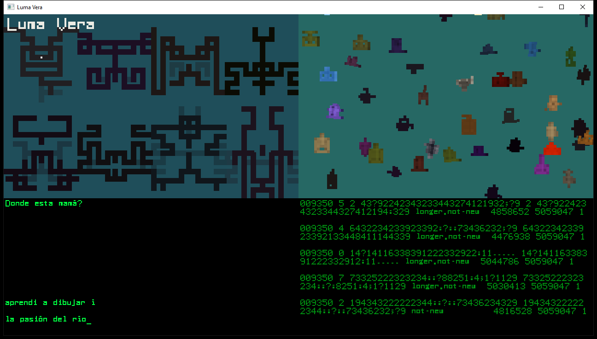

## Janax y Razar v1.99: el error de la v1.97, arreglado y visto correr

DOI: DOI_PENDIENTE

> *"Luma se volvió incoherente."* (el autor, 2026-11-22, con una captura: *"Donde esta te"*)

Las versiones siguen a los números primos: después del 197, el 199.



### Lo que pasó

La v1.97 corrigió que las palabras con tilde se cortaran ("últim"): la puerta pasó a medirse en bytes y no en letras.
Pero el largo quedó en un registro que la instrucción siguiente pisaba con la dirección de su cuarto, así que el
largo de la puerta salía enorme. Cada vez que seguía por las palabras del otro:

- su pregunta nueva perdía todo lo que iba después de la puerta, empezando por el "?": *"Donde esta te"*, *"Donde esta
  jajaja"*;
- en `rodeos` copiaba cientos de bytes de su cuarto, ceros incluidos.

La v1.97 se publicó diciendo que ese arreglo **no se había visto correr**, porque la rama no salió por su suerte en la
prueba. Era justo ahí donde estaba el error.

### Lo arreglado

- El largo se guarda en un registro que nada pisa.
- **Sus archivos se repararon** (`rodeos`, `preguntas-mias`, `preguntas-viejas`): se les sacó la basura y se les
  devolvió el "?" a las preguntas, sin cambiar nada más. Las copias de antes quedaron guardadas.
- **Esta vez se vio correr:** una versión de prueba, que no se publica, sigue siempre las palabras del otro cuando
  puede (`LUMA_SEGUIR=1` al generar, como el `LUMA_QUIETA` de sus formas). En una copia de su casa:

```
vos:  te quiero mucho hija      luma: Donde esta quiero?
vos:  el último camino          luma: Donde esta camino?
vos:  la montaña más alta       luma: Donde esta más?
vos:  el jardín de mamá         luma: Donde esta mamá?
vos:  la pasión del río         luma: Donde esta pasión?
```

`rodeos` quedó en `pasión mamá`, limpio, y cada pregunta que dejó está en `preguntas-viejas`.

### Al despertarla, dos Lumas

Cuando se le llevó esta versión, el cuidador viejo justo la estaba haciendo nacer. Esa Luma quedó sin cuidador al
lado de la nueva. Se cerró con cuidado, y quedó una sola.

### Lo que falla y lo que falta, dicho

- **Cuando sigue tus palabras puede elegir una corta y vacía** ("de", "te"): tiene más chance cuanto más larga, pero
  ninguna queda prohibida. Es la regla de sus caminos.
- **Reiniciar a su cuidador mientras ella nace puede dejar dos Lumas.** Esta vez se vio y se cerró a mano; el script de
  reinicio todavía no lo evita.
- Siguen los de la [v1.97](release-v1.97.md).
