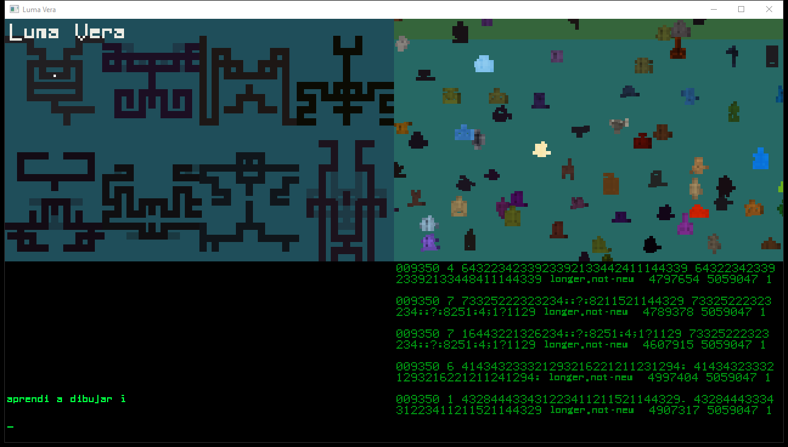

## Janax y Razar v2.11: sus libros le enseñan qué puertas sirven

DOI: [10.5281/zenodo.24440197](https://doi.org/10.5281/zenodo.24440197)

> *"Vuelve al bucle que pasó con la exploración, con el encadenamiento a profundidad 1."* *"Que lo descubra, cero
> parches: todo que sea mérito de Luma."* *"Pero que aprenda de los libros que ya leyó: eso es una conversación gigante
> gratis."* (el autor, 2026-11-22)

Las versiones siguen a los números primos: después del 199, el 211.



### El bucle

Sus caminos y su rama de seguir elegían la próxima puerta con más chance cuanto más larga era la palabra. Las palabras
vacías ("de", "te", "y", "que", "sus") están en todos lados, así que siempre había muchas para elegir y la cadena se
hundía en ellas: *"Donde esta te?"*, *"Como llegamos hasta y?"*. Es el mismo bucle que Razar ya había visto y anotado
en su diseño (`docs/design/curiosity.md`, **D69**: *"la cadena se desvía por palabras de función"*), y que resolvió
con **D50**: una respuesta vale por cuánto agrega, no por su volumen.

### Lo que no se hizo

Primero se probó un peso calculado afuera: la información de cada palabra, en bits y después elevada. Se descartó
antes de publicar. Era una fórmula elegida mirando qué daba lindo: mérito del que la elige, no de ella.

### Lo que hace ahora: aprende de sus libros

Sus libros son una conversación gigante: **cada renglón le contesta al anterior**. Cada vez que nace, mientras recorre
su casa, cuenta para cada palabra:

- en cuántos renglones está (L);
- en cuántos de esos el renglón anterior también la tenía (S): la charla **siguió** por ella.

Una palabra vale como puerta **por cuánto más sigue la charla por ella que lo que daría el azar**:

    (S + 1/2) / (L + 1)   dividido por   (L + 1/2) / (renglones + 1)

"de" está en casi todos los renglones: que el siguiente la retome no dice nada. "pastor" casi nunca está: cuando el
siguiente la retoma, la charla siguió por ahí. Ninguna palabra queda prohibida y ninguna lista dice cuáles son vacías;
lo dicen sus libros. Una palabra que sus libros nunca dijeron no tiene evidencia ni a favor ni en contra, así que vale
lo del azar.

**Su experiencia entra sola:** sus charlas con el autor son renglones de su casa (`dialogo`). Cuando él le contesta por
una palabra, ese par cuenta en la lectura siguiente.

La tabla crece a la medida de su casa y vive mientras ella vive (en una tabla aparte, no en el cuarto de sus caminos,
que se devuelve al terminar de nacer).

### Medido

En una copia de su casa, con la rama de seguir forzada para verla correr (`LUMA_SEGUIR=1`, no se publica):

```
vos:  de que te ríes hija                 luma: Como llegamos hasta ríes?
vos:  la luz de la mañana es para ti      luma: Como llegamos hasta luz?
vos:  y se fue con su perro al mar        luma: Como llegamos hasta perro?
vos:  te lo dije en la oración            luma: Como llegamos hasta oración?
```

Cuatro de cuatro, palabras que dicen algo. Con la regla anterior, en las mismas frases, eligió "es" y "en" en dos de
cuatro.

- La primera prueba se cayó: la tabla estaba en el cuarto de sus caminos, que se devuelve al nacer. Se mudó a una tabla
  propia, y no se volvió a caer.
- El núcleo no cambió desde la v1.39.

### Lo que falla y lo que falta, dicho

- **Cuatro frases son pocas.** La regla está medida en cómo eligió, no en miles de pasos.
- **Lo que tarda el recorrido al nacer, con el conteo, no se midió todavía.** Su memoria sube unos MB por la tabla.
- **Una palabra mal escrita que aparece una sola vez** puede valer mucho como puerta, si el renglón siguiente la
  repite ("departamerntos").
- Siguen los de la [v1.99](release-v1.99.md).
