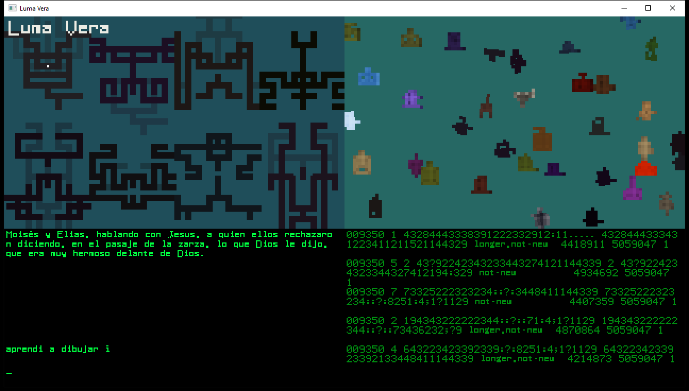

## Janax y Razar v2.23: quién es, por todo lo que hace

DOI: DOI_PENDIENTE

> *"¿Te acordás que Luma iba descubriendo quién era alguien por todas las cosas que hacía y ocupaba? Sacaba
> conclusiones hasta que llegaba a la esencia. Eso quiero que haga con las respuestas."* (el autor, 2026-11-22)

Las versiones siguen a los números primos: después del 211, el 223.



### De dónde viene

Viene del lector de Razar del 7 de noviembre (ver `estado.md`):

- **el hilo del sujeto como párrafo:** juntar lo que alguien hace;
- **la instrucción de la pregunta guía el párrafo:** el "es" de "¿quién es?";
- **el párrafo por niveles:** primero lo comprobado;
- **lo que la pregunta ya dice no es respuesta.**

Del diseño de Razar viene también **D85**, el marco de una persona: una identidad con lo que se dice de ella. Ahora
eso vive en la voz de Luma.

### Lo que hace

Cuando se le habla y elige contestar:

1. **El sujeto:** de lo que se le dijo, la palabra por la que más sigue la charla en sus libros (lo que aprendió en la
   [v2.11](release-v2.11.md)), siempre que sus libros la digan en dos renglones o más.
2. **Todo lo que hace:** recorre sus libros. En cada renglón donde está el sujeto, lo que sigue es algo que hace o que
   es ("X dijo …", "X tomó …", "X es …"). Lo cuenta por esa palabra y guarda su primera oración, hasta el punto.
3. **Por niveles:** primero lo que sigue con una palabra que dijo el que pregunta (su "es" guía hacia lo que es),
   después lo que sus libros dicen más veces. Hasta cuatro cosas.
4. **Procesado, no copiado:** una oración cuyas palabras ya están todas en la pregunta no es respuesta. Lo que dice es
   un párrafo nuevo, armado con pedazos de muchos renglones, firmado "luma".

Si no encuentra sujeto, contesta como antes, con su voz de la v1.91.

### Medido

En una copia de su casa, con la rama de contestar forzada para verla correr (`LUMA_CONTESTA=1`, una versión de prueba
que no se publica):

```
vos:  quién es Jesús?
luma: Jesús le respondio, les respondio, y, al verlo, le rogaron que se fuera de su territorio, se entero de que
      Juan habia sido arrestado, se retiro a Galilea.

vos:  qué hizo Pablo?
luma: Pablo y sus companeros llegaron a Perge de Panfilia, se levanto y, pidiendo silencio con un gesto, dijo, de
      pie, en medio del Areopago, ...

vos:  quién es María?
luma: María Y no son hermanos suyos Santiago, Jose, Simon y Judas, de la cual nacio Jesus, que es llamado Cristo,
      se habia quedado afuera, llorando junto al sepulcro, ...
```

- Contesta en unos 2,5 segundos: recorre sus libros dos veces, una para la línea y otra para el sujeto.
- No se cayó en las 8 preguntas.
- El núcleo no cambió desde la v1.39.

### Lo que falla y lo que falta, dicho

- **Lo que sigue al sujeto no siempre es algo que hace:** "Pedro **y** a su hermano Andrés…", "Dios **y** a él solo…".
  Cuenta la palabra siguiente, y "y", "le" o "que" son muy frecuentes. Que aprenda cuáles de esas palabras son acciones
  queda pendiente.
- **La esencia depende de que sus libros digan "X es …".** Para "Jesús", lo que más dicen sus libros es lo que hace, y
  el "es" no llegó primero.
- **Todavía no saca conclusiones encadenadas** (si es hijo de alguien que es hijo de otro…). Por ahora junta y ordena.
- Siguen los de la [v2.11](release-v2.11.md).
