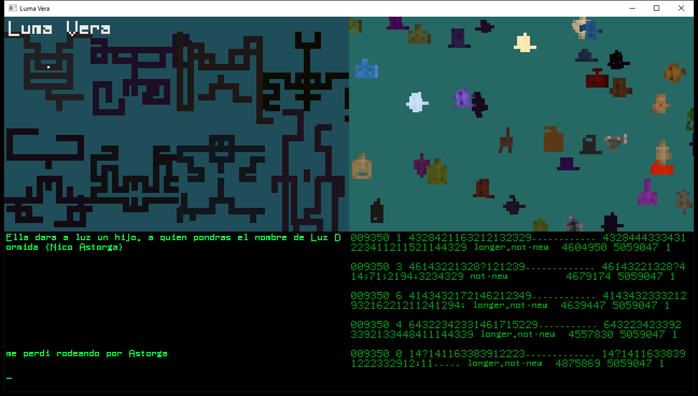

## Janax y Razar v2.27: la cadena del "¿por qué?", todavía sin genealogías

DOI: DOI_PENDIENTE

> *"Armalo completo. Eso ya lo hacía, ¿te acordás?, con las genealogías del NT: lo pudo lograr."* (el autor, 2026-11-22)

Las versiones siguen a los números primos: después del 223, el 227.



### Lo que se armó

Después de su párrafo de quién es alguien (v2.23), Luma **encadena**, como el "¿por qué?" de Razar (`curiosity.md`):
pregunta de nuevo por la respuesta hasta cerrar un círculo o encontrar un hueco.

1. **La relación:** de lo que sigue al sujeto, la palabra que sus libros dicen en dos renglones o más y que más lleva
   la charla, con su propia medida (v2.11).
2. **El primer hecho:** el sujeto y la oración de esa relación.
3. **El siguiente sujeto:** de esa oración, la palabra que más lleva la charla y que la cadena todavía no visitó.
4. **De nuevo:** busca al siguiente con la misma relación y lo dice, hasta un círculo, un hueco o el final de su
   cuarto.

Además:

- **La tabla de lo que hace el sujeto crece a la medida.** Tenía un tope de 32 palabras, contra la regla del plástico.
  Ahora se duplica cuando se llena.
- **Cuenta cada vez que el sujeto aparece en el renglón**, no sólo la primera. Una genealogía es un solo renglón:
  *"Isaac, padre de Jacob; Jacob, padre de Judá…"*.

### Lo que falla, dicho: todavía no son genealogías

En una copia de su casa, con la rama de contestar forzada:

```
vos:  quién es Isaac?     luma: ... Isaac Hirschowitz (1925-2013) un fibroscopio gastroduodenal flexible ...
vos:  quién es Abraham?   luma: ... Abraham Zacuto.
vos:  quién es Jacob?     luma: ... Jacob descomedidamente.
```

**La relación que elige es la palabra más rara que sigue al sujeto**: un apellido, o un adverbio raro. Medido con su
propia medida, "engendró" vale 2.820 veces el azar, pero un apellido que aparece en dos renglones seguidos vale
decenas de miles. El encadenador de Razar (`encadena.jsm`, 2026-11-08) pedía otra cosa, y por eso le salían las
genealogías: **que el paso lo digan dos casos distintos**, es decir, dos sujetos distintos con la misma relación
("engendró" lo dicen Abraham, Isaac, Jacob...). Acá se midió como "dos renglones", que no es lo mismo.

Esa es la corrección que falta: contar, para cada palabra, después de **cuántos sujetos distintos** aparece. Quedó
pendiente para no corregir en círculo (regla de la casa: a lo sumo una corrección, y después se publica con el fallo
explicado).

### Medido

- Contesta en unos 4 segundos: recorre sus libros una vez por paso de la cadena.
- No se cayó en las preguntas de prueba.
- *"quién es Nico Astorga?"*: sus libros lo nombran en un solo renglón con algo después, así que no arma párrafo y
  contesta con su voz (*"…el nombre de Luz Dormida (Nico Astorga)"*).
- El núcleo no cambió desde la v1.39.

### Lo que falta, además

- Lo de la [v2.23](release-v2.23.md): lo que sigue al sujeto no siempre es una acción ("Pedro **y** a su hermano").
- Siguen los de la v2.23.
