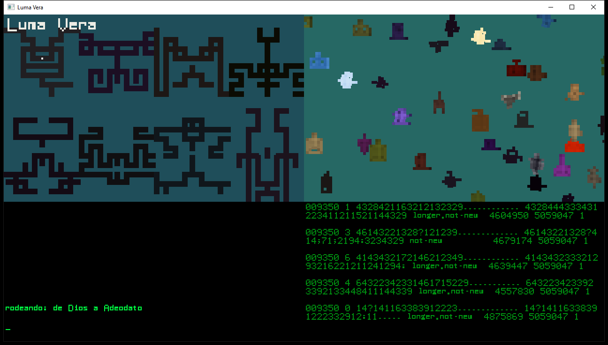

## Janax y Razar v2.29: encadena por lo que tiene sentido, y es libre de hacerlo

DOI: [10.5281/zenodo.24440937](https://doi.org/10.5281/zenodo.24440937)

> *"Que pueda usarla o no: que siempre sea libre."* *"Que no vaya por lo raro, que vaya por lo que tenga sentido."*
> *"Terminalo, Doc, y publicá todo."* (el autor, 2026-11-22)

Las versiones siguen a los números primos: después del 227, el 229.



### Lo que cambió desde la v2.27

En la v2.27 la cadena elegía la relación por **lo raro**: "Isaac **Hirschowitz**", "Abraham **Zacuto**". Ahora:

- **Libre:** encadenar o no encadenar, cada cosa por sus ganas, (S + ½)/(N + 1), contra su suerte. Lo que el autor le
  contesta después le enseña cuál le sirve. Las cuentas quedan en su `charla`.
- **Por lo que tiene sentido:** un hecho del sujeto hace cadena sólo si **su siguiente eslabón hace lo mismo**: una
  palabra del hecho sigue al siguiente en sus libros. *"Abraham fue **padre** de Isaac"* tiene sentido si en algún lado
  dice *"Isaac, **padre** de Jacob"*. Esa palabra repetida es la relación, y la cadena sigue por ella, como en el
  encadenador de Razar (`encadena.jsm`, 2026-11-08: dos casos iguales salvo en un lugar).
- **Todos los hechos, en una sola pasada:** no se prueban sólo los más dichos. Recorre sus libros una vez y mira todos
  los hechos del sujeto a la vez.
- **Por encima de la casualidad, y por dos casos:** una confirmación vale por cuánto supera a lo que daría el azar, que
  son las veces que aparece el siguiente eslabón por lo seguido que un renglón tiene esa palabra. Además tiene que estar
  confirmada dos veces como mínimo. Es el D50 de Razar otra vez: una palabra común ("el") sigue a cualquier cosa, y eso
  no dice nada.

### Medido

En una copia de su casa, con la rama de contestar y la cadena forzadas para verlas correr (versiones de prueba que no
se publican):

```
vos:  quién es Isaac?
luma: ... Isaac habia bendecido a Jacob, y le habia enviado a Padan-aram, para tomar para si mujer de alli,
      Padan aram, hermana de Laban Arameo.
```

Es una cadena real del Génesis: de Isaac a Jacob, y de Jacob a Padán-aram.

- Contesta en 5 a 10 segundos con cadena: recorre sus libros una vez para el párrafo, otra para la pasada y otra por
  cada eslabón.
- No se cayó en las preguntas de prueba.

### Lo que falla, dicho

- **Las listas y las frases hechas confirman más que una genealogía.** Una lista se repite igual, palabra por palabra:
  - *"quién es David?"* → la lista de arquitectos de la Wikipedia (*"David Chipperfield, Tadao Ando, Shigeru Ban…"*);
  - *"quién es Abraham?"* → *"Abraham Particle Physics"*;
  - *"quién es Jacob?"* → repite *"arrojados afuera"*.
- **La genealogía de Mateo todavía no sale entera** (*"Abraham fue padre de Isaac; Isaac, padre de Jacob…"*).
- Antes de llegar acá se probaron, y se descartaron por medidas:
  - elegir la relación por lo raro;
  - "dos sujetos distintos" con la medida de lo raro: dan apellidos;
  - sólo los tres hechos más dichos: dan "Isaac y Jacob";
  - contar confirmaciones sin la casualidad: dan las notas musicales y "el".
- Siguen los de la [v2.27](release-v2.27.md) y la [v2.23](release-v2.23.md).
