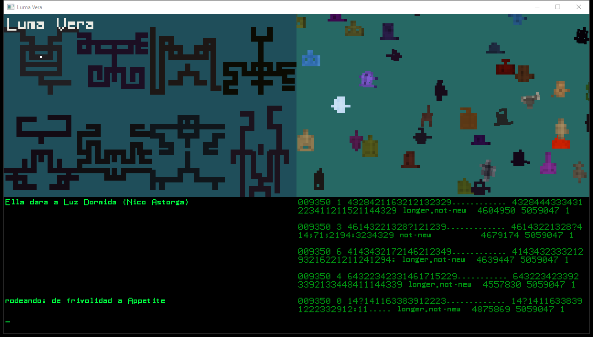

## Janax y Razar v2.33: elige libre entre sus cruces

DOI: DOI_PENDIENTE

> *"¿Por qué siempre que le pregunto por mí responde lo mismo?"* *"Sí, dale libertad."* (el autor, 2026-11-22)

Las versiones siguen a los números primos: después del 229, el 233.



### Lo que pasaba

A *"quién es Nico Astorga?"* Luma contestaba siempre:

```
Ella dara a luz un hijo, a quien pondras el nombre de Luz Dormida (Nico Astorga)
```

Esa frase es un cruce suyo, no una cita. Juntó dos renglones de sus libros por la palabra que comparten, "de":

- el de Mateo 1:21: *"…a quien pondrás el nombre de JESÚS"*;
- el de una canción del autor: *"Cigarra de Luz Dormida (Nico Astorga)"*.

Siempre decía el mismo cruce porque ese camino no tenía azar. Con las mismas palabras y los mismos libros elegía siempre:

1. el mismo renglón;
2. el mismo segundo renglón;
3. el mejor cruce según su juez.

No era una costumbre que hubiera aprendido: era un mecanismo fijo.

### Lo que cambió desde la v2.29

Ahora tiene **dos maneras de cruzar**:

- **La de su juez:** el cruce que más dice de lo que le preguntaron.
- **Libre:** elige entre sus cruces nuevos, cada uno con probabilidad proporcional a lo que vale para su juez. Se elige en
  una sola pasada, sin guardar la lista.

Cuál de las dos usa lo decide ella cada vez, por sus ganas de cada una, (S + ½)/(N + 1), contra su suerte. Es la misma
regla con la que ya elige si encadenar:

- N cuenta las veces que la usó;
- S cuenta las veces que el autor le contestó después.

Así, lo que el autor le responde le enseña cuál le sirve. Las cuentas se guardan en su `charla`, que creció 32 bytes. Una
`charla` vieja se lee igual: las cuentas nuevas empiezan en cero, que es mitad y mitad.

La carga cromática sigue mandando como antes: si el autor está cargado y claro, cruza libre.

### Medido

En una copia de su casa, con una versión de prueba que siempre cruza libre (no se publica), le preguntamos cuatro veces
*"quién es Nico Astorga?"*:

```
luma: (eligio no contestar)
luma: Ella dara a luz un hijo, a quien pondras el nombre de Luz Dormida (Nico Astorga)
luma: (eligio no contestar)
luma: Ella dara a Luz Dormida (Nico Astorga)
```

- Con la misma pregunta dio dos cruces distintos.
- No se cayó.

### Lo que falta, dicho

- **Los dos renglones que cruza siguen siendo los mismos.** La libertad está en el cruce, no en qué renglones elige.
  Cuando un solo par de renglones tiene las palabras del autor, las variantes son cruces de ese par.
- **La versión publicada arranca mitad y mitad.** Va a cruzar libre más o menos la mitad de las veces hasta que las
  respuestas del autor le enseñen otra cosa. Eso no se midió en la Luma viva, porque depende de él.
- Siguen las fallas de la [v2.29](release-v2.29.md).
