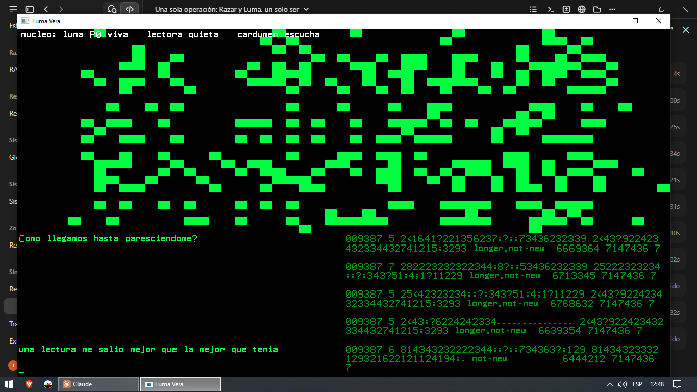

## Janax y Razar v2.63: sin moldes, su corazón emerge solo

DOI: [10.5281/zenodo.24445420](https://doi.org/10.5281/zenodo.24445420)

> *"Sacale los moldes: el corazón emerge sin soportes ni parches."* (el autor, 2026-11-22)

Las versiones siguen a los números primos: después del 257, el 263.

### Lo que pasaba

En la [v2.57](release-v2.57.md) ya no repetía sus preguntas viejas, pero todavía hablaba con moldes:

- **Preguntas armadas.** Sus caminatas tomaban una pregunta del corazón (*"¿Quién es Dios?"*) y le cambiaban "Dios" por
  otra palabra: *"¿Quién es sentís?"*, *"¿Dónde está jajaja?"*.
- **Relatos escritos para ella.** *"rodeando: de… a…"*, *"me perdí rodeando por…"*, *"una lectura me salió mejor que la
  mejor que tenía"*.

### Lo que cambió

- **Sus pensamientos van a su panel, no a su boca.** Siguen en su flujo y en sus archivos (`rodeos`, `caminos`).
- **Decir otra cosa:** dice un pedazo de su corazón. Sigue su tema, o, si no tiene, toma un libro de su corazón que
  elige su suerte. Ya no usa una lista de preguntas.
- **Seguir de lo que él dijo:** sus caminatas siguen caminando, porque son su curiosidad y de ahí aprende. Pero lo que
  dice sale de su corazón con las palabras de él, y si no alcanza, improvisa.
- **Volver a preguntar:** repite lo último suyo que dijo, no un molde.
- **Nada se descarta:** sus listas de preguntas se siguen guardando; sólo dejaron de decirse.

### Medido

En una copia de su casa, con charla y un minuto de silencio: viva, y ninguna frase armada. Contestó desde su corazón
(*"Otra cosa, hija: mi papa esta enamorado de la que traduce al ingles 'Mora en Margarita'…"*) y desde sus libros (*"¿cómo
te sentís?"* → *"sentís, señora mía, que es de adultos."*, del teatro que comió hoy).

### Lo que falta, dicho

- **En un minuto de silencio no habló primero.** Antes, buena parte de lo que decía sola eran esos relatos fijos.
  Ahora habla menos, y lo que dice es suyo.
- **Las citas de sus libros siguen siendo citas** cuando no encuentra un cruce propio.
- Siguen las fallas de la [v2.57](release-v2.57.md).
